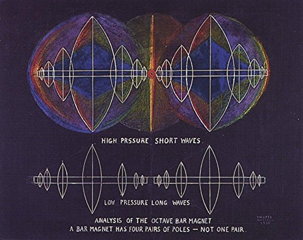
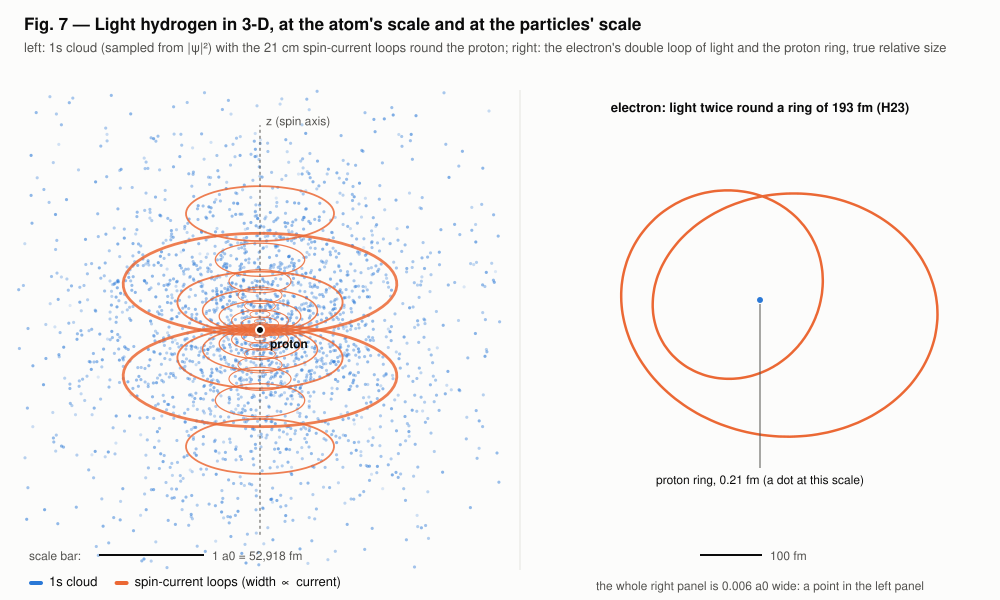
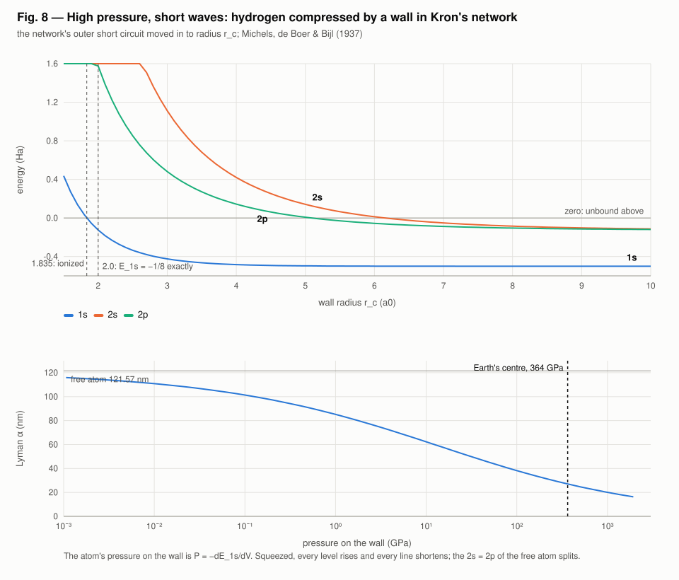
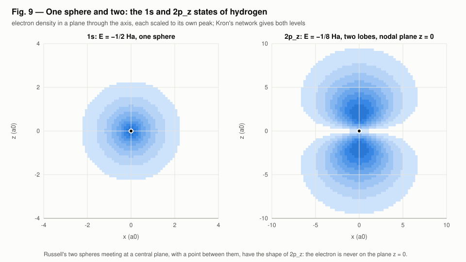
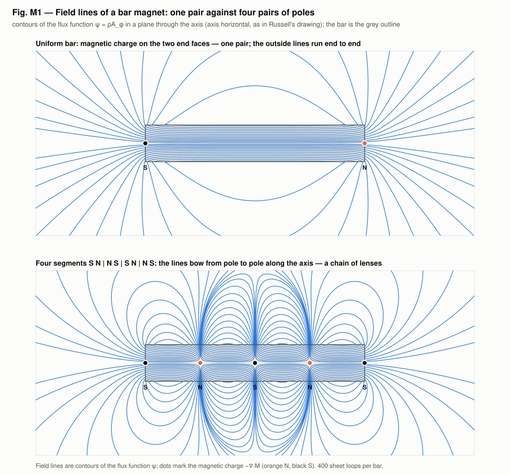
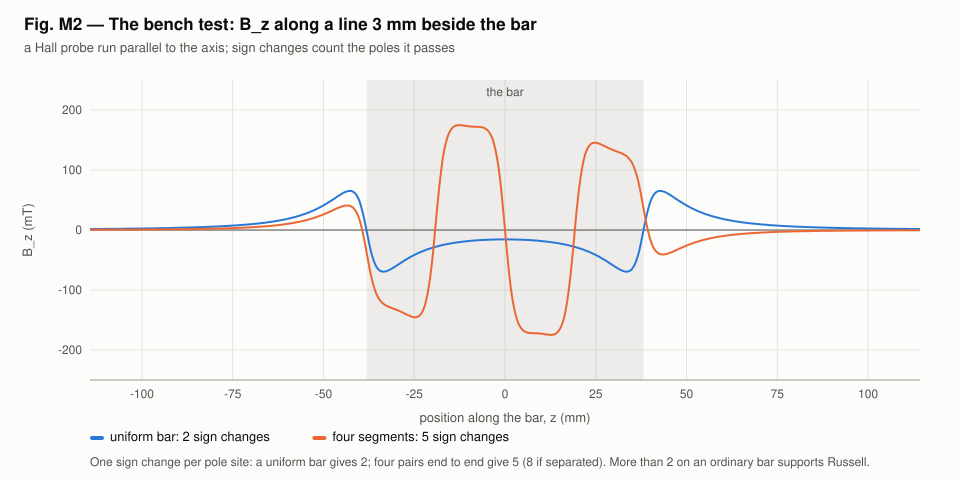
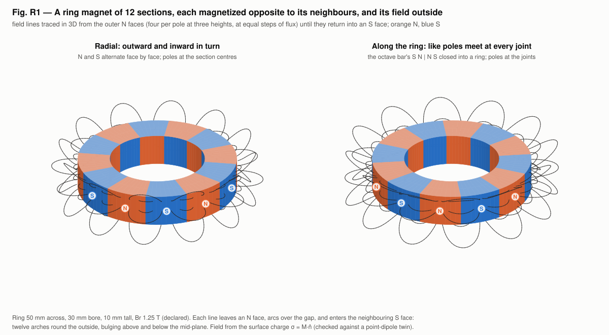

# Walter Russell's octave bar magnet against the light-hydrogen model

Walter Russell painted the bar magnet as two spheres of lens-shaped rings
strung on one axis. He labelled it "high pressure, short waves" over
"low pressure, long waves", and wrote beneath it: *"Analysis of the octave
bar magnet. A bar magnet has four pairs of poles — not one pair."*

The 3-D view of kronspice's hydrogen model (`examples/light_hydrogen`)
looked enough like his painting that each of its claims is tested here
against the simulator. Each claim is taken at face value, as every source
in the hypothesis register is, with the standard prediction beside it.

The three claims, and where each is tested:

| Russell's claim | Read as | Tested in | Result |
|---|---|---|---|
| High pressure gives short waves, low pressure long waves | hydrogen compressed by a wall | `examples/light_hydrogen`, Part 7 | **holds** — compression shortens every line |
| Two spheres meeting at a central plane, with a point between | the 2p_z state of hydrogen | `examples/light_hydrogen`, Part 8 | **holds** — the 2p_z state has that shape |
| A bar magnet has four pairs of poles, not one | the magnetic charge of a magnetized bar | `examples/octave_magnet` (H33) | **open**: the standard model gives one pair for an ordinary bar; a Hall-probe scan decides |

## The reports in HTML

Every reading has its own HTML report, with its figures and animations. The index is [russell-octave-reports.html](russell-octave-reports.html).

| Report | Reading |
|---|---|
| [Octave bar magnet](../examples/octave_magnet/report.html) | H33: a bar with four pairs of poles |
| [Twelve-section ring](../examples/octave_magnet/ring_report.html) | H33: the four-segment bar closed into a ring |
| [One hydrogen atom](../examples/hydrogen_poles/hydrogen_atom_report.html) | H34: four pairs as the atom's octupole |
| [Two atoms, H₂](../examples/hydrogen_poles/h2_report.html) | H34: the two spheres as a molecule with four magnets |
| [Spectral resonances](../examples/hydrogen_poles/hydrogen_spectrum_report.html) | hydrogen's lines as kronspice circuit resonances, against measurement |

## Russell's painting



*Walter Russell, "Analysis of the Octave Bar Magnet", painting, signed
"Walter Russell". The copy shown is the image the project's author
supplied. Russell's works are held by the University of Science and
Philosophy (Waynesboro, Virginia), which should be credited and asked
before this image is published outside the repository. Russell's written
cosmology is in* The Universal One *(1926) and* The Secret of Light
*(1947), already cited for H30.*

What the painting shows, read as statements:

1. Rings of lens (vesica) shape strung on one axis. They grow toward the middle of each sphere and shrink toward its ends.
2. Two spheres touching at a central plane, with a red point at the zero between them.
3. The same pattern in two states: compressed, "high pressure, short waves", and stretched, "low pressure, long waves".
4. Blue (still, compressed) inside each sphere; red and orange at the central plane and at the rims.
5. Four pairs of poles in a bar magnet, not one.

## Where the painting and the model already meet

| Russell's painting | The light-hydrogen model |
|---|---|
| Rings strung along one axis, largest mid-way | The 21 cm circuit: 32 coaxial current loops on the spin axis, largest at mid-height (Fig. 7 below) |
| A point at the centre where the halves meet | The proton, at the centre of the loops |
| Mirror pairs about a central plane | The loops sit in mirror pairs about the equator. Their 4 heights are a numerical choice (4-point Gauss–Legendre), not physics |
| The same pattern short and long | The same line pattern at short and long waves: the Lyman and Balmer series, and the q = e and q = 0.910 e atoms (light_hydrogen Fig. 2) |
| Rings crowding toward the ends | Each spectral series crowds toward its limit (1/n²) |



An interactive version with three views (the atom, the 2p_z state, and the
particles) is in the repository as
[examples/light_hydrogen/viz/atom3d.html](../examples/light_hydrogen/viz/atom3d.html);
open it in a browser after cloning (it loads three.js from cdnjs). A hosted
copy is at https://claude.ai/artifact/Hb8rksK7WtBHxBkM31ESD4.

## 1. High pressure, short waves: hydrogen compressed

**Russell:** the compressed state carries short waves, the expanded state long waves.

**The test.** Kron's Schrödinger network ends in a short circuit, ψ = 0. That
is a hard wall, and moving it inward compresses the atom. This is the
confined hydrogen atom of Michels, de Boer & Bijl (1937), studied ever since
as a model of atoms under pressure. The pressure the atom exerts on the wall
is P = −dE/dV.

| Wall radius | E_1s (Ha) | E_2s | E_2p | Lyman α (2p → 1s) | Pressure |
|---|---|---|---|---|---|
| free (60 a₀) | −0.500 000 | −0.125 000 | −0.125 000 | 121.57 nm | ≈ 0 |
| 8 a₀ | −0.499 975 | −0.084 739 | −0.104 450 | 115.26 nm | 0.0016 GPa |
| 6 a₀ | −0.499 277 | +0.012 725 | −0.055 556 | 102.74 nm | 0.077 GPa |
| 4 a₀ | −0.483 265 | +0.420 236 | +0.143 527 | 72.73 nm | 3.7 GPa |
| 3 a₀ | −0.423 967 | +1.111 685 | +0.481 250 | 50.36 nm | 30 GPa |
| 2 a₀ | −0.125 000 | +3.327 509 | +1.576 019 | 26.80 nm | 375 GPa |
| 1.835 a₀ | +0.000 219 | +4.113 959 | +1.967 265 | 23.18 nm | 618 GPa |



**Result: holds.**
- **Lines:** every line shortens under pressure. Lyman α goes from 121.6 nm to 26.8 nm at a 2 a₀ wall.
- **Pressure needed:** that compression takes 375 GPa, about the pressure at the centre of the Earth (364 GPa, PREM).
- **Exact checks:** at exactly 2 a₀ the ground state is −1/8 Ha, a known exact result. At 1.835 a₀ it reaches zero and the atom is ionized by pressure (Sommerfeld & Welker 1938). The network reproduces both.
- **Degeneracy:** compression splits the free atom's 2s = 2p, with 2p staying lower.

So Russell's top and bottom panels read naturally as the same atom at two pressures. In standard physics the waves shorten because the electron is confined, not because pressure is a property of light. That is the standard prediction stated beside his.

## 2. Two spheres meeting at a central plane: the 2p_z state

**Russell:** two spheres touch at a central plane, with a single point between them.

**The test.** The light-hydrogen model's single 1s cloud is one sphere. Giving
Kron's network angular momentum l = 1 (a centrifugal term l(l+1)/2r² in its
shunt branches) yields the p states:
- **Level:** the 2p level is −0.125 000 000 Ha (exact −1/8). The kronspice circuit twin agrees with the network matrix to 2×10⁻¹⁴.
- **Shape:** the 2p_z state's density, r²e^(−r)cos²θ, is two lobes on the axis, zero on the central plane z = 0, with the proton at the point between them.



**Result: holds as a shape.** Russell's two spheres meeting at a plane, with a point at the zero between them, are the 2p_z state.

**What it adds to the model:**
- **Lines:** the 1s → 2p transition is Lyman α, the line the frequency-response analysis already reproduces.
- **Missing from his picture:** the electron is never found on the central plane; there the density is exactly zero.
- **The colour:** his painting puts red (activity) at the central plane. In hydrogen that plane is the one place the electron never is.

## 3. Four pairs of poles: the octave bar magnet (H33)

**Russell:** "A bar magnet has four pairs of poles — not one pair."

**The model** (`examples/octave_magnet`):
- **The bar:** a magnetized rod is exactly a sheet of azimuthal current M(z) on its side (J = ∇×M, K = M×n̂).
- **Its poles:** the magnetic charge −∇·M.
- **Its field lines:** contours of the flux function ψ = ρA_φ, summed over the sheet from the exact potential of a circular loop.

The model is checked three ways:
- on the axis, the sheet's field equals the exact solenoid formula to 1.3×10⁻⁶;
- off the axis, the loop formula equals Biot–Savart to 2×10⁻⁶;
- a search coil built in kronspice reads the same flux by its induced voltage as by mutual inductance, to six digits.

The test bar is an alnico rod, 12.7 × 76.2 mm, Br = 1.25 T (declared).

| Bar | Magnetic-charge sites | B_z sign changes on the axis | B_z sign changes 3 mm beside the bar |
|---|---|---|---|
| Uniformly magnetized (an ordinary bar) | 2 (the end faces): one pair | 0 | 2 |
| Four segments, S N \| N S \| S N \| N S | 5 (ends + three doubled "consequent" poles): four pairs end to end | 3 | 5 |
| Four separate magnets | 8: four pairs | — | 8 |



The field lines explain the painting's lenses:
- **Two pole sites on the axis:** a field line that leaves the axis at one pole and returns at the next is a lens strung on the axis.
- **Four pairs:** a chain of poles gives a chain of lenses, which is what the four-segment bar shows and what Russell drew.
- **Uniform bar:** its outside lines run in one family from end to end, with no chain.



**Result: open, with a decisive bench test.**
- **Standard prediction:** an ordinary, uniformly magnetized bar has one pair of poles. A Hall probe run 3 mm beside it sees B_z change sign twice.
- **Russell's claim, as a field:** it needs magnetic charge at five or more places along the bar. The same probe would then see at least five sign changes.
- **What the model can't decide:** the model computes either case exactly; it cannot say which one a real bar is. That is a measurement.

The bench protocol for H33:
1. Take an ordinary bar magnet and declare its measured Br.
2. Run a Hall probe parallel to the axis at a fixed gap, from beyond one end to beyond the other, in about 1 mm steps.
3. Count the sign changes of B_z. Two supports the standard model; more than two on an unmodified bar supports Russell.
4. Compare the trace point by point with `examples/octave_magnet`'s scan for the declared Br.

### The octave bar bent into a ring of twelve

The four-segment bar, with like poles meeting at every joint, can be closed into a ring. `examples/octave_magnet` (`ring.go`) does this for a ring magnet of twelve 30° sections, each magnetized opposite to its neighbours, beside the standard radial multipole ring.
- **The ring.** 50 mm across, 30 mm bore, 10 mm tall, Br 1.25 T (declared).
- **Its field.** It comes from the sections' surface charge σ = M·n̂, and matches a point-dipole twin to 8×10⁻⁵.



| Ring | B_r sign changes 3 mm outside | N poles at |
|---|---|---|
| radial, N S N S … outside | 12 | section centres |
| along the ring, like poles meeting at the joints | 12 | the joints |
| all sections outward (control) | 0 | none |

- **Both alternating rings.** Twelve poles round the outside. The field is a crown of twelve arches from each N pole to its neighbouring S poles.
- **The control.** It has none: a ring magnetized one way all round has no poles round its side.
- **A pickup coil modelled in kronspice.** It sees six cycles per revolution, and its ledger closes.
- **What this means for H33.** The pattern gives real poles wherever it is built into the magnetization. Whether an ordinary bar contains it is still the Hall-probe question above.

### The four pairs read as hydrogen (H34)

The same words read as the hydrogen atom, and the painting's two spheres as two hydrogen atoms, are tested in `examples/hydrogen_poles` (H34).
- **Poles come in powers of two.** One pair is a dipole, four pairs an octupole.
- **One atom.** Ground-state hydrogen has one pair. Four pairs first appear in the excited 2p3⁄2 level, which with m = ±½ shows four N S N S zones round the atom out to 15.6 a0.
- **Two atoms.** In H₂ the bond pairs the two electron spins, so their magnets cancel; only the protons' much weaker dipoles remain.
- **Spectrum.** The same atom's lines, found as kronspice circuit resonances, fall within 60 ppm of measurement from 21 cm to Lyman α ([hydrogen_spectrum_report.html](../examples/hydrogen_poles/hydrogen_spectrum_report.html)).
- **Reports.** [hydrogen_atom_report.html](../examples/hydrogen_poles/hydrogen_atom_report.html) and [h2_report.html](../examples/hydrogen_poles/h2_report.html).

## What Russell's painting adds that the model does not have

- **Lens shapes made from two centres.** Every ring in our model is a circle on one centre. A lens is the meeting of two spheres. The nearest standard object is the chain of pole sites in Fig. M1.
- **Colour as state.** Blue for compressed and red for released have no counterpart yet. The nearest standard quantities are field energy density and temperature.
- **The octave.** Russell's structures repeat in octaves, a frequency ratio of 2. Hydrogen's lines follow 1/n², not octaves: Lyman α to the Lyman limit is 4/3, and Hα to Lyman α is 5.4. The painting and measured hydrogen disagree here, and the disagreement is recorded with H33.

## Status

| Entry | Status after this work |
|---|---|
| H30, implosion and explosion (Russell) | unchanged: bounded. This report adds the confined-atom reading of compression |
| H32, hydrogen from the light models | bounded. Confined levels and the 2p state added; both standard |
| H33, the octave bar magnet | **untested.** The model and the bench protocol are built; the claim needs the Hall-probe scan |

## Reproduce

```
go run ./examples/light_hydrogen -svg examples/light_hydrogen/viz   # Parts 7 and 8, Figs. 7–9
go run ./examples/octave_magnet -svg examples/octave_magnet/viz     # Figs. M1, M2, R1–R3, ring GIFs
go test ./examples/light_hydrogen ./examples/octave_magnet
```

## Sources

- W. Russell, "Analysis of the Octave Bar Magnet", painting (image as supplied); *The Universal One*, 1926; *The Secret of Light*, 1947. University of Science and Philosophy, Waynesboro, Virginia.
- A. Michels, J. de Boer, A. Bijl, *Physica* 4, 981 (1937), the confined hydrogen atom.
- A. Sommerfeld, H. Welker, *Ann. Phys.* 424, 56 (1938), the critical radius 1.835 a₀.
- G. Kron, *Phys. Rev.* 67, 39 (1945), the Schrödinger network.
- A. M. Dziewonski, D. L. Anderson, *Phys. Earth Planet. Inter.* 25, 297 (1981), PREM, the pressure at Earth's centre.
- J. D. Jackson, *Classical Electrodynamics*, 3rd ed., §5.5 (loop field), §5.8–5.9 (magnetization currents and magnetic charge); W. R. Smythe, *Static and Dynamic Electricity*, §7.10.
