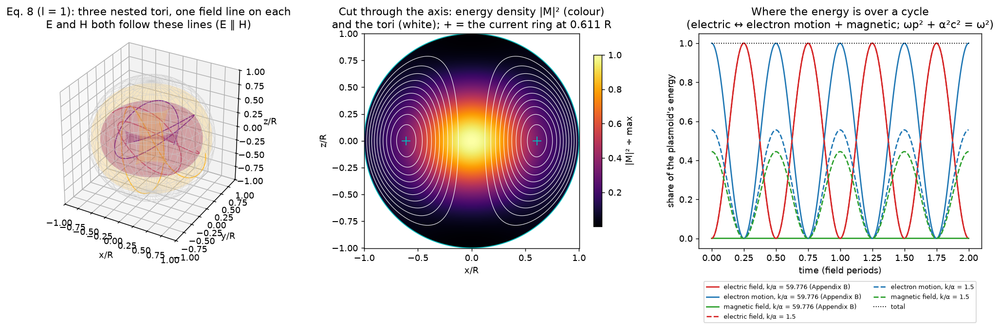
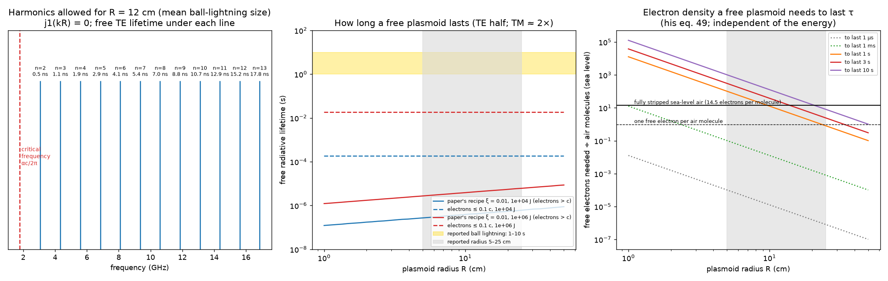
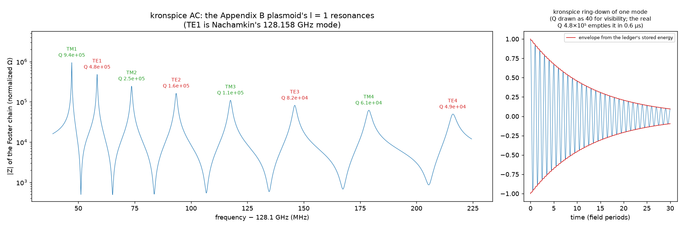
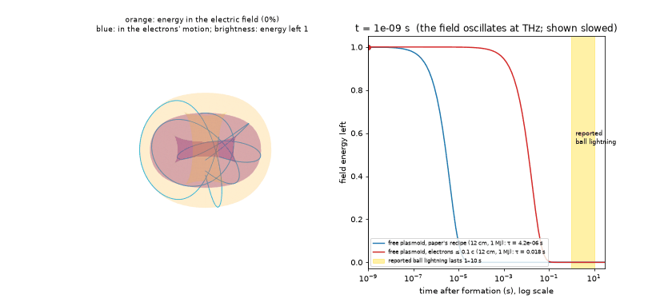

# Force-free time-harmonic plasmoids: harmonics and size (H26)

J. Nachamkin, *Force-Free Time-Harmonic Plasmoids*, PL-TR-92-3044
(Phillips Laboratory / University of Dayton Research Institute, 1992);
copy in `reference/Force-Free Time-Harmonic Plasmoids.pdf`.

The paper proposes a plasmoid built from:
- a plasma sphere holding a standing electromagnetic wave whose E and H
  are parallel everywhere (force-free);
- a vortical plasma flow that balances the field's pressure;
- a "resonant size" at which it should not radiate.

It offers this as a model of ball lightning. This example studies the
paper as written, at ball-lightning sizes:
- which harmonics (frequencies) a plasmoid of each size may have;
- what the paper's recipe gives over the reported range of size and
  energy;
- how long a free plasmoid lasts;
- the kronspice circuit analysis of its spectrum and of its charge
  condition.

The paper's field and worked example were first checked in
[plasmoid_rings](../plasmoid_rings), which also covers the spheromak and
electron-ring readings.

```
go run ./examples/Force-Free_Harmonic_Plasmoids    # about five seconds
go test ./examples/Force-Free_Harmonic_Plasmoids
go run ./examples/Force-Free_Harmonic_Plasmoids -viz examples/Force-Free_Harmonic_Plasmoids/viz
python examples/Force-Free_Harmonic_Plasmoids/viz/render.py       # pictures and the animation (~25 s)
python examples/Force-Free_Harmonic_Plasmoids/viz/make_report.py  # Force-Free_Harmonic_Plasmoids_report.pdf
```

Report: [Force-Free_Harmonic_Plasmoids_report.pdf](Force-Free_Harmonic_Plasmoids_report.pdf).

## Pictures







The animation shows the plasmoid oscillating, with its energy moving
between the electric field (orange) and the electrons' motion (blue), and
fading at its computed free lifetime. A clock beside it runs from 1 ns to
30 s against the reported 1–10 s.



## The paper's equations used

- **Eq. 8, l = 1.** The field M (the same normalization as eq. B3):

  M = 2 cos θ · j1(αr)/(αr) r̂ − [j0(αr) − j1(αr)/(αr)] sin θ θ̂ ± j1(αr) sin θ φ̂.

  It obeys ∇×M = αM, and has the surface r = R as a field surface when
  j1(αR) = 0. The first such zero is 4.4934, the paper's minimum radius.
- **Eqs. 9–13.** E = E0·M·sin(ωt + φ), H ∝ M·cos(ωt + φ), with
  E = Z0(k/α)H and k = ω/c.
- **Eq. 15.** The critical frequency is ω0 = αc.
- **Eq. 35, the resonant size.** j1(αR) = 0 and j1(kR) = 0, with k > α
  (eq. 48).
- **Eqs. 38, 49.** The free-electron charge density
  ρ_e = (m/e)·ε0c²(k² − α²).
- **Eq. 58, small-oscillation factor ξ.** ω² = |e/m|·E0/(ξR).
- **Appendix B.** R0 = 10 cm, 1 MJ at 0 °C and 1 atm, half of it in the
  field: (ε0E0²/4)∫|M|²dV = 0.5 MJ (B2), with ∫|M|²dV = 35.87/α³ (B3).

**Ball lightning as reported** (eyewitness statistics):
- diameter usually 10–50 cm, mean 24 cm;
- lifetime peaking at 2–5 s, mean about 10 s;
- energy estimates from 10 kJ to above 1 MJ.

Sources: arXiv:physics/0312122 and arXiv:1102.2829 (authors to be
confirmed against the papers).

## Results (`run_output.txt`)

**1. The field and Appendix B.**
- Eq. 8 is force-free to 1.8×10⁻¹⁰ and divergence-free to 1.4×10⁻¹¹.
- ∫|M|²dV is 35.868/α³ numerically, confirming his B3.
- **Arithmetic slip in B4.** His E0 = 3.566×10⁹ V/m follows from B2 only
  if the integral is 35.87/**α²**. With B3 as printed, E0 is √α = 6.70
  times larger.

| Case | E0 (V/m) | ω (B5) | kR used (zero n) | f (GHz) | ρ_e (C/m³) | Electrons | v/c | Peak E / air breakdown |
|---|---|---|---|---|---|---|---|---|
| As printed, his k = 2686 /m | 3.566×10⁹ | 7.919×10¹¹ | 268.60 (85) | 128.16 | −32.63 | 8.532×10¹⁷ | 2.69 | 792 |
| As printed, nearest zero | 3.566×10⁹ | 7.919×10¹¹ | 265.46 (84) | 126.66 | −31.87 | 8.333×10¹⁷ | 2.65 | 792 |
| B3 as printed (α³) | 2.39×10¹⁰ | 2.05×10¹² | 683.30 (217) | 326.0 | −211.2 | 5.52×10¹⁸ | 6.83 | 5312 |

- Every printed value of the first row is reproduced. His step from
  k = 2642 to 2686 /m skips the nearest zero of j1 (265.46) and lands on
  the next one.
- Eq. 49 is the cold-plasma dispersion relation ω² = ωp² + α²c², to
  4×10⁻¹⁷.
- **His scaling to small sizes (eq. 86: energy ∝ R at fixed R/λ and ξ).**
  - At 1 mm the scaling gives 10 kJ; the text says about 15,000 J.
  - At 50 µm: 500 J and λ = 1.17 µm, both as printed.
  - The electron count there is 4.27×10¹⁴, against the printed 4.3×10¹³
    (checked on the page image).
  - The density is 30 times sea-level molecular density, against his
    "about forty".

**2. Spatial harmonics.** For higher orders l the minimum radius is the
first zero of j_l: αR = 4.4934, 5.7635, 6.9879 and 8.1826 for l = 1 to 4.
The paper uses l = 1, as here.

**3. Temporal harmonics.** For a given size, eq. 35 allows a comb
f_n = x_n·c/2πR, where x_n are the zeros of j1 above αR. At R = 12 cm
(the mean diameter):

| n | kR | f (GHz) | k/α | Free electrons (m⁻³) | Free TE / TM lifetime |
|---|---|---|---|---|---|
| 2 | 7.725 | 3.07 | 1.72 | 7.7×10¹⁶ | 0.53 / 0.90 ns |
| 3 | 10.904 | 4.34 | 2.43 | 1.9×10¹⁷ | 1.1 / 2.1 ns |
| 5 | 17.221 | 6.85 | 3.83 | 5.4×10¹⁷ | 2.9 / 5.5 ns |
| 8 | 26.666 | 10.60 | 5.93 | 1.4×10¹⁸ | 7.0 / 13.6 ns |

The critical frequency is 1.79 GHz, and the density rises as (k² − α²).

**4. Size and energy map.** Diameter 2–100 cm, energy 10 kJ–1 MJ, field
energy from B2 and B3 as printed.

- **(a) His recipe, ξ = 0.01.**
  - Electrons move at **v/c = ξ·kR = 1.4 to 12 c** everywhere in the
    reported range, which breaks his own non-relativistic analysis
    (§V–VII).
  - The peak field is 48 to 168,000 times the breakdown field of air.
- **(b) The lowest harmonic that keeps v ≤ 0.1 c.**
  - This needs ξ of 7×10⁻⁷ to 5×10⁻⁵, at 0.1–700 THz.
  - At 1 MJ and 1–5 cm it needs more free electrons than sea-level air
    has molecules.
  - Free radiative lifetimes are 0.18 ms (10 kJ) and 18 ms (1 MJ) for
    TE, and twice that for TM, independent of size.
- **(c) What a free plasmoid needs to last as long as ball lightning.**
  - Free, both halves of his field radiate (the TE and TM l = 1 leaky
    modes of the sphere).
  - For kR ≫ 1 the energy lifetime is **τ_TE = R(kR)²/(2c·x1²)**, and
    τ_TM = R(kR)²|g′(x_t)|/(2c·x_t³) with g(x) = 1 + x·j1′/j1 and
    x_t = 2.7437. Both agree with the complex root finder to four figures
    at kR = 268.6, 1000 and 3000.
  - So lasting τ fixes kR, and with eq. 49 the electron density,
    whatever the energy:

| R (cm) | τ (s) | f (THz) | Free electrons ÷ sea-level molecules |
|---|---|---|---|
| 5 | 1 – 10 | 470 – 1485 | 102 – 1020 |
| 12 | 1 – 10 | 126 – 399 | 7.4 – 74 |
| 25 | 1 – 10 | 42 – 133 | 0.8 – 8.1 |
| 50 | 1 – 10 | 15 – 47 | 0.10 – 1.0 |

Fully stripped sea-level air holds 14.5 free electrons per molecule. At
the mean size, lasting seconds needs about that full stripping or more,
and every size needs near-total ionization of the air at visible-to-
infrared frequencies. The paper's own answer is that the resonant size
stops radiation. It does not for a free sphere, because the TE and TM
halves need different sizes ([plasmoid_rings](../plasmoid_rings)); he
names external fields or surface currents as what would supply the
difference (§IX).

**5. kronspice: the plasmoid's spectrum.** The Appendix B sphere's first
four TE and four TM l = 1 resonances (TE1 is his 128 GHz mode) were
built as a Foster chain of parallel RLC tanks driven by an AC current
source:

| Mode | f (GHz) | Q (mode) | kronspice f error | kronspice Q error |
|---|---|---|---|---|
| TE1 (his) | 128.15833 | 4.80×10⁵ | 2×10⁻¹⁶ | 2×10⁻⁶ |
| TE2–TE4 | 128.19–128.32 | 1.6×10⁵ – 4.9×10⁴ | ≤ 2×10⁻¹⁵ | 2×10⁻⁶ |
| TM1–TM4 | 128.15–128.28 | 9.4×10⁵ – 6.1×10⁴ | ≤ 1×10⁻¹⁵ | 2×10⁻⁶ |

- A ring-down of TE1 (400 periods) returns Q = 4.7992×10⁵ against
  4.7985×10⁵. The ledger's heat equals the energy lost to 5×10⁻⁶ of the
  stored energy. Its energy lifetime is 0.60 µs.

**6. kronspice: eq. 49 as a circuit.** A one-dimensional plasma line
(Kron's field network: series μ0Δ, shunt ε0Δ) is loaded at every node by
the electrons' kinetic inductance m/(ne²Δ). Shorted half a wavelength
π/α apart, it resonates at:

| k/α | Cells | kronspice − exact lattice | Lattice − eq. 49 |
|---|---|---|---|
| 59.776 (Appendix B) | 200 | 7×10⁻¹⁰ | 3×10⁻⁹ |
| 1.5 | 50 | 7×10⁻¹² | 7.3×10⁻⁵ |
| 1.5 | 200 | 4×10⁻⁹ | 4.6×10⁻⁶ |

So his charge-density condition is the resonance of a plasma-loaded
line, and the lattice error falls as 1/N².

## The reported seconds

Witnesses report ball lightning lasting seconds. This example does not
dispute the reports; it measures the paper's model against them.

As written, a free plasmoid radiates its field away at every reported
size and energy:
- in microseconds by the paper's recipe;
- in tens of milliseconds at most with its electrons kept
  non-relativistic.

Lasting seconds would need more free electrons than the air holds at the
mean size. So either the plasmoid is not free, or its energy is not
mainly in this field:
- **Held from outside.** The paper itself (§IX) says the boundary must be
  matched by an external standing field or by surface currents. A
  plasmoid held that way lasts as long as its supply.
- **Energy stored elsewhere.** The standard models that reach seconds
  store the energy chemically. Discharges into silicon make luminous
  balls lasting several seconds in the laboratory (Abrahamson & Dinniss,
  *Nature* 403, 519, 2000; Paiva et al., *Phys. Rev. Lett.* 98, 048501,
  2007). These are context, not the paper's model.

## Where it stands

- **Sound.** The paper's field mathematics is sound, and its charge
  condition is standard plasma physics.
- **Appendix B.**
  - Its field amplitude carries an α² for α³ slip.
  - Its worked example drives the electrons faster than light.
  - Its frequency skips the nearest allowed harmonic.
- **Free lifetime.** Over the reported range of ball-lightning sizes, the
  free plasmoid's radiative lifetime is microseconds by his recipe and
  milliseconds when kept non-relativistic. Seconds would need more free
  electrons than the air can give at the mean size.
- **Status.** H26 stays *untested* as a ball-lightning model; this
  example adds the size and harmonic bounds above.
- **What would move it.** A measured external field or surface current
  that holds a plasmoid at its resonant size, as the paper itself
  suggests; the microwave-sustained cavity plasmoids it mentions are the
  laboratory case.

## Tests

| Test | Checks |
|---|---|
| `TestFieldAndB3` | eq. 8 force-free; ∫\|M\|²dV = 35.87/α³ |
| `TestAppendixB` | printed E0, ω, k, ρ_e, electrons to 10⁻³; eq. 49 = dispersion; α³ case √α larger |
| `TestHarmonics` | zeros of j1 and j_l; v/c = ξ·kR > 1 at ball-lightning size |
| `TestLifetimes` | closed forms = root finder (10⁻³ TE, 5×10⁻³ TM); 12 cm, 3 s beyond fully stripped air |
| `TestKronspice` | Foster chain f to 10⁻⁹, Q to 10⁻⁴; ring-down Q and ledger; plasma line = lattice and eq. 49 |

## Files

| File | Contents |
|---|---|
| `beltrami.go` | eq. 8 (l = 1), curl and divergence check (from `plasmoid_rings`) |
| `plasma.go` | constants, Appendix B (B1–B7) as printed and with B3 |
| `radiation.go` | leaky TE/TM l = 1 resonances of a plasma sphere (from `plasmoid_rings`, overtones added), large-kR lifetimes |
| `harmonics.go` | zeros of j1 and j_l, designs by ξ, by v/c and by lifetime, ∫\|M\|² |
| `circuits.go` | kronspice: Foster-chain spectrum, ring-down, plasma-loaded line |
| `main.go` | sections 1–6 |
| `viz.go` | `-viz`: the CSVs behind the pictures (lifetimes, densities, comb, kronspice spectrum and ring-down) |
| `main_test.go` | tests |
| `viz/render.py` | `plasmoid_structure.png`, `harmonics_and_size.png`, `kronspice_spectrum.png`, `plasmoid_cycle.gif` |
| `viz/make_report.py` | the PDF report (`internal/pdfreport` layout) |

## Sources

- J. Nachamkin, *Force-Free Time-Harmonic Plasmoids*, PL-TR-92-3044 (1992), DTIC AD-A257 765.
- S. Chandrasekhar, P. C. Kendall, *Astrophys. J.* 126, 457 (1957): force-free fields.
- J. A. Stratton, *Electromagnetic Theory* (1941), §9.22: the sphere's boundary-value problem.
- F. F. Chen, *Introduction to Plasma Physics*: electromagnetic waves in a cold plasma.
- "On electromagnetic models of ball lightning with topological structure", arXiv:physics/0312122; "Ball lightning observation: an objective video-camera analysis report", arXiv:1102.2829: ball-lightning statistics (authors to be confirmed).
