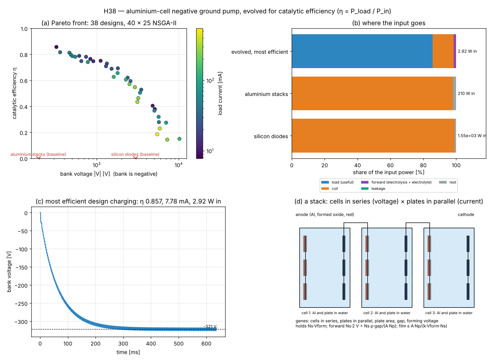
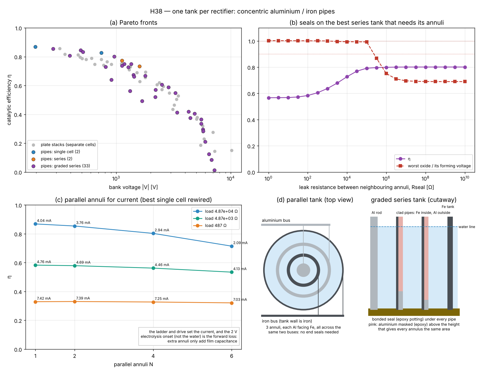

# Aluminium-cell ground pump, evolved for catalytic efficiency

The negative Cockcroft–Walton ground pump of
[photon_electron](../photon_electron), with its rectifiers replaced by
stacks of the aluminium–water valve cell from
[sparkgap_diode](../sparkgap_diode). A genetic search (NSGA-II) designs
the stacks and the drive for **catalytic efficiency**: pumping electrons
from ground onto a negative bank with as little energy as possible.
Register entry H38 (CLAUDE.md §1).

```
go run ./examples/al_cell_pump                    # plates and pipes, two 40 × 25 evolutions, ~15 min on 2 CPUs
go run ./examples/al_cell_pump -study pipes       # the one-tank pipe study only
go run ./examples/al_cell_pump -data DIR          # also writes pareto.csv, baseline.csv, best_bank.csv
python3 examples/al_cell_pump/viz/plot_pump.py DIR examples/al_cell_pump/viz/pump.png
python3 examples/al_cell_pump/viz/plot_pipes.py DIR examples/al_cell_pump/viz/pipes.png
go test ./examples/al_cell_pump                   # ~6 s
```



## What "catalytic efficiency" means here

Lifting one electron from ground to a bank at −|V| costs at least e·|V|,
whatever the circuit. That is the floor, and no resonance or barrier
lowering goes under it; the ledger enforces it (`ElPerJ ≤ Ideal` is a
test). What a circuit *can* change is how much more than e·|V| it spends.
So the fitness is

- **η = P_load / P_in** in steady state (the bank's voltage drifts under
  1 % over the measuring window, so energy still filling capacitors is
  not counted as output);
- with two more objectives, the bank voltage and the load current;
- and two constraints: the stacks never see more than 90 % of their
  holding voltage in reverse, and the bank is in steady state.

η = 1 would mean "the drive only pays e·|V| per electron". Each design's
input is split into load, coil resistance, rectifiers conducting
(electrolysis onset plus electrolyte), rectifiers leaking, and the rest;
the split sums to the input within 1 %.

## The stack

`Stack{Ns cells in series, Np plates in parallel, plate area, gap, forming voltage}`:

| | value | from |
|---|---|---|
| holds (reverse) | Ns · Vform | oxide formed at Vform, ≤ 700 V |
| forward onset | Ns · 2 V | electrolysis per cell |
| forward resistance | Ns · ρ · gap / (A · Np), ρ = 0.1 Ω·m | water electrolyte |
| reverse leakage | A·Np · j0 · exp(β·E), reaching 0.1 A/m² at Vform | Güntherschulze–Betz, β = 3e-8 m/V, 1.4 nm/V oxide growth |
| above Vform | sparks (2 Ω per cell) | breakdown |
| film capacitance | ε_r 9.5 · ε0 · A · Np / (1.4 nm/V · Vform) / Ns | formed oxide |
| varactor | C(v) = C0 · (1 + κ·|v|/hold), κ = 2 % | a barrier oxide has fixed thickness, so small |

Cells in series raise the voltage it holds and divide its film
capacitance; plates in parallel raise the current and multiply the film.

## Genes

drive frequency (50 Hz – 100 kHz) and amplitude (1–50 V), tank capacitor,
stages (1–8), ladder capacitors, load, and the stacks: cells in series
(1–10), plates in parallel (1–20), plate area (10 mm² – 100 cm²), gap
(1–20 mm), forming voltage (50–700 V). The film is evolved as a linear
capacitor (κ = 0, 16× faster) and every Pareto design is re-measured with
κ = 2 % and again with silicon diodes in place of the stacks.

## Results (seed 1, 40 × 25; full output in [run_output.txt](run_output.txt))

| | bank | load | input | η | coil | forward | leakage |
|---|---|---|---|---|---|---|---|
| baseline, silicon diodes (10 V, 100 kHz, 1 µF tank) | −2953 V | 0.30 mA | 1.55 kW | 0.0006 | 98.9 % | 0 % | 0 % |
| baseline, aluminium stacks | −194 V | 0.02 mA | 210 W | 0.00002 | 98.0 % | 0 % | 0 % |
| **evolved, most efficient** | **−321 V** | **7.8 mA** | **2.9 W** | **0.857** | 12.8 % | 1.4 % | 0 % |
| evolved, 5 cells × 3 plates | −357 V | 36 mA | 15.6 W | 0.816 | | | |
| evolved, 8 cells × 5 plates, 2 stages | −1113 V | 12 mA | 17.9 W | 0.751 | | | |
| evolved, 5 cells × 4 plates, 3 stages | −3372 V | 69 mA | 459 W | 0.505 | | | |
| evolved, 7 cells × 8 plates, 3 stages | −10.2 kV | 140 mA | 9.5 kW | 0.150 | | | |

The most efficient design: **one cell of six 13 mm² plates, 7.9 mm gap,
formed at 545 V**, one stage, driven at 471 Hz and 50 V into a 0.25 µF
tank. It delivers 1.66e16 electrons per joule against the e·|V| ideal of
1.94e16. Its electrolysis onset alone would allow η ≤ 0.988; the coil
takes most of what is lost.

### What the evolution found

- **The baseline's loss is the tank, not the rectifiers.** A 1 µF tank
  at 100 kHz circulates hundreds of amps to hold its swing; 98–99 % of
  the drive heats the coil, whichever rectifier is used. The evolution
  goes to small tanks (0.2–1 µF) at hundreds of Hz to a few kHz, where
  the circulating current is small and the coil takes 13–20 % on the
  designs above η 0.75.
- **The film capacitance is the stack's main barrier.** At 100 kHz the
  baseline stack's 0.05 µF film all but shorts it (the high-frequency
  failure the 1911 *Britannica* notes for the electrolytic valve). Every
  efficient design pushes plate area to the low end (13–60 mm²),
  forming voltage to the top (545–700 V) and stacks cells in series:
  all three shrink the film.
- **The rectifiers conducting cost little.** The electrolysis onset (2 V
  per cell) and the water's resistance together take 0.4–9 % of the
  input across the front.
- **Leakage is negligible** once the reverse voltage is kept below 90 %
  of the forming voltage (the exponential falls off fast).
- **Voltage and current cost efficiency.** Past about −1 kV the designs
  need more stages and bigger tanks, and the coil's share grows again
  (to 50–84 %): η falls to 0.5 at −3.4 kV and 0.15 at −10 kV.
- **Silicon is still better.** Swapping silicon diodes into each evolved
  design raises η by 0.01–0.09. The aluminium stack works, but its film
  and onset are costs, not a catalyst.
- **The varactor slightly hurts.** With κ = 2 %, η drops by 0.002–0.013
  on every design.

### The parametric route (2f pumping)

Driving the tank at 2f through the film's C(v) grows oscillation at f
only if the capacitance swing m = ΔC/C exceeds 2/Q (Mathieu threshold).
The formed oxide gives m ≤ 2 % even swung to its forming voltage, so it
needs Q > 100; the coil's Q of 50 needs m > 4 %. The oxide is too linear
to pump parametrically; a varactor diode, whose capacitance changes
several-fold, could.

## One tank per rectifier: concentric pipes

The plate stacks above put each cell in its own tank. Here each rectifier
is one tank: an aluminium rod at the centre, pipes around it and the tank
wall outside. Every annulus of water between two neighbouring pipes is
one cell. Two ways to wire it:



- **Parallel (bus bars).** The pipes alternate aluminium and iron. Every
  aluminium pipe goes to one bus bar and every iron pipe to the other,
  so every annulus is aluminium facing iron, the same valve between the
  same two buses. An inner pipe works on both faces. Neighbouring annuli
  sit at the same voltage, so water around the pipe ends carries no
  current and **the ends need no seals**. The tank holds one forming
  voltage (≤ 700 V).
- **Series (clad pipes).** Current crosses every annulus in turn, and
  the tank holds N forming voltages. For all the cells to face the same
  way, each pipe must be aluminium outside and iron (or stainless)
  inside. Plain alternating aluminium and iron would put neighbouring
  cells back to back and block both ways. Neighbouring annuli now differ
  by a cell's voltage, so water around a pipe's end shorts a cell, and
  **every pipe must be sealed at the bottom**. The tops stand above the
  water line, so only the bottoms leak.

Genes: the drive, tank, stages, ladder and load as before, plus the
wiring (parallel, series, graded series), the number of annuli (1–10),
the rod radius, the water gap, the wetted length (5–300 mm) and the
forming voltage. The pipe walls are 1.5 mm. Each annulus's water
resistance is ρ·ln(b/a)/(2π·L), and its aluminium face is 2π·r·L.

### What it found (seed 1, 40 × 25)

| tank | bank | load | input | η |
|---|---|---|---|---|
| single cell: Al rod Ø3.9 mm in an iron tank Ø7 mm, 5 mm wetted, formed at 414 V | −197 V | 4.0 mA | 0.92 W | **0.869** |
| graded series, 2 annuli, tank Ø18 mm | −282 V | 6.7 mA | 2.2 W | 0.856 |
| graded series, 2 annuli, tank Ø10 mm | −959 V | 31 mA | 37 W | 0.801 |
| graded series, 8 annuli, tank Ø42 mm, 3 stages | −2.5 kV | 13 mA | 53 W | 0.606 |
| graded series, 5 annuli, tank Ø57 mm, 4 stages | −4.8 kV | 19 mA | 228 W | 0.405 |

- **Pipes match the plates.** The pipe front lies on the plate front:
  η 0.87 against 0.86 at a few hundred volts, and 0.6 against 0.6 at
  2.5 kV. A single tank of up to 10 annuli replaces up to 10 separate
  cells.
- **Again, the less aluminium the better.** The wetted length sits at
  its 5 mm minimum on almost every design. The most efficient
  rectifier is a thimble: one aluminium rod in an iron cup.
- **Parallel annuli do not help at these currents.** No multi-annulus
  parallel tank reached the front. Rewiring the best single cell as 2,
  4 or 6 parallel annuli lowers η: 0.869, 0.854, 0.803, 0.715 at its own
  load. A 10× or 100× smaller load does not draw more current
  (4.0 → 4.8 → 7.4 mA). The pump's current is set by its ladder and
  drive, and the conducting loss is the 2 V electrolysis onset, not the
  water. Extra annuli only add film. The parallel tank's lower water
  resistance pays off only when I·Rw nears the 2 V onset: about 1 A for
  these cells. That is the right layout for a high-current rectifier,
  not for this pump.
- **Plain series tanks load the inner annulus.** The inner annulus has
  the least aluminium, hence the least film capacitance, and the AC
  voltage divides as 1/C. In a test design (rod 1 mm, 3 annuli of 3 mm,
  5 mm wetted, formed at 300 V) the annuli take 92, 16 and 9 % of their
  forming voltage. The outer annuli
  hardly help.
- **Graded series fixes it.** Masking the outer pipes' aluminium
  (epoxy above a height) so every annulus has the same area makes them
  share equally (41/41/41 % in the same design). Graded series tanks fill 33 of the 37
  places on the front.
- **Seals matter only when the tank needs its annuli.** The −282 V tank
  takes 35 % on each of its 2 annuli, 0.69 forming voltages in all, so
  one annulus could hold it alone and a leak only saves forward drops.
  The −959 V tank takes 1.38 forming voltages, so it needs both. Its
  seals must leave **at least about 0.3 MΩ** between neighbouring annuli
  to keep 99 % of its η with no oxide past 90 %. Under a 5 mm-wide seal
  that is a water film thinner than about 70 nm: a bonded (potted) seal,
  not a gasket. Pipes merely standing on the floor (0.5 mm clearance,
  about 13 Ω) drive the inner annulus to its forming voltage (it sparks),
  and η falls to 0.57.

## Limits

- Cell constants are representative (water ρ, Güntherschulze–Betz β and
  oxide growth from the literature, leakage at forming from well-formed
  foil), not measured on a particular cell; a bench cell should be
  characterised (forward onset, leakage against voltage, film
  capacitance) and the constants replaced.
- The film does not age or re-form during the run; a real oxide loses
  its holding voltage when idle and re-forms with current.
- The coil is a fixed Q of 50; a better coil (or a lower-loss tank)
  moves the whole front up.
- Gas from electrolysis, heating and electrolyte changes are not
  modelled. In a series tank, foam over the pipe tops could bridge
  neighbouring annuli like a leaky seal.
- The forward current density is not limited: the high-current designs
  run their small aluminium faces at up to ~1 kA/m² (averaged), where
  gassing would be heavy.
