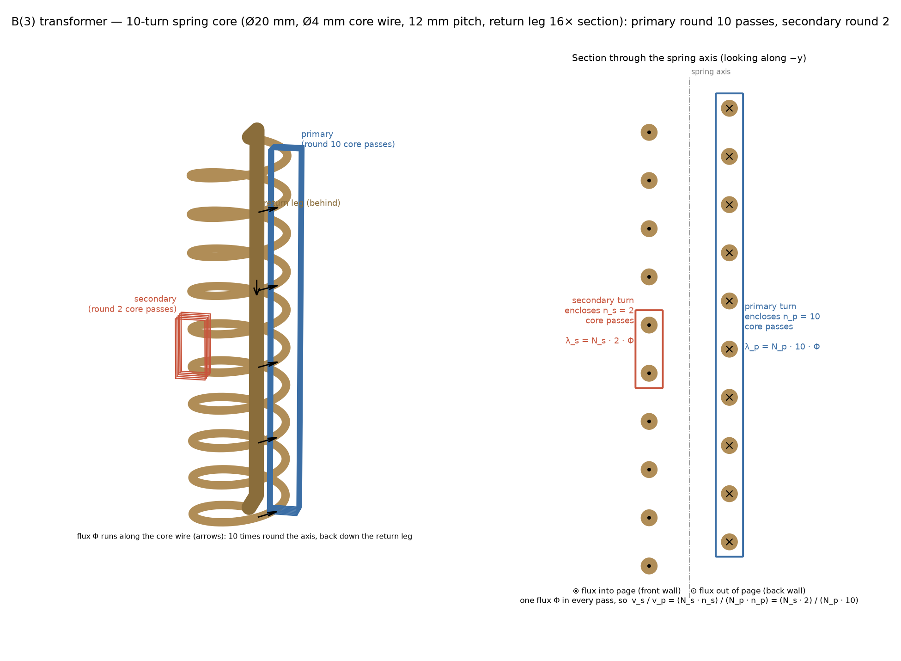

# B(3) transformer: a spring as the core

A transformer whose core is itself a spring. The core is a helix of N turns,
closed by a return leg, so the magnetic flux runs along the core wire and
goes round the spring's axis N times. The user calls this helical flux the
"B(3)" field of the design: a magnetic field moving in a helix.

The windings are wrapped round the spring's wall. Each turn of a winding goes
in through the bore and out round the outside, so it encloses some of the
core wire's passes. The design case:

- **Primary:** 100 turns round all 10 core passes.
- **Secondary:** 100 turns round 2 core passes.

The question: what is the voltage ratio, and how does the rate of change of
flux differ between the two windings, for an N-turn core?

Register entry **H52** (CLAUDE.md §1): Evans' B(3) field, emulated by this
transformer in honour of Myron Evans. The full write-up, with input and output
waveforms, frequency response, the energy ledger against core turns and the
magnetic-amplifier use, is
[b3_transformer_report.pdf](b3_transformer_report.pdf).

```
go run ./examples/b3_transformer                        # about 5 s
go run ./examples/b3_transformer -data examples/b3_transformer/viz/data   # also the report's data
python3 examples/b3_transformer/viz/plot_report.py examples/b3_transformer/viz/data examples/b3_transformer/viz
python3 examples/b3_transformer/viz/make_report.py examples/b3_transformer/b3_transformer_report.pdf
python3 examples/b3_transformer/viz/core.py examples/b3_transformer/viz/core.png
go test ./examples/b3_transformer
```



## The answer

Each winding turn links the flux once for every core pass it encloses. If
every pass carries the same flux Φ:

    λ = N_w · n_c · Φ          v = N_w · n_c · dΦ/dt
    v_s / v_p = (N_s · n_s) / (N_p · n_p)

Here N_w is the number of winding turns and n_c the number of core passes
each turn encloses.

- **Ratio for the design:** (100·2)/(100·10) = 0.2. The core's passes act
  as a second turns ratio, multiplied by the winding ratio.
- **Rate of change:** dΦ/dt is the same in every pass, so it is the same at
  the primary and the secondary. What differs is how many times each winding
  links it.
  - Per volt on the primary, dΦ/dt = 1/(N_p·N) Wb/s. So the more core turns
    the primary encloses, the slower the flux changes for the same voltage,
    and the lower the core flux density.
- **Primary round all N passes, secondary round 2:** the ratio is 2/N
  (table below, N = 2 to 40). The ratio follows N exactly as it would follow
  winding turns.
- **A straight wire up the bore,** closed outside away from the return leg,
  links the flux N times. One wire there gives N·dΦ/dt. A turn encircling
  the whole spring links the net axial flux only once.

None of this adds energy. The magnetic circuit is a transformer with turns
N_w·n_c. The kronspice runs show that the power out is less than the power
in, and the ledger closes.

### Against a normal transformer, for any N_p, N_s

| quantity | normal transformer | spring core |
|---|---|---|
| voltage ratio v_s/v_p | N_s/N_p | (N_s·n_s)/(N_p·n_p) |
| current ratio i_s/i_p (ideal) | N_p/N_s | (N_p·n_p)/(N_s·n_s) |
| impedance ratio Z_p/Z_s | (N_p/N_s)² | ((N_p·n_p)/(N_s·n_s))² |
| dΦ/dt in the core per primary volt | 1/N_p | 1/(N_p·n_p), the same in every pass |
| volts per winding turn | dΦ/dt in both windings | n_p·dΦ/dt (primary), n_s·dΦ/dt (secondary) |
| peak flux density | V_pk/(ω·N_p·A) | V_pk/(ω·N_p·n_p·A) |
| magnetizing inductance | N_p²·A_L | (N_p·n_p)²·A_L |

**Where the difference lies.** In a normal transformer every turn of both
windings sees the same dΦ/dt, so the volts per turn are equal and the ratio
comes only from the turn counts. On the spring core the flux changes at the
same rate in every pass. But a primary turn wraps 10 passes and sees 10·dΦ/dt,
while a secondary turn wraps 2 and sees 2·dΦ/dt.

- **Volts per turn:** at 20 V peak, 0.200 V per primary turn against 0.040 V
  per secondary turn.
- **Equivalent:** the 100:100 spring design behaves as a 1000:200 normal
  transformer.

Core constants in the design geometry (A_L = 1/(N·R_turn + R_return), the
inductance per effective turn²):

| core | A_L | L_p at N_p·n_p = 1000 | −3 dB band (loaded) | ratio at 1 kHz |
|---|---|---|---|---|
| nanocrystalline tape | 2.44 µH | 2.44 H | below 1 Hz – 23.7 kHz | 0.1977 |
| silicon-steel wire | 97.4 nH | 0.097 H | 3.4 Hz – 2.8 kHz | 0.1849 |
| Galfenol wire | 2.12 nH | 2.1 mH | 126 Hz – 1.6 kHz | 0.1386 |

The flux density per volt is 12.7 mT per peak volt at 1 kHz for
N_p·n_p = 1000, whatever the core.

### Energy ledger against core turns

The nanocrystalline spring with N core turns runs for 20 cycles at 20 V
peak, 1 kHz, into one fixed 632 Ω load. The primary goes round all N passes
and the secondary round 2.

The columns:

- **E in:** energy the source delivers.
- **E back:** energy the magnetizing current returns to the source in part
  of each cycle.
- **Net in:** E in − E back.

Energies are in mJ:

| N | ratio | B pk | E in | E back | net in | E load | E copper | residual/E in | η |
|---|---|---|---|---|---|---|---|---|---|
| 2 | 0.9901 | 1.265 T* | 6.179 | 0.042 | 6.137 | 6.123 | 0.014 | 1e-7 | 0.998 |
| 4 | 0.4951 | 0.633 T | 1.593 | 0.049 | 1.544 | 1.542 | 0.002 | 6e-8 | 0.999 |
| 10 | 0.1980 | 0.253 T | 0.310 | 0.062 | 0.248 | 0.247 | 0.0003 | 2e-8 | 0.999 |
| 20 | 0.0990 | 0.127 T | 0.114 | 0.052 | 0.062 | 0.062 | 0.0001 | 2e-9 | 0.998 |
| 40 | 0.0495 | 0.063 T | 0.049 | 0.033 | 0.016 | 0.016 | 0.00004 | −6e-9 | 0.998 |

\* Above the tape's 1.2 T saturation, so outside the linear model.

- **Balance:** net in = load + copper + stored, to the residual.
- **Output power:** it falls as 1/N² at a fixed drive and load.
- **Efficiency:** it stays at 0.998–0.999. More core turns change the ratio
  and the rate of change per pass, not the energy balance.

### As a magnetic amplifier for older circuits

A magnetic amplifier is a saturable reactor (Mali 1960, in `reference/`):

- **Gate winding:** it sits in series with the AC load and blocks the supply
  until the core saturates.
- **Control current:** a small DC current sets the point in each half cycle
  where that happens.

In a self-saturating amplifier the ampere-turns balance:
I_load·N_g ≈ I_c·N_c. On the spring core each winding's ampere-turns are
multiplied by its passes, as its volts are. So:

    current gain K_i = (N_c·n_c)/(N_g·n_g)        power gain K_p = K_i²·R_load/R_control
    control current to saturate I_c = B_s·A·(N·R_turn + R_return)/(N_c·n_c)
    gate blocks up to V_rms ≈ 4.44·f·N_g·n_g·B_s·A

| windings (nanocrystalline design, 60 Hz, 100 Ω load) | I_c to saturate | gate blocks | K_i | K_i, ordinary core | K_p |
|---|---|---|---|---|---|
| control 100 t × 10 passes, gate 100 t × 2 | 6.19 mA | 0.8 V | 5 | 1 | 1.2e3 |
| control 500 t × 10 passes, gate 50 t × 2 | 1.24 mA | 0.4 V | 50 | 10 | 2.4e4 |

**Using it with an older circuit:**

- **Drive the control winding from the weak signal.** Wind the control round
  all the passes and drive it from the signal: a tube's plate current, a
  thermocouple, a photocell, a small transistor stage. Wind the gate round a
  few passes.
- **Full-wave:** two gate windings on opposite walls, each with its own
  rectifier, make the full-wave self-saturating amplifier.
- **Size the gate for the supply.** This small core blocks 0.8 V at 60 Hz.
  A 120 V load needs N_g·n_g ≈ 30,000 effective turns at 1.2 T, for example
  1,500 turns round 20 passes, or a larger core section.
- **Core material and reset:** use square-loop tape. Reset the core with a
  bias winding when it is driven by one-sign pulses (CLAUDE.md §3j).
- **No energy is added.** The load power comes from the AC supply through
  the gate.
- **Not yet simulated.** The core here is linear. Simulating the saturating
  amplifier needs the hysteretic core of §3j (milestone M9r).

## Keeping the flux off the gaps

The ratio holds only if the flux stays on the wire. Air between neighbouring
turns is a second path. It leaks in two ways:

1. **Spread.** With the primary round all passes, neighbouring turns differ
   in magnetic potential by Φ·R_return/N. That difference drives flux across
   the gaps, so the passes no longer carry equal flux. The spread is measured
   as (max − min)/max of dΦ/dt over the passes.
2. **Edge leakage of a winding round only some passes.** The winding's flux
   returns round its edges through the unwound neighbouring passes. This
   lowers the coupling k, and it shows when that winding is driven: the swap
   ratio falls below 5.

The air path is weak next to the wire when the helix number is small:

    H = (2πR)² / (μr · a² · acosh(p/2a))  ≪ 1

R is the spring radius, a the core-wire radius and p the pitch. The air
permeance between two neighbouring passes is that of two parallel cylinders,
μ0·π/acosh(p/2a) per unit length (the two-wire capacitance formula with
ε0 → μ0).

Spreading the gaps was the first idea. It helps only logarithmically, and it
lengthens the return leg. The levers, from a plain 1 mm wire with 1 mm gaps:

| core | spring | H | spread | k | swap (ideal 5) |
|---|---|---|---|---|---|
| nanocrystalline tape | plain: a 1 mm, gap 1 mm, return 1× | 0.041 | 2.4e-3 | 0.925 | 4.28 |
| nanocrystalline tape | gap 1 → 8 mm | 0.017 | 2.5e-3 | 0.962 | 4.63 |
| nanocrystalline tape | gap 1 → 18 mm | 0.014 | 3.4e-3 | 0.966 | 4.67 |
| nanocrystalline tape | return 1× → 16× | 0.041 | 1.5e-4 | 0.930 | 4.33 |
| nanocrystalline tape | core wire a 1 → 2 mm | 0.014 | 1.2e-3 | 0.971 | 4.71 |
| **nanocrystalline tape** | **design: a 2 mm, gap 8 mm, return 16×** | **0.0057** | **5.8e-5** | **0.989** | **4.89** |
| silicon-steel wire | design | 0.14 | 1.4e-3 | 0.814 | 3.31 |
| Galfenol wire | design | 6.6 | 0.034 | 0.383 | 0.73 |

What each lever does:

- **Thick return leg:** it removes the spread.
- **High μr:** the edge leakage falls in proportion.
- **Thick core wire relative to the spring:** the edge leakage falls as
  (a/R)².
- **Wider gaps:** they help least.

**Design:** a 10-turn spring, Ø20 mm, of Ø4 mm nanocrystalline tape-wound
core, 12 mm pitch (8 mm gaps), with a return leg of 16× the core section
(Ø16 mm). Silicon steel and Galfenol cannot keep the flux on the wire at
this size.

## Results (design spring)

Ratio with the 10-pass primary driven, from the magnetic network:

| core | H | ratio | ideal | spread | bore wire / v_p (ideal 0.01) |
|---|---|---|---|---|---|
| Galfenol wire | 6.55 | 0.200618 | 0.2 | 0.034 | 0.010000 |
| silicon-steel wire | 0.143 | 0.200035 | 0.2 | 1.4e-3 | 0.010000 |
| nanocrystalline tape | 0.0057 | 0.200001 | 0.2 | 5.8e-5 | 0.010000 |

Core turns N (nanocrystalline; primary round all N, secondary round 2):

| N | 2 | 4 | 10 | 20 | 40 |
|---|---|---|---|---|---|
| ratio | 1.000000 | 0.500011 | 0.200001 | 0.100000 | 0.050000 |
| dΦ/dt per primary volt [Wb/s] | 5e-3 | 2.5e-3 | 1e-3 | 5e-4 | 2.5e-4 |

Passes enclosed (nanocrystalline):

| windings | ratio | ideal | spread |
|---|---|---|---|
| primary 10, secondary 1 | 0.099995 | 0.1 | 5.8e-5 |
| primary 10, secondary 5 | 0.499998 | 0.5 | 5.8e-5 |
| primary 2 (passes 1–2), secondary 9–10 | 0.974875 | 1.0 | 0.028 |
| primary 5 (passes 1–5), secondary 9–10 | 0.395804 | 0.4 | 0.011 |

A primary round only some of the passes must push the flux of the rest
through the core. The neighbouring turns then differ in potential, and
dΦ/dt is no longer the same in every pass. The good design keeps that
difference to 1–3 %.

**kronspice.** The circuit has these elements:

- **Drive:** 20 V peak at 1 kHz from a 0.5 Ω source.
- **Windings:** inductances from the network, with 1 % declared air leakage
  and copper resistance (Ø0.5 mm).
- **Load:** the secondary's reactance, on the secondary.
- **Bore wire:** into 1 MΩ.

| core | k(p,s) | ratio AC | bore AC | Pin | Pout | η | ledger residual | B peak |
|---|---|---|---|---|---|---|---|---|
| Galfenol wire | 0.379 | 0.1963 | 0.00979 | 4.13 W | 1.02 W | 0.247 | 3e-7 | 0.25 T |
| silicon-steel wire | 0.806 | 0.1981 | 0.00990 | 0.189 W | 0.183 W | 0.969 | 4e-7 | 0.25 T |
| nanocrystalline tape | 0.979 | 0.1980 | 0.00990 | 12.4 mW | 12.4 mW | 0.999 | 2e-8 | 0.25 T |

- **Swap test:** the 2-pass winding is driven at 4 V peak, which gives the
  same core flux. It gives v(10-pass)/v(2-pass) = 4.84 (ideal 5), with
  η 0.994.
- **Galfenol's low η:** its magnetizing current is large, because the
  inductance is low at this size. That current heats the copper.
- **Eddy currents:** they are not modelled. Nanocrystalline tape (18 µm,
  skin depth 54 µm at 1 kHz) is inside the model. Solid steel (δ 0.17 mm)
  and solid Galfenol (δ 1.3 mm) wire of Ø4 mm are not; they would need
  laminating or stranding.
- **Saturation:** B is 0.25 T, at most 0.21 of saturation in every core.

## The helical field and B(3)

**What the core field is.** In one pass, the field along the wire, B = Φ/A,
splits into two parts:

- **Transverse part B(0) = B·cos α:** it lies across the axis and turns once
  per pitch as you go up the spring. This is a spatial circular
  polarization with wavenumber κ = 2π/p.
- **Axial part B·sin α:** it points along the axis. The pitch angle α is
  10.8° in the design.

**How Evans reads it.** In the B Cyclic theorem, B(1)×B(2) = i·B(0)·B(3)*,
the longitudinal field |B(3)| equals the transverse amplitude B(0) (AIAS
Essay 36). The run reports that value next to the standard reading.

**The standard reading.** B(1)×B(2) = i·B(0)²·k is an axial vector, not a
field. The field actually present along the axis inside the wire is
B·sin α. The net axial flux through any cut of the spring is Φ, which the
return leg brings back.

| at 0.25 T in the wire | value |
|---|---|
| transverse B(0) = B·cos α | 0.249 T |
| \|B(3)\| from the B Cyclic theorem | 0.249 T |
| axial field in the wire, B·sin α | 0.0475 T |
| \|B(1)×B(2)\| (standard, T²) | 0.062 |

**Measuring the two parts.** A wire up the bore reads the transverse
circulation, N·dΦ/dt. A coil round the outside of the spring reads the axial
flux, once per turn. A search coil round the whole spring, or a Hall probe
in the bore, can therefore tell the two readings apart on the bench.

## Model

- **Magnetic network** (`core.go`):
  - The core wire is cut into 24 segments per turn, each a reluctance
    ℓ/(μ0·μr·A).
  - Each segment boundary is joined to the same azimuth on the next turn by
    the two-cylinder air permeance.
  - The return leg is one reluctance.
  - A winding is an MMF of N_w·I in the segment it crosses in each enclosed
    pass.
  - The nodal system is a symmetric positive-definite band, solved by band
    Cholesky.
  - Inductances come from the linkages.
- **Tests** (`main_test.go`):
  - μr → ∞ gives the ideal ratio to 1e-9.
  - L is symmetric to 1e-10.
  - Flux balances at every node.
  - The design holds the 2/N law to 1e-4.
  - Every lever lowers the leakage.
  - kronspice agrees with the network, closes its ledger, and stays inside
    its eddy and saturation limits.
- **Not modelled:**
  - eddy currents and hysteresis;
  - air leakage between non-neighbouring turns and from the spring's
    outside;
  - the windings' own air flux, apart from the declared 1 %.

  The two-cylinder formula assumes p ≲ R; at 12 mm pitch on a 10 mm radius
  it is an estimate.

## Files

| file | contents |
|---|---|
| `core.go` | materials, spring geometry, magnetic network, windings, inductances, leakage measures |
| `circuit.go` | kronspice circuit (AC ratios, loaded transient, ledger) |
| `b3.go` | the helical field decomposed, B Cyclic value and the standard reading, pickups, magnetic-amplifier estimate |
| `main.go` | the eight sections of the run |
| `report.go` | the report's data (`-data DIR`): waveforms, frequency response, ratio sweeps, passes, ledger against N |
| `main_test.go` | tests above |
| `run_output.txt` | output of `go run` |
| `viz/core.py`, `viz/core.png` | the drawing |
| `viz/plot_report.py`, `viz/make_report.py` | report figures and PDF |
| `b3_transformer_report.pdf` | the simulation report |

## Sources

- M. W. Evans, AIAS lecture essays 30, 34–39 on the B(3) field (essay 36,
  "The Nature of the B(3) Field": the B Cyclic theorem), from
  aias.institute; copies in `reference/aias-b3/`. Original paper: M. W.
  Evans, *Physica B* 182, 227, 1992.
- Material data (declared): Etrema Galfenol (μr 75–100, as in
  [magnetostrictive_transformer](../magnetostrictive_transformer)); typical
  3 % Si electrical steel; Fe-based nanocrystalline tape (Finemet type).
- Two-wire permeance: the parallel-cylinder capacitance formula (e.g.
  C. R. Paul, *Analysis of Multiconductor Transmission Lines*, §4.2) with
  ε0 → μ0.
