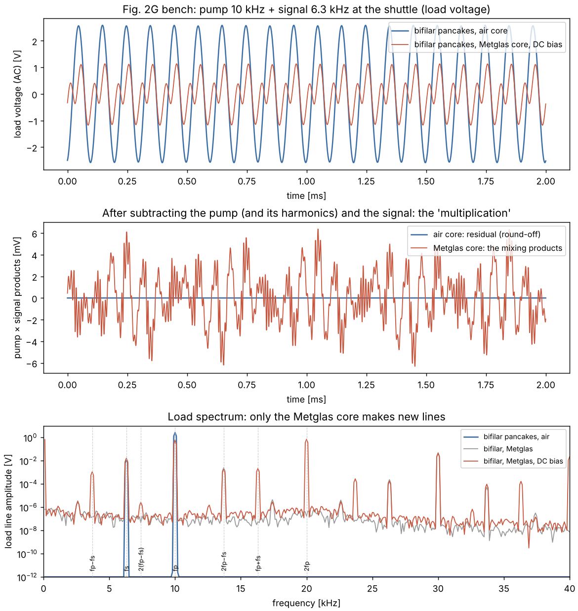
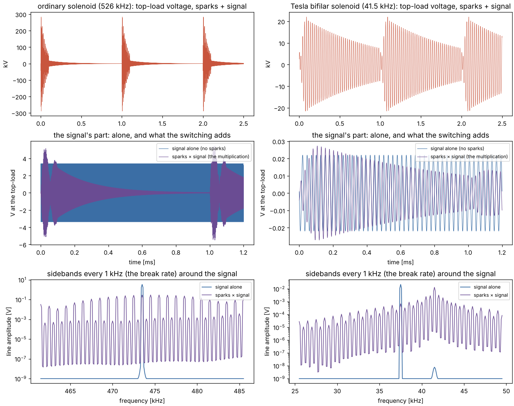

# Barrett's oscillator-shuttle-circuits (Tesla OSC), Figs. 2–5

T. W. Barrett, "Tesla's nonlinear oscillator-shuttle-circuit (OSC) theory
compared with linear, nonlinear-feedback and nonlinear-element electrical
engineering circuit theory", *Annales de la Fondation Louis de Broglie* 16(1),
23–41 (1991); the same disclosure is US Patent 5,493,691 (20 Feb 1996).
Barrett says Tesla's circuits, with energy shuttled to and from several
floating "grounds", are nonlinear in a way that Kirchhoff's and Ohm's laws
cannot describe, mix pump and signal into an idler that obeys the
Manley–Rowe relations, phase-conjugate the signal, and carry the algebra
of quaternions (SU(2)) and higher Cayley–Dickson numbers. Register entry
H36 (CLAUDE.md §1).

```
go run ./examples/barrett_osc                  # about 1.5 minutes
go run ./examples/barrett_osc -data DIR        # also the figure data (CSV)
python3 examples/barrett_osc/viz/plot_bench.py DIR viz/bench.png
python3 examples/barrett_osc/viz/plot_tesla.py DIR viz/tesla_coil.png
go test ./examples/barrett_osc
```

The circuits are read from the paper's drawings (Fig. 1 is Tesla's own
coil forms; Figs. 2–5 are Barrett's). Neither the paper nor the patent
gives a component value, so every value is declared in the code. Spark
gaps (Fig. 3) use the gap model and solver of
`examples/sparkgap_diodebridge` (copied in `gap.go`, `sim.go`, `cell.go`);
everything else runs in kronspice.

## Fig. 2 — the OSCs A–G as drawn

Pump ~ (10 V, 1 MHz, 10 Ω source), pump coil α 10 µH, shuttle coil β 30 µH,
load box 50 Ω with its coil γ 5 µH, 2 Ω per coil, A's store 1 nF, each
floating terminal (G2, G3) a 10 pF top-load with 1 GΩ insulation leak,
coupled coils k = 0.3 (0.6 for G's pancakes), F's capacitor 1 nF. The
shuttle's terminal receives the signal (1 V, 630 kHz), as the patent says
("oscillator shuttles … are also receive and transmit antennas").

| Fig. | load at fp | load at fs | transient vs AC (fp, fs) | largest mixing product | ledger |
|---|---|---|---|---|---|
| A | 58.7 mA | 2.4 µA | 1e-4, 1e-5 | 1e-14 | 7e-8 |
| B | 62.1 mA | 1.04 mA | 6e-5, 2e-5 | 6e-15 | 1e-8 |
| C | 58.7 mA | 5.0 µA | 1e-4, 2e-5 | 7e-15 | 1e-8 |
| D | 58.3 mA | 14.5 µA | 8e-5, 4e-5 | 1e-14 | 1e-8 |
| E | 54.6 mA | 1.5 µA | 1e-4, 2e-5 | 3e-15 | 7e-9 |
| F | 35.1 mA | 1.5 µA | 2e-4, 4e-5 | 1e-14 | 1e-7 |
| G | 58.5 mA | 9.9 µA | 7e-5, 5e-5 | 1e-14 | 1e-8 |

Every circuit is linear: the transient load current holds exactly the
lines AC analysis gives for each source alone (superposition), and no
mixing product rises above round-off. Coils and capacitors, however their
grounds float, make a linear network, and a linear network makes no idler.
**Bench test:** drive the pump, feed a signal to G2, and look for fp − fs
in the load. The standard prediction is only what the parts' own
nonlinearity gives (ferrite cores, ceramic dielectrics).

**With a nonlinear store.** Fig. 2A with the terminal top-load a varactor,
q = Ct·(v + v²/(2·20 V)), pump 2 V, signal 0.2 V:

- an idler at fp − fs = 370 kHz appears at the terminal (the shuttle's
  transmitting end), 4.1×10⁻⁵ of the pump line;
- Manley–Rowe sums for the power into the varactor: 4×10⁻⁷ and 5×10⁻⁷
  (zero for a lossless nonlinear reactance; harmonics to 4th);
- idler ∝ Vs^1.01 · Vp^1.03: standard χ⁽²⁾ mixing, Es*·Ep. The paper's
  Eq. 24 (patent Eq. 15) has |Es|²·Ep, which would give Vs².
- signal phase +60° moves the idler by −62.7°: phase conjugation.

So the mixing, Manley–Rowe and phase conjugation Barrett describes are
those of any parametric mixer, and they come from the nonlinear element,
not from the floating grounds.

Spectra use a Hann window: a floating terminal charges slowly when a
nonlinear store rectifies (its leak time constant is about a second), and
the β–top-load ring has not quite died out after the warm-up; neither is
periodic in the window.

## Fig. 3 — the switched −, +, − capacitors (spark gaps)

10 kV on 1 nF each, 1 µH into 50 Ω (G), 1 cm air gaps (Paschen 35.5 kV,
so they hold the 20 kV between neighbours), triggered at 0, 100 and
200 ns, hot channels recovering over 1 µs:

- load voltage lobes −6.71, +3.42, −1.37 kV: the drawn − + − pulse;
- ledger: 150 mJ stored = 66.3 mJ to the load + 76.5 mJ in the arcs +
  3.8 mJ left + 3.4 mJ solver damping (residual 1×10⁻¹⁰ J).

This is a lumped frozen-wave generator, the impulse source of later
ultrawideband radar. When a gap fires, the next capacitor shares charge
with the one before it with no inductance between them. That loss goes to
the arcs, which is why the + and second − lobes are smaller.
Transmission-line segments in place of capacitors avoid it.

## Fig. 4 — the coil networks (Q, H, J)

α…ψ = 10…70 µH (1 mΩ each), 1 pF per node, 10 pF per open terminal,
5 MHz.

- **One-terminal networks (A, B(i), C(i)).** Driven at the terminal
  against G1, the admittance is 1.21, 1.36 and 1.62 × that of the
  terminal's own capacitance, and only through the 1 pF at the inner
  nodes. With no inner-node capacitance every coil current is zero. A
  network with one terminal is only its terminal's capacitance, so the
  coils, and with them the α, β, γ "products", act only through stray
  capacitance, or as antennas in an outside field.
- **Two-ports (B(ii) = X, C(ii) = Y, B(ii) with values reversed = Z):**
  - kronspice cascade XY = ABCD(X)·ABCD(Y) to 2×10⁻¹⁶;
  - XY ≠ YX by 41 %, so order matters ("αβ ≠ βα");
  - XYZ = (XY)Z = X(YZ) to 1×10⁻¹⁰, so cascades are associative;
  - det ABCD = 1 to 1×10⁻¹⁶ (reciprocal: always invertible);
  - S†S = I to 2×10⁻⁶ (lossless S is unitary, an element of U(2)).

Order dependence is real, and it is ordinary two-port theory: cascades
multiply as 2×2 matrices, which do not commute. The SU(2) Barrett names is
the group of a lossless two-port's scattering matrix, up to phase.
Cascades are, however, associative and invertible. They cannot carry the
Cayley numbers' non-associativity (box H) or the zero divisors of box J.
Box H's "(αβ)γ ≠ γ(αβ)" is in any case a commutator, not an associator.

## Fig. 5 — the quaternion "idler"

x = x0 + x1·i + x2·j + x3·k with x0 = Es*·e^{−iωs t}, x1 = Es·e^{−iβs t},
x2 = √Ep·e^{iωp t}, x3 = √Ep·e^{−iβp t}. This is a sum: each component holds
only the signal or the pump frequency, with nothing at fp − fs (all
< 10⁻¹⁶). An idler needs a product, that is a nonlinear element, which is
what the Fig. 2A varactor shows. x1, x3 and Eq. 24 also write β·t. β is
a propagation constant (rad/m, the paper's own wave equation), so β·t is
not a phase; the travelling-wave phase is β·z.

## Bench version of Fig. 2G: Tesla bifilar pancakes, and a Metglas core



The pump coil α and the shuttle coil β are the flat Archimedean spirals of
[pulsed_bifilar](../pulsed_bifilar) (214 turns of 0.5 mm copper, 127 m).
Its 20-section distributed model gives the same L = 6.84 mH for both
windings, but a self-capacitance of 6.5 pF ordinary (first resonance
757 kHz) against 3.03 nF bifilar (34.9 kHz), 470× more. Each coil is that
lumped equivalent: L, its wire resistance (10.9 Ω), and the
self-capacitance across it. A bifilar pancake is a capacitor above 35 kHz,
so the bench runs below that: pump 10 kHz (30 V), signal 6.3 kHz (1 V)
into the shuttle's 10 nF store, idler 3.7 kHz.

The pancakes are coupled k = 0.6 in air (declared), and modelled as a
transformer: each winding's leakage, a shared magnetizing inductance, and
an ideal 1:1 transformer built from a VCVS and a CCCS, which keeps the
windings isolated. A Metglas 2605SA1 backing (declared) multiplies the
magnetizing inductance by 4 and saturates it from 20 mA, with a core-loss
resistance (Q 50). The ribbon's magnetoelastic resonance (k_me 0.3,
mechanical Q 300, 0.54 m long for 3.7 kHz at 4 km/s) is a parallel tank in
series with it, the standard equivalent of a magnetostrictive resonator.

| Case | load at fp | fs | idler fp−fs | 2fp−fs | Manley–Rowe | ledger |
|---|---|---|---|---|---|---|
| ordinary pancakes, air | 2.99 V | 11.8 mV | 8e-16 V | 6e-16 V | — | 3e-9 |
| bifilar pancakes, air | 2.57 V | 12.2 mV | 7e-15 V | 1e-14 V | — | 5e-9 |
| bifilar, Metglas | 0.46 V | 15.7 mV | 1.4e-7 V | 2.5 mV | 2e-3, 2e-5 | 5e-4 |
| bifilar, Metglas, DC bias 13 mA | 0.60 V | 15.9 mV | 1.09 mV | 1.8 mV | 1e-4, 1e-4 | 2e-4 |
| bifilar, Metglas, bias, ribbon at 3.7 kHz | 0.66 V | 15.4 mV | 0.029 mV | 1.8 mV | 1e-4, 2e-4 | 3e-4 |

- **Air core:** pancakes, ordinary or bifilar, are linear and make no
  idler. The bifilar winding changes the lines through its self-capacitance,
  but adds no new frequency.
- **Unbiased Metglas:** the core is symmetric, so it makes only odd orders.
  The strongest product is the four-wave line 2fp − fs.
- **Biased Metglas:** a DC bias makes the even orders too, including the
  three-wave idler fp − fs.
- **Manley–Rowe** holds for the core's flux curve.
- **Ribbon tuned to the idler:** it cuts the idler 38×. A
  magnetostrictive resonance is an impedance peak of the core branch, so it
  acts as a trap at that frequency; to help the idler, tune the ribbon
  elsewhere.

In the figure, the middle panel subtracts the pump with its harmonics and
the signal, leaving only pump × signal: a few mV with the biased core, and
round-off with air. The Metglas spectrum's ~1e-6 V floor is numerical,
from the core curve's piecewise-linear table.

## A spark-gap Tesla coil with Barrett's floating terminal



**The coil.**
- **Secondary:** the 400-turn solenoid of
  [pulsed_bifilar](../pulsed_bifilar), L = 4.85 mH for both windings.
  Self-capacitance is 3.84 pF ordinary (1.167 MHz) and 3.01 nF bifilar
  (41.6 kHz), with a 15 pF top-load. It rings at 526 kHz (ordinary) or
  41.5 kHz (bifilar).
- **Primary (declared):** 10 kV DC through 10 kΩ charges 20 nF. A rotary
  spark gap fires 1000 times a second onto a primary tuned to each
  secondary, with k = 0.15.
- **Signal:** 1 V from 50 Ω enters in series with the top-load's
  capacitance, the Thevenin form of a small antenna. It runs at 0.9 of the
  secondary's frequency, placed between the spark's 1 kHz lines.

**The solver.** `kronspice` has no spark gap and its examples' gap solver
uses backward Euler, which would damp a high-Q ring-down. So `tcsim.go`
steps this circuit by the trapezoidal rule, with coupled inductors and the
gap model of `gap.go`. It starts from a consistent state and keeps a
mid-step energy ledger that closes to round-off (5e-10 J of 43 J).
`TestTeslaTwin` checks it against kronspice with the gap held closed: the
top-load voltage agrees within 0.1 %, and the ledger to 1e-9.

**Separating the multiplication.** The spark runs are made with the signal
at phase 0 and at π. Half their difference keeps only what is linear in the
signal, and subtracting the signal-alone run leaves what the switching does
to the signal.

| | ordinary solenoid | bifilar solenoid |
|---|---|---|
| top-load peak with sparks | 289 kV | 22 kV |
| signal alone at the top-load | 3.4 V | 22 mV |
| sparks × signal, rms | 1.02 V (0.43 × signal) | 10 mV (0.66 × signal) |
| sidebands fs ± k·1 kHz | ≈ 0.2–0.3 V each, flat over ±12 kHz | grow towards the coil's 41.5 kHz resonance |
| ledger residual | 5e-10 J of 43 J | 6e-11 J of 50 J |

The gap switches the coil on and off 1000 times a second, and that
multiplies the weak signal at the top-load: sidebands every 1 kHz. This is
real mixing, made by a time-varying element, of the kind Barrett's own
Tesla coils would have shown.

The rotary gap here is a timed switch: 0.2 Ω for a 100 µs dwell per
firing, opening at the next current zero. That makes the coil a linear,
periodically switched circuit. The full arc model (strikes at thresholds,
re-strikes while the channel is hot) behaves differently. There, the 1 V
signal flips individual re-strikes in a 289 kV ring-down, and the runs
diverge, by 4.7 kV rms between the two signal phases. That is the coil's
sensitivity to any small disturbance. A real gap's random jitter
(nanoseconds to microseconds) swamps it, so it is not usable mixing.

## Verdict

The verdict below is for Figs. 2–5 as drawn. The bench and Tesla-coil
sections above add the nonlinear parts a real build has: a Metglas core,
and the spark gap.

- The circuits as drawn are linear and obey Kirchhoff's laws (kronspice
  is built on them, and transient, AC and the energy ledger agree).
- Barrett's mixing and phase conjugation are real effects of a nonlinear
  element, with standard scaling and the Manley–Rowe relations.
- The SU(2) and order effects are ordinary two-port matrix algebra.
- Fig. 3 is a working pulse former.
- The claims beyond this (noise rejection, lower transmission loss from
  "higher symmetry") are untested here: the paper gives no measurement
  and no equation to simulate.
