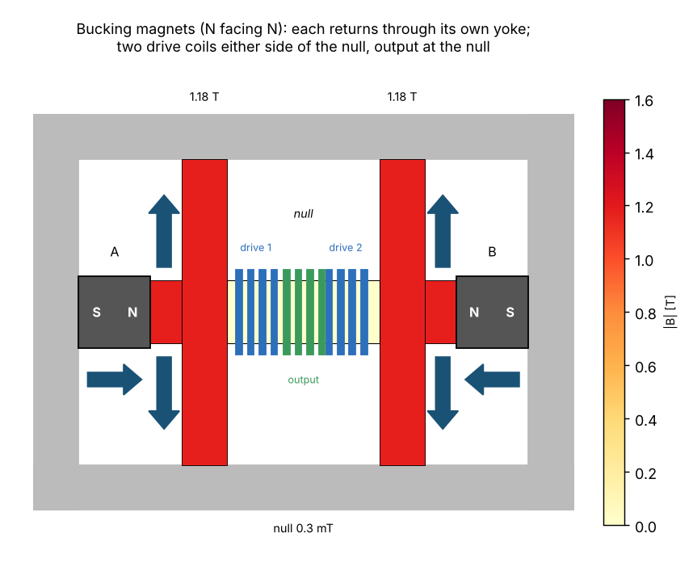

# Bearden's MEG and a bucking-magnet knife edge through the energy ledger

The Motionless Electromagnetic Generator (S. L. Patrick, T. E. Bearden et
al., US 6,362,718, 2002) is a permanent magnet in a laminated core with two
side legs; control windings switch the magnet's flux from one leg to the
other, and output windings on the legs collect the change. The claim is a
coefficient of performance above 1: more power at the load than the
control windings take, the magnet supplying the difference (register
entry H10, CLAUDE.md §3k tier 3). This example builds that arrangement as a
magnetic circuit with the full ledger on, beside a relative of it: two
magnets bucking N to N on one bar, with a split drive coil either side of
the null point where their fluxes meet, a "knife edge" that a small drive
can tip either way.

Both run in kronspice and, as twins, in ngspice.

```
go run ./examples/bearden_meg            # 60 runs, the table, results.csv, run_output.txt
go run ./examples/bearden_meg -write     # regenerate netlists/ and ngspice/
go test ./examples/bearden_meg
KRON=./kronspice python3 examples/bearden_meg/viz/make_viz.py   # graphs, diagrams, videos
```



## The model

Kronspice's magnetic domain (exchange channel `magnetic`: across = MMF
[A], through = flux rate [V]) in the gyrator-capacitor form (Hamill, IEEE
Trans. Power Electron. 8(2), 97–103, 1993):

| Part | Element |
|---|---|
| Core segment, 1 cm² | capacitor `Q=pwl(MMF, Φ)` for its length: the B-H curve of the earlier ngspice drafts (0.6 T at 100 A/m, 1.6 T at 2 kA/m), no hysteresis |
| Winding of N turns | gyrator `Y`, g = 1/N |
| NdFeB magnet, 5 mm × 1 cm² | MMF source 4500 A (Hc·l, ramped in over 0.5 ms) in series with its recoil permeance 2.64e-8 Wb/A |
| Leak, every MMF node | 1 TΩ analogue to ground, so the DC point exists; booked as dissipation |

Every element but the resistors is lossless, so the ledger sees the
magnets as sources like any other. Energies are integrated over 10 whole
drive periods after the circuit has settled (MEG 1 ms, knife 10 ms: its
all-iron drive path has L/R ≈ 3 ms).

**MEG.** Magnet in the centre leg; each 5 cm side leg carries a control
winding (50 turns, 1 Ω source, alternate 45 % pulses) and an output winding
(200 turns into its load).

**Knife edge.** Magnets A and B face N to N along one bar, `Gap` apart
(default 15 cm of iron, four equal segments). Each magnet's flux returns
from its junction to its own S end through its own 5 cm iron yoke, so the
bar between the junctions carries no flux when the magnets match:

```
yoke ─ [S A N] ─ jl ═ drive 1 ═ null (output) ═ drive 2 ═ jr ─ [N B S] ─ yoke
```

The two drive coils (25 turns each, in series, wound to aid along the bar)
sit either side of the null; the output coil (200 turns) sits at it. The
drive's own flux path (bar, both yokes) is all iron. `NullLeak` adds an
air path from the null to the yokes: without it every bar segment carries
the same flux and the two drive coils act exactly as one coil of 50 turns.

## Results (kronspice, 8 November 2026)

No run reached COP 1; the highest was 0.990 (knife edge, 3 kΩ load). The
magnets supplied no net power: under 1e-3 of the drive in every run but
the 10 %-mismatched knife (1.0e-3, still settling), and that remainder
goes into stored energy, not the load. The ledger closes to better than
4e-6 of the drive energy on every run.

| Sweep | Result |
|---|---|
| Knife, 2 V, 10 kHz, 100 Ω | 0.276 W in, 0.238 W to the load, COP 0.862 |
| Knife, drive 0.5–100 V | COP 0.862 throughout (17 mW to 690 W); the null swings ±5 mT at 2 V, −0.23…+0.07 T at 50 V, never to the knee |
| Knife, load 1 Ω–100 kΩ | COP 0.059 → 0.990 (3 kΩ) → 0.738 |
| Knife, frequency 1–50 kHz | COP 0.844–0.862 |
| Knife, magnet mismatch ±10 % | COP 0.861–0.864 |
| Knife, magnet spacing 2–30 cm | COP 0.862 (iron only; air leakage is set separately) |
| Knife, air leakage at the null 1e-8–1e-6 Wb/A | COP 0.861 → 0.823: flux leaving at the null bypasses the output coil |
| Knife, series-resonant drive, 10 kΩ | 80 nF draws 9.4× the non-resonant power; COP 0.982 at every capacitor |
| Knife, series-resonant drive, 1 kΩ | too heavily loaded to peak by 300 nF; COP 0.983 throughout |
| MEG, 5 V pulses, 10 kHz, 100 Ω | 12.3 W in, 1.46 W to the loads, COP 0.119 |
| MEG, drive 1–20 V | COP 0.119 throughout |
| MEG, load 10 Ω–10 kΩ | COP 0.160–0.002 |
| MEG, frequency 1–25 kHz | COP 0.111–0.121 |

The full table is `results.csv`; the run log is `run_output.txt`.

**Reading it.** With its flux path in iron, the knife edge is a good
transformer (up to 99 % at a matched load), and the magnets' only role is a
DC bias that the loaded output coil holds still: COP is flat in drive
level, spacing and mismatch. An earlier version of this example put the
coils on a centre leg whose flux had to return through the magnets (recoil
permeance close to air); there the drive winding was 0.13 mH and COP
peaked at 0.86. Resonance multiplies the power drawn, never the share
delivered.

## Pictures and videos (`viz/`)

| File | Shows |
|---|---|
| `knife_diagram.png`, `meg_diagram.png` | the two cores, coloured by flux density, with the flux direction |
| `knife_flux.mp4`, `meg_flux.mp4` | the flux over two drive cycles beside the waveforms |
| `cop_all_runs.png` | every run against break-even |
| `energy_split.png` | where the drive energy goes, three cases |
| `knife_waveforms.png`, `knife_null_zoom.png`, `meg_waveforms.png` | drive, current, flux and output in steady state |
| `resonance.png`, `null_leakage.png` | the resonance and leakage sweeps |
| `bh_operating_paths.png` | where each part sits on the B-H curve |

## Checks (`go test`)

- `TestLedger`: on every twin case the ledger closes (≤ 1e-3), the magnets'
  net power is under 1e-3 of the drive, and 0 < COP < 1.
- `TestTimestep`: halving the step (200, 100, 50 ns) leaves COP unchanged
  to 1e-3, and the magnets' share stays under 1e-4.
- `TestGyratorAsVCCS`: both circuits with every gyrator replaced by the two
  VCCS used in the ngspice twins give the same COP in kronspice to 1e-4.
- `TestNetlistsCurrent`: `netlists/` and `ngspice/` are what `-write`
  generates.
- `TestNgspiceTwin`: alignment with ngspice (below).

## Alignment with ngspice

Six cases (`knife_baseline`, `knife_20V`, `knife_resonant`, `knife_leak`,
`meg_baseline`, `meg_10ohm`) are written twice from one spec:
`netlists/NAME.cir` for kronspice and `ngspice/NAME.cir` for ngspice, where
each gyrator is two VCCS (`G`) and each core segment a B source
`I=ddt(pwl(v(a,b), …))`. ngspice runs in the tools container:

```
docker build -t kronspice-tools internal/golden/docker
docker run --rm -v "${PWD}:/src" kronspice-tools sh examples/bearden_meg/ngspice_run.sh
go test -v -run NgspiceTwin ./examples/bearden_meg
```

`TestNgspiceTwin` then reads each `ngspice/NAME.dat`, computes the same
energy split, and requires drive power, load power and COP within 2 % of
kronspice and each probe waveform within 2 % RMS of its swing. Until the
`.dat` files exist the test logs the missing case and passes.

**Status:** ngspice results pending (not yet run in the container).

## Register

H10 stays *untested*: this is the standard prediction for a bench replica
(COP < 1, magnets supplying nothing net over whole cycles), against which a
measured MEG or knife edge can be read. A bench run needs the drive input
measured with a true-power meter over whole cycles, the output into a known
load, and the magnets' flux before and after, as the ledger does here.
