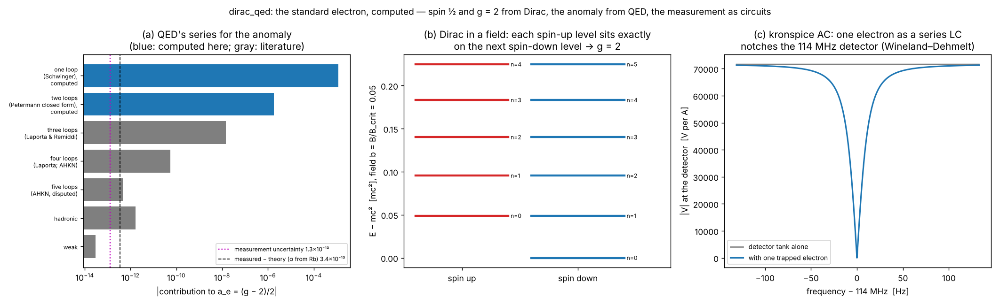
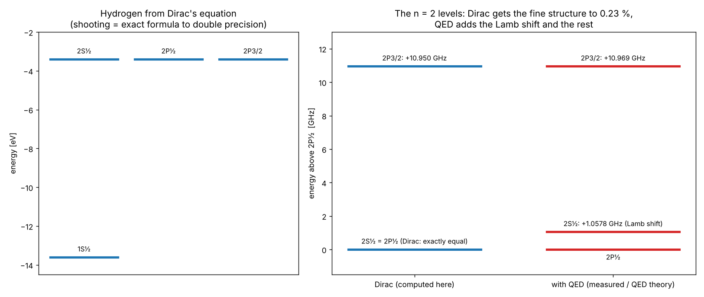

# Dirac + QED: the standard electron, built as the benchmark

The electron ledger scores every electron model in this repository
against the measured electron. Beside them sits the standard model of
the electron: Dirac's equation (1928) plus quantum electrodynamics
(Schwinger, Feynman, Tomonaga, Dyson, late 1940s). It is **not one of
our hypotheses**. It is the standard prediction that root CLAUDE.md
asks to sit beside every hypothesis. Here it is computed rather than
quoted, so each of its numbers can be checked line by line.

```
go run ./examples/dirac_qed -viz examples/dirac_qed/viz   # about 2 s
python3 examples/dirac_qed/viz/plot_dirac.py               # pictures
go test ./examples/dirac_qed                               # about 1 s
```

The output is in `run_output.txt`.



## 1. Dirac's equation, free (`dirac.go`)

H = α·p + β (ħ = c = m = 1) is diagonalized as a 4×4 Hermitian matrix
(Jacobi on its real embedding). The results:

- **The spectrum:** the eigenvalues are ±√(p² + 1), each twice
  (particle and antiparticle, spin up and down), to 12 digits.
- **Spin ½:** helicity S·p̂ on the positive-energy states is ±½, and
  S² = ¾ = s(s + 1). Spin ½ is not put in. It comes from the
  four-component equation that special relativity forces.

## 2. Dirac's equation in a magnetic field: g = 2

H = [[1, σ·π], [σ·π, −1]] is built in the oscillator basis of the
cyclotron motion (40 levels, with edge artifacts dropped) and
diagonalized for fields b = B/B_crit from 10⁻⁶ to 1
(B_crit = 4.4×10⁹ T).

- **Spin flip equals one cyclotron quantum.** In every field, flipping
  the spin costs exactly one cyclotron quantum, so g = 2.000000000000.
  The levels are √(1 + 2b·k), and spin and orbit enter only through
  k = n + ½ + s_z.
- **This is Dirac's g = 2,** the value every ring model in this
  repository has had to work to reach.

## 3. Hydrogen from Dirac's radial equations

The radial equations are solved by RK4 shooting in ln r with bisection
(Z = 1, infinite nuclear mass):

| level | E/mc² (shooting) | exact formula | binding |
|---|---|---|---|
| 1S½ | 0.999973373968303 | same | 13.605874 eV |
| 2S½ | 0.999993343469921 | same | 3.401480 eV |
| 2P½ | 0.999993343469921 | same | 3.401480 eV |
| 2P3/2 | 0.999993343558540 | same | 3.401435 eV |

- **The integration converges quickly.** At 50 steps the 1S level is off
  by 5.5×10⁻¹³; from 100 on it matches to double precision (tested).
- **Fine structure:** Dirac gives 2P3/2 − 2P½ = 10.9497 GHz, or 10.9437 GHz
  with the reduced mass. QED's value is 10.96905 GHz, so Dirac alone is
  0.23 % low.
- **The Lamb shift:** Dirac puts 2S½ and 2P½ at exactly the same energy.
  Measured, 2S½ is 1057.845(9) MHz higher (Lundeen & Pipkin 1981). That
  is the Lamb shift, the first thing QED explained.



## 4. QED's correction: g − 2 (`qed.go`)

a_e = (g − 2)/2 = Σ A⁽²ⁿ⁾(α/π)ⁿ + hadronic + weak.

| order | coefficient | source | contribution (α from Rb) |
|---|---|---|---|
| one loop | 0.5000000000000 | **computed**: Feynman-parameter integral (Peskin & Schroeder 6.56) | 1.161409731852×10⁻³ |
| two loops | −0.328478965579194 | **computed**: Petermann's closed form 197/144 + π²/12 − (π²/2)ln 2 + ¾ζ(3) | −1.772302×10⁻⁶ |
| three loops | 1.181241456587 | Laporta & Remiddi 1996 (analytic) | 1.480411×10⁻⁸ |
| four loops | −1.9122457649 | Laporta 2017 (semi-analytic) | −5.564×10⁻¹¹ |
| five loops | 6.737(159) | Aoyama, Kinoshita & Nio 2019 (numerical; disputed) | 4.55×10⁻¹³ |
| muon and tau loops | | Aoyama, Hayakawa, Kinoshita & Nio 2012 | included above |
| hadronic | | vacuum polarization (LO + NLO) + light-by-light | 1.685×10⁻¹² |
| weak | | | 2.97×10⁻¹⁴ |

| α from | a_e (theory) | measured − theory |
|---|---|---|
| Rb (Morel 2020) | 1.159652180246×10⁻³ | +3.44×10⁻¹³ |
| Cs (Parker 2018) | 1.159652181598×10⁻³ | −10.08×10⁻¹³ |

The measured value is 1.15965218059(13)×10⁻³ (Fan et al. 2023). The two
differences reproduce the published +34(16)×10⁻¹⁴ and −101(27)×10⁻¹⁴
(arXiv:2311.12112), and that check is a test.

Theory and measurement agree to parts in 10¹⁰ of the anomaly and parts
in 10¹³ of g. The two α measurements disagree with each other by more
than that (5.5σ).

## 5. The measurement in kronspice (`trap.go`)

The trap is a Penning trap with B = 5.3 T and ν̄_z ≈ 114 MHz (Fan et al.
2023).

- **The electron as a circuit:**
  - **The model.** A trapped electron's axial motion, seen from the
    endcaps, is a series LC: L_e = m d²/e² = 435 H, C_e = 4.5×10⁻²¹ F
    (d = 3.5 mm, illustrative; Wineland & Dehmelt 1975).
  - **The detector.** It is a 114 MHz tank (Q = 1000). The electron is
    coupled through an ideal 1:10⁵ transformer built from controlled
    sources, so the circuit's element values sit on the tank's scale.
  - **The result.** kronspice AC finds the notch at 114 MHz
    (−8.5×10⁻⁷ Hz off), depth 4.2×10⁻⁴. Its width at half depth × √3 is
    26.237 Hz, against R e²/(2π m d²) = 26.224 Hz.
- **The two clocks:**
  - **The frequencies.** For the theory g, the trap's frequencies are
    ν̄_c = 148.36 GHz, ν̄_a = 172.09 MHz and ν̄_m = 43.8 kHz. The measured
    magnetron frequency is 43 kHz.
  - **The readout.** Each is read as a tank resonance in kronspice AC.
    g/2 = (ν̄_c + ν̄_a)/√(ν̄_c² + ν̄_z² + ν̄_m²) (the Brown–Gabrielse
    invariance theorem) recovers g/2 to 5×10⁻¹⁷.
  - **This is a closed loop:** g goes in, the circuits read it back. It
    shows the measurement chain, not new physics.

## What is derived and what is put in

| | Dirac + QED |
|---|---|
| spin ½ | **derived** (Part 1) |
| g = 2 | **derived** (Part 2) |
| hydrogen fine structure | **derived**, 0.23 % from Dirac alone (Part 3) |
| Lamb shift, g − 2 | **derived** from the same QED, with α measured independently (Part 4) |
| charge e, mass m, α | **put in**: measured, not explained |
| what the electron *is* | **not addressed**: a point with no structure |
| the series itself | renormalized (infinities subtracted), believed to be asymptotic, not convergent |

**On "corrections as a way out"** (user, 2026-11-13). QED's terms are not
fitted: each comes from the same equation, with α taken from a
separate experiment, and Schwinger's term was computed in 1948 against
a then-new measurement. What QED does not do is explain the electron:
its charge, its mass and α are inputs. That gap is where a structural
model could add something QED cannot.

## Files

- `dirac.go`: the free Hamiltonian, spin, Landau levels and g, hydrogen
  by shooting, and the exact formula.
- `qed.go`: Schwinger's integral, ζ(3), Petermann's A⁽⁴⁾, the literature
  terms and the series.
- `trap.go`: the electron as a series LC, the detector, the transformer,
  and the clock tanks.
- `main.go`: Parts 1–5. `main_test.go`: every number above.
- `viz/plot_dirac.py` → `viz/dirac_qed_graph.png`,
  `viz/dirac_qed_hydrogen.png` (from the run's CSVs).

## References

- P. A. M. Dirac, *Proc. R. Soc. A* 117, 610 (1928).
- J. Schwinger, *Phys. Rev.* 73, 416 (1948).
- A. Petermann, *Helv. Phys. Acta* 30, 407 (1957); C. M. Sommerfield, *Phys. Rev.* 107, 328 (1957).
- S. Laporta, E. Remiddi, *Phys. Lett. B* 379, 283 (1996); S. Laporta, *Phys. Lett. B* 772, 232 (2017).
- T. Aoyama, M. Hayakawa, T. Kinoshita, M. Nio, *PRL* 109, 111807 (2012); T. Aoyama, T. Kinoshita, M. Nio, *Atoms* 7, 28 (2019); the tenth-order value disputed in arXiv:2404.00649.
- X. Fan, T. G. Myers, B. A. D. Sukra, G. Gabrielse, *PRL* 130, 071801 (2023).
- L. Morel et al., *Nature* 588, 61 (2020) (α from Rb); R. H. Parker et al., *Science* 360, 191 (2018) (α from Cs).
- arXiv:2311.12112 (the Rb/Cs comparison: +2.2σ, −3.7σ).
- D. J. Wineland, H. G. Dehmelt, *J. Appl. Phys.* 46, 919 (1975) (the trapped particle as a series LC).
- L. S. Brown, G. Gabrielse, *Rev. Mod. Phys.* 58, 233 (1986) (the invariance theorem).
- S. R. Lundeen, F. M. Pipkin, *PRL* 46, 232 (1981) (the Lamb shift, 1057.845(9) MHz).
- M. E. Peskin, D. V. Schroeder, *An Introduction to Quantum Field Theory* (1995), §6.3.
