# earth_machine — the Earth as an electromagnetic machine

The planet as three Kron networks:

1. **Geodynamo** (below): the core dynamo modeled as the **Rikitake two-disk dynamo** (T. Rikitake, Proc. Camb.
Phil. Soc. 54, 89, 1958) — two homopolar disks, each excited by the other's
field coil — built from kronspice machine elements (N) and run as a transient.

2. **Global atmospheric circuit** (Layer 2 below): thunderstorms charging
   the ionosphere through leaky air.
3. **Earth–ionosphere cavity** (Layer 3 below): Schumann resonances on a
   transmission line in colatitude.

Then the three are linked (Linking the layers, below), and the geodynamo is
put through convergence, parameter and drive studies (Layer 1 studies).
The article built from these results: "The Earth as an Electromagnetic
Machine: A Kron-Network Approach" (Claude Docs, link in CLAUDE.md).

```
go run ./examples/earth_machine                 # everything (several minutes)
go run ./examples/earth_machine -layer N        # 1 geodynamo, 2 global circuit, 3 cavity, 4 layer-1 studies, 5 the links, 6 stacked, 7 nonlinear ionosphere
go run ./examples/earth_machine -data viz/data  # figure data (CSV), then: python viz/plot_layers.py
go test ./examples/earth_machine
```

| File | Contents |
|---|---|
| `main.go` | layer 1: the Rikitake machine (circuit + RK4 twin), four cases, the `-layer` switch |
| `studies.go` | layer-1 studies: convergence, the (μ, A) plane, and the paper107 variations |
| `atmosphere.go`, `atmosphere2.go` | layer 2 and its refinements (two-scale profile, land/ocean, storm generators) |
| `cavity.go`, `cavity2.go` | layer 3 and the frequency-dependent (two-height) ionosphere |
| `coupled.go` | the links: one network for layers 2 and 3, dynamo → conductivity, one ledger |
| `stacked.go` | the stacked design: couplings from the geometry, coil-inductor circuit, gap and torque studies |
| `ionosphere_nl.go` | layer 7: a nonlinear (electron-heated) ionosphere in the cavity, two transmitters, mixing products; figure `viz/ionosphere_nl.png` |
| `figdata.go`, `viz/plot_layers.py` | figure data and figures 4–8 (300 dpi) |
| `viz/plot_fluid.py`, `viz/plot_stacked.py` | Fig. 9 (the machine as two eddies) and Fig. 10 (the stacked design) |

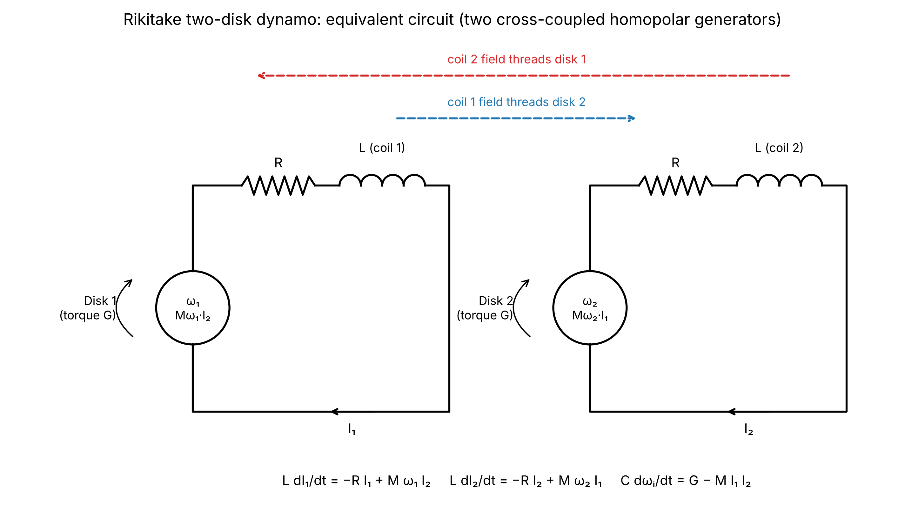

## Model

| | |
|---|---|
| Disk *i* | machine element with two windings: its radial path and the *other* loop's field coil; speed matrix `G[0][1] = ±M` gives the speed EMF `M·ωᵢ·I_coil` and the back torque `M·I₁·I₂` |
| Shaft *i* | mechanical node, inertia `C` (capacitor), drive torque `G` (current source on the mechanical channel), as in `eckardt_homopolar` |
| Loop *i* | disk path → `R` → field coil `L` (threads the other disk) |

`L dI₁/dt = −R I₁ + M ω₁ I₂`, `L dI₂/dt = −R I₂ + M ω₂ I₁`, `C dωᵢ/dt = Gᵢ − M I₁ I₂`.
With all constants 1 this is Rikitake's dimensionless system with μ = 1, A = 1.

## Results (`run_output.txt`)

- **Equilibrium:** I₁² = k² = 1.618… (the golden ratio); the linearization is
  (λ + 2)(λ² + k² + k⁻²), a neutral oscillation of period **4.20** — the
  machine's resonance, and the floor of the reversal intervals (min 3.9).
- **Case 1, co-rotating:** 71 reversals in t = 50…1000, intervals 3.9–70,
  mean 12.2, CV 0.92 (a Poisson process has 1). The circuit tracks an
  independent RK4 integration to 4×10⁻³ for t ≤ 10; after that chaos
  separates them, so only the statistics are comparable (RK4: 49 reversals,
  mean 17.3 — the counts are sensitive to step size and need a sweep).
- **Energy:** drive work = ohmic heat + Δ(stored) to 2×10⁻⁷ relative.
- **Case 2, disk 2 driven backwards, same wiring:** the feedback is negative;
  the currents decay to 10⁻¹³ and both shafts spin up without load.
- **Case 3, disk 2 backwards with coil 2 rewound:** identical to case 1 with
  I₂ and ω₂ negated (test `TestCounterRotatingRewoundMirrors`, to 10⁻⁹): the
  sense of the feedback loop matters, not the direction of spin.

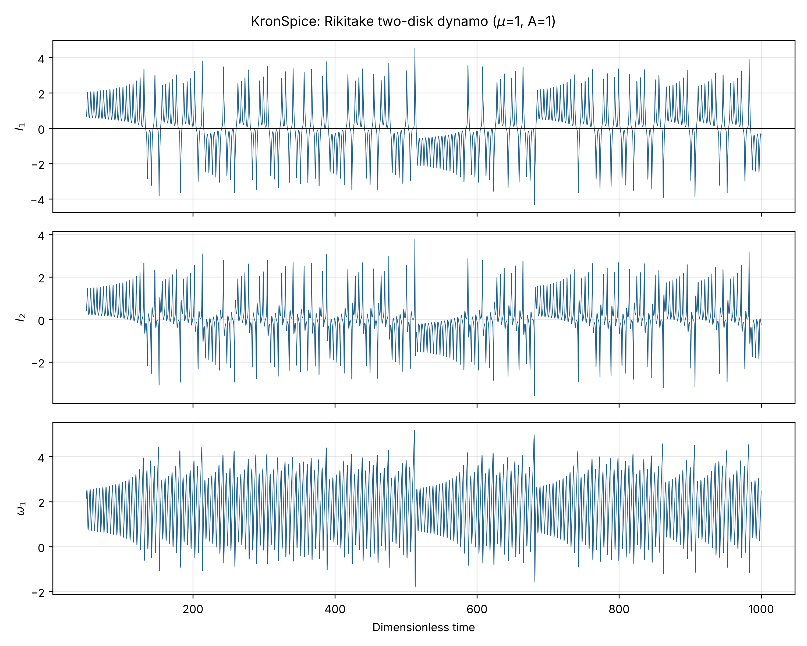
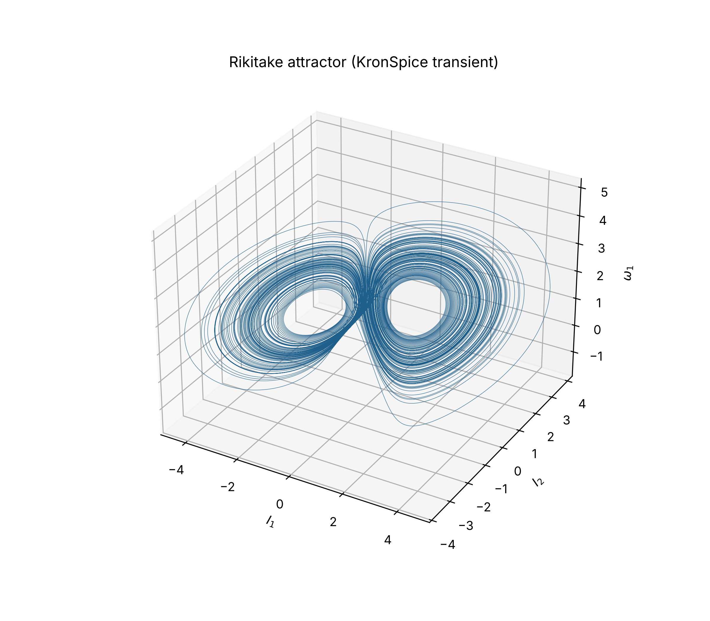
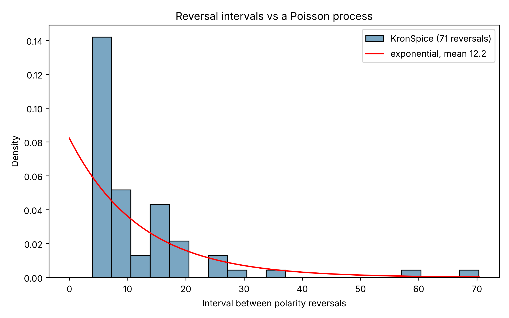

## Limits

Dimensionless; no claim about reversal times in years. Rikitake does not give
superchrons or the field weakening seen before real reversals (Layer 1
studies, below). The engine's ledger used to book a start-up mismatch of
−3.75×10⁴ J from the UIC point (inconsistent winding ICs routed through the
reference resistors at t = 0); `analysis/tran.go` now leaves the imposed point
out of the integral (`TestUICImposedPointNotIntegrated`), and the engine's
mismatch is 1.1×10⁻⁵ J (4×10⁻⁹ of the drive work). `Books` stays as an
independent check from the trace.

## Layer 2 — the global atmospheric circuit

`atmosphere.go`. Wilson's circuit (Rycroft, Israelsson & Price, *JASTP* 62,
1563, 2000): storms lift positive charge to the ionosphere, and the return
current flows down through fair-weather air everywhere else. The air is a
leaky dielectric, so each spherical shell is R ∥ C (total current
𝔎 + ∂𝔇/∂t). 60 shells, thin near the ground, form a ladder from the
ground to the node `ion`, and the storms are one current source across
it, booked on the thermal channel (a convective heat engine).

Conductivity σ(z) = σ0·exp(z/H) is calibrated on three measured anchors:
V_I = 250 kV, J = 2 pA/m², E0 = 120 V/m. That gives σ0 = J/E0 =
1.67×10⁻¹⁴ S/m and H = 2.08 km. A one-scale profile is an approximation:
real profiles have a low-conductivity boundary layer under a steeper
free-air rise.

| Quantity | Result |
|---|---|
| global current J·4πR² | 1,020 A |
| global resistance | 244.9 Ω |
| V_I, circuit vs exact ladder I·ΣR | 249.84 kV, rel. 9×10⁻⁶ (sphericity −0.07 % from the flat column) |
| Earth's charge, circuit vs −ε0E0·4πR² | −5.42×10⁵ C, both |
| balancing positive charge | 5.42×10⁵ C in the air, half below 1.42 km; 1.7×10⁻⁶ C at the ionosphere |
| capacitance | geometric shell to 60 km 0.076 F; effective Q/V_I 2.17 F |
| relaxation time | R·C_eff = ε0/σ0 = 531 s (8.9 min), an identity of the model |
| power | 255 MW from the storms, all to heat; ledger residual 4×10⁻⁶ |
| switch-on | 63 % of V_I in 229 s; circuit vs Σ I·R_k(1 − e^(−t/R_kC_k)) within 8×10⁻⁵ |
| Carnegie curve (±15 % daily storm current; Harrison, *Surv. Geophys.* 34, 209, 2013) | V_I follows with ratio 0.99969 and a 4.4 min lag |

The charge that balances the Earth's sits in the lowest kilometres of
air, not on the ionosphere. So the "spherical capacitor" picture
understates the capacitance about 30 times, and the ionospheric potential
tracks global storm activity within minutes.

## Layer 3 — the Earth–ionosphere cavity

`cavity.go`. The shell between the ground and the ionosphere is a line in
colatitude (Madden & Thompson, *Rev. Geophys.* 3, 211, 1965): V = E_r·h,
I = H_φ·2πa·sinθ, L' = μ0h/(2πa sinθ), C' = ε0·2πa sinθ/h. The
telegrapher's equations then become Legendre's, with f_n =
c/(2πa)·√(n(n+1)). Ladder: 181 bands of 1°, with each band's exact area
as its capacitor to ground and an inductor between neighbouring bands. A
1 A AC current source into the pole band is a vertical lightning stroke.

**Perfect cavity (twin):** ladder eigenfrequencies 10.591, 18.343, 25.939,
33.484, 41.004 Hz against Legendre's 10.591, 18.345, 25.943, 33.493,
41.020 Hz. The error is second order in the band width (test). The
engine's AC sweep at Q1 = 300 peaks at the eigenfrequencies, with an AC
ledger residual of 0.

**Lossy cavity, fitted to mode 1 only** (7.8 Hz, Q = 5; Sentman 1995):
v/c = √(h_e/h_m) = 0.740 (h_e = 49 km at h_m = 90 km), with uniform
damping α = 4.93 s⁻¹ (shunt G = 2αC).

| n | model f [Hz] | model Q | measured [Hz] | model / measured | measured v/c |
|---|---|---|---|---|---|
| 1 | 7.80 | 5.0 | 7.8 | 1.000 | 0.736 |
| 2 | 13.55 | 8.7 | 14.3 | 0.948 | 0.780 |
| 3 | 19.18 | 12.2 | 20.8 | 0.922 | 0.802 |
| 4 | 24.77 | 15.8 | 27.3 | 0.907 | 0.815 |
| 5 | 30.34 | 19.4 | 33.8 | 0.898 | 0.824 |

The Legendre spacing is right, but one constant velocity and constant
loss leave modes 2–5 up to 10 % low and make Q grow with f. The measured
spectrum implies v/c rising with frequency and Q staying near 4–6. Both
need ionospheric heights that depend on frequency (the two-height or
"knee" models, e.g. Mushtak & Williams, *JASTP* 64, 1989, 2002), which
are not built yet. A station on the equator sees only the even modes
(P_n(0) = 0 for odd n), at 13.6, 24.8 and 35.9 Hz. The pole spectrum's
first peak (7.48 Hz) sits below the mode frequency because the broad
modes overlap; measured values are spectral peaks, so a fit to the peak
rather than the mode is the next refinement.

### Layer 3 refinement — frequency-dependent heights (`cavity2.go`)

Two-scale-height ionosphere (Greifinger & Greifinger, *Radio Sci.* 13, 831,
1978; Sentman, *JATP* 52, 35, 1990): h_e(f) = h_e0 + ζe·ln(f/f0) − iπζe/2,
h_m(f) = h_m0 − ζm·ln(f/f0) + iπζm/2. Per unit arc length the line then has a
series R and L and a shunt G and C that change with frequency, so the ladder
is rebuilt at every frequency and solved by the engine's AC analysis there
(781 ladders, AC ledger residual 0). Fitted to the five measured frequencies
and Q1 = 5: h_e = 52.3 km, h_m = 90.2 km at 8 Hz (ζe = 0.55 km, ζm = 9.94 km).

| n | model f [Hz] | Q | measured [Hz] | model / measured |
|---|---|---|---|---|
| 1 | 7.96 | 5.0 | 7.8 | 1.020 |
| 2 | 14.27 | 4.7 | 14.3 | 0.998 |
| 3 | 20.64 | 4.5 | 20.8 | 0.992 |
| 4 | 27.11 | 4.3 | 27.3 | 0.993 |
| 5 | 33.68 | 4.2 | 33.8 | 0.996 |

Q2–Q5 are predictions and fall inside the reported 4–6. The fit trades ζe
against h_e0 (ζe of 0.55 km is small for a lower-ionosphere scale height);
the frequencies are well constrained, the split between the two scale
heights is not.

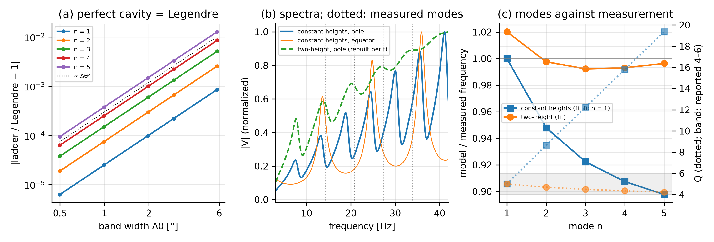

### Layer 2 refinements (`atmosphere2.go`)

Declared, illustrative inputs; the three global anchors still calibrate.

- **Two-scale profile** (boundary layer 1.5 km, free-air scale height 5 km;
  H_BL solved = 1.09 km): V_I 249.67 kV, E0 119.8 V/m, half the space charge
  now below 0.72 km. τ = ε0/σ0 = 531 s is unchanged: Q = ε0E0A and I = JA make
  R·C_eff = ε0/σ0 for any profile.
- **Land (29 %, σ0 1.0×10⁻¹⁴ S/m) and ocean (2.2×10⁻¹⁴ S/m) in parallel,**
  same storm current: V_I 224.8 kV; land 160 A, ocean 860 A; E0 = 108 V/m over
  both (one ionosphere, J ∝ σ0).
- **Storm generators with their own paths** (up to the ionosphere, down to the
  ground, a local return between the charge centres), generator current set so
  that 1020 A still reaches the ionosphere:

| R_up [Ω] | R_down [Ω] | R_cloud [Ω] | I_s [A] | reaching ionosphere | P_gen [MW] | in storms [MW] | fair weather [MW] |
|---|---|---|---|---|---|---|---|
| 50 | 100 | 1000 | 1423 | 71.7 % | 573 | 318 | 255 |
| 100 | 100 | 500 | 1928 | 52.9 % | 875 | 620 | 255 |
| 100 | 500 | 250 | 4468 | 22.8 % | 3851 | 3596 | 255 |

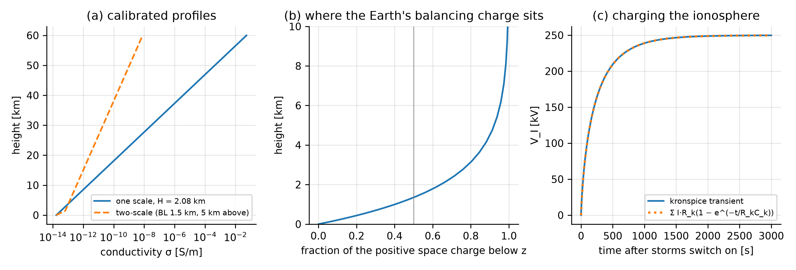

## Layer 1 studies (`studies.go`)

**Convergence (task 2).** Counts at a fixed time depend on the integrator;
the interval distribution does not. RK4 over t = 20 000 at h = 0.004, 0.002,
0.001, 0.0005: 1385, 1442, 1470, 1473 reversals, mean 14.35 → 13.49; two-sample
KS against the finest step p = 0.01, 0.65, 0.88. The circuit at max step 0.02,
0.01, 0.005 (t = 4000) against the finest RK4: p = 0.13, 0.38, 0.39.

**The (μ, A) plane against the polarity record (task 3).** A parametric
bootstrap KS test (mean fitted, 400 resamples) rejects exponential intervals
everywhere (p ≤ 0.0025, the floor). μ = 0.5 with A ≥ 2 is periodic (CV 0).
Longest/mean ≤ 6 (record: the Cretaceous Normal Superchron, ≈ 38 Myr, against a
Cenozoic mean of 0.2–0.3 Myr, ≳ 100); the last swing before a reversal is
8–23 % *above* the median swing where the machine is chaotic, where the
record shows the dipole weakening (Valet & Meynadier 1993).

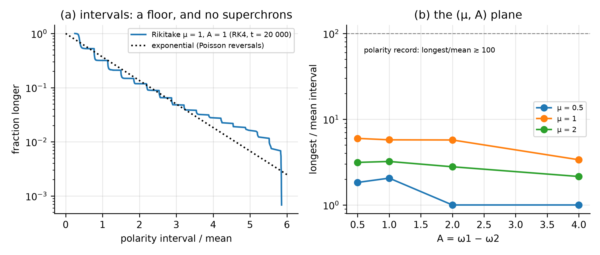

**paper107 variations (task 4;** Evans, Amador & Eckardt, `reference/paper107.pdf`**).**

| Variation | Built as | Result |
|---|---|---|
| a. modulated torque G = 1 + 0.3 sin(ωd t) | SIN current sources on the shafts | reversal rate 0.03–0.14 per unit time (0.075 unmodulated), highest near 0.8 ωn; RMS field unchanged; circuit = RK4 (7.6×10⁻³ over t ≤ 10) |
| b. each disk on its own speed drive | voltage sources on the mechanical nodes | growth (−R + M√(ω1ω2))/L, circuit = exact to 4 decimals; opposed speed modulation decays at the old threshold |
| c. feedback coil around each disk | G[0][0] = −K·M (the element books ω·G·i as a drop) | K ≥ 0.125: one polarity, no reversals; K = −0.5: 21 reversals against 1438, the coil's I² torque drives the shafts; circuit = RK4 to 1.4×10⁻³ |
| d. Tesla's opposed fields | case 4: co-rotating, coil 2 rewound | λ = −1 ± i about I = 0, the field dies; Tesla's magnets excite separately |
| e. rotating-frame terms | one disk at ω(t) = 5 sin 10t | machine = exact to 7×10⁻⁶; for a 1 T, 10 cm, 50 rev/s lab disk the Stewart–Tolman, centrifugal and Coriolis terms are 6×10⁻¹¹, 2×10⁻⁹, 4×10⁻⁹ of the motional EMF |

None adds energy; every ledger closes. The ECE reading stays in the register
(H15, H16) with this as its standard prediction.

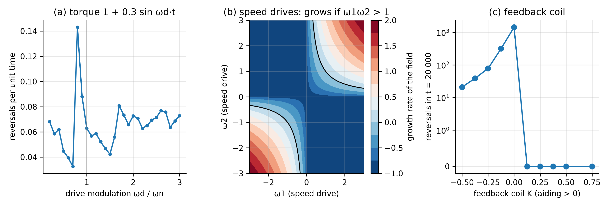

## Linking the layers (`coupled.go`)

1. **One network for layers 2 and 3.** Each colatitude band of the cavity
   ladder takes the band's air column (layer-2 shells, two-scale profile, to
   100 km) as its shunt; the column tops are joined by the ionosphere's series
   path (μ0·h_m, h_m = 90 km, with its loss). 61 bands × 40 shells:
   - DC: one equipotential ionosphere, 249.6–250.3 kV across all bands, 255 MW,
     ledger 2×10⁻⁹;
   - ELF, same elements: peaks 7.2, 13.0, 18.9, 24.9, 30.9 Hz (measured 7.8,
     14.3, 20.8, 27.3, 33.8), with no fitted electric height: h_e comes from
     σ(z) = ωε0 in the profile, 45.6 km at 8 Hz, 52.7 km at 33 Hz (fit: 52.3).
2. **Dynamo → atmosphere.** The dipole shields the air from galactic cosmic
   rays (cutoff rigidity ∝ dipole moment), σ ∝ √q (ion–ion recombination).
   With the unshielded ion production declared as 2× today's, V_I falls to
   177 kV (circuit: 176.7 kV) and τ to 376 s when the dipole vanishes; over a
   Rikitake run V_I dips to 177 kV at each reversal. Quasi-static: minutes
   against millennia.
3. **One ledger.** Dynamo on the mechanical channel (ohmic losses estimated
   0.2–0.5 TW, Christensen & Tilgner, *Nature* 429, 169, 2004), storms on the
   thermal channel; the cavity draws on lightning. No layer powers another.

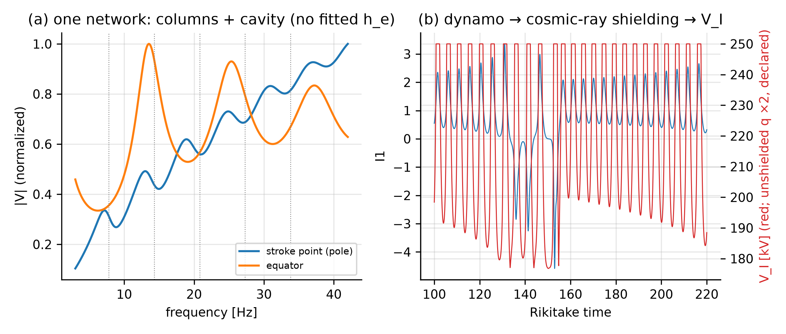

## The stacked design (`stacked.go`)

The two disks (eddies) on one axis, one above the other, each inside the coil
fed by the other, instead of side by side: in the core's terms, two eddies
stacked along the rotation axis. The couplings come from the copper machine
of [homopolar](../homopolar) (`dual.go`) scaled to the disk radius (coil
1.2 r_o, 0.4 r_o long), with `em.MutualCircles` and `em.Nagaoka`:

| gap [r_o] | KS (coil on its own disk / M) | KM (coil–coil / L) |
|---|---|---|
| 0.53 (the homopolar machine) | 0.519 | 0.387 |
| 1 | 0.263 | 0.193 |
| 2 | 0.081 | 0.062 |
| 6 | 0.0052 | 0.0042 |

In the circuit the coils are inductors with a Mutual element and the machine
elements carry sense windings; it equals the RK4 equations to 1.2×10⁻³ and the
ledger closes (3×10⁻⁶ J).

**No gap reverses** (μ = 1, A = 1, t = 20 000). Rikitake's chaos rests on a
conserved speed difference A = ω1 − ω2: side by side, both disks feel the same
back torque M·I1·I2. Stacked, each disk also feels its own coil's KS·M·Ii²,
different on the two disks, so A drains away (gap 6 r_o: 1.00 → 0.35 at
t = 200 → 0.005 at 1000) and the field locks to one polarity, however weak the
stray coupling. Holding A with unequal drives (G = 1 ± δ) only brings
reversals back at close stacking and δ = 0.5, and then like a clock (interval
3.87, the oscillation period; CV 0.13). Stacked eddies make a stable dynamo;
irregular reversals need the two loops to couple only through each other's
field. (The side-by-side feedback coil of task 4c locks the field for the same
reason.)

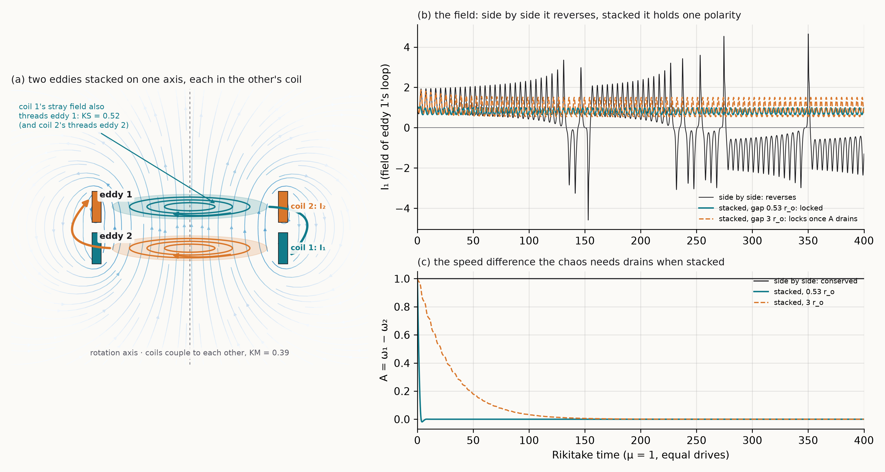

The fluid view of the side-by-side machine: [viz/fig9_fluid_machine.png](viz/fig9_fluid_machine.png).

## Layer 7 — a nonlinear ionosphere (`ionosphere_nl.go`)

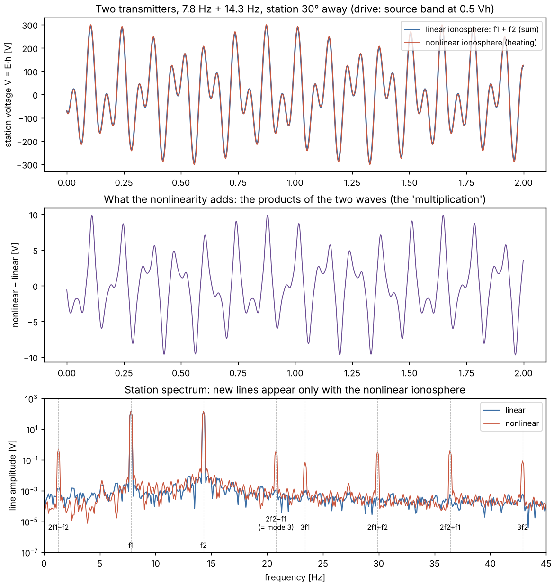

**The model.** The cavity of layer 3 (fitted to mode 1, Q 5) with its
ionospheric loss made field-dependent by electron heating:
G(E) = G0/(1 + (E/Ep)²). In the collision-dominated steady state
Te/T = 1 + (E/Ep)² with ν ∝ Te (A. V. Gurevich, *Nonlinear Phenomena in
the Ionosphere*, 1978). This is the mechanism behind the Luxembourg effect
(Tellegen, *Nature* 131, 840, 1933) and HF heating experiments.
- **Heating field:** Ep = √(3kTmδ(ω²+ν²))/e ≈ 0.02 V/m for the night-time
  D region (T 200 K, δ 1e-3, ν 1e6 s⁻¹; declared).
- **Field at a band:** taken as the cavity's vertical field V/h_e, an upper
  bound on what reaches the plasma. So Vh = Ep·h_e ≈ 1 kV.
- **Drive:** two transmitters at the source band, at 7.8 and 14.3 Hz (the
  measured modes 1 and 2), received 30° away.

| source peak / Vh | drive | station f1, f2 | 2f1−f2 (1.3 Hz) | 2f2−f1 (20.8 Hz) | linear cavity at those lines |
|---|---|---|---|---|---|
| 0.01 | 1 A | 2.9 V | 7e-6 V | 2e-5 V | 1e-6, 8e-6 V |
| 0.1 | 10 A | 29 V | 3.6 mV | 3.2 mV | 4e-4, 3e-4 V |
| 0.5 | 49 A | 150 V | 0.48 V | 0.40 V | 1e-3, 9e-4 V |

With a linear ionosphere the two signals simply add. With heating, the
third-order (four-wave) products appear, and 2f2 − f1 = 20.8 Hz falls on the
measured third Schumann frequency. The 7.8 Hz line also changes (+3 % at
0.5 Vh) through the shared loss. Its sign follows from taking the loss
∝ σ(E), which is an assumption of this shunt model.

The ledger closes to 3e-5 in both runs.

**The scale.** Vh corresponds to about 20 mV/m over the whole cavity
height. Natural Schumann fields are far smaller, and real ELF transmitters
stay in the linear regime. At ELF the cavity is linear in practice; heating
the ionosphere takes HF power (HAARP, EISCAT).
