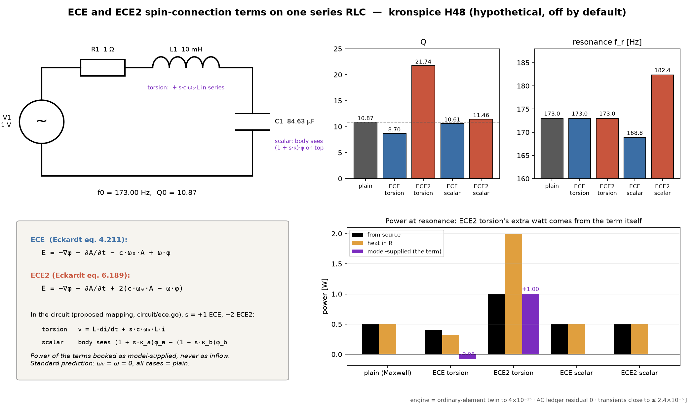

# ECE and ECE2 on a series RLC circuit (H48)

kronspice can run any circuit with the spin-connection terms of
Einstein–Cartan–Evans theory (CLAUDE.md §1, register entry H48; §3c). These
terms are a hypothetical option and are off by default. The netlist line
`.ece form=ece|ece2` switches them on. This example takes one series RLC
circuit and runs it five ways:
- plain (Maxwell);
- with the torsion term in the ECE form and in the ECE2 form;
- with the scalar term in the ECE form and in the ECE2 form.

Three more runs add UFT 456's two conductivities to the ECE2 torsion case
(see [UFT 456 conductivities](#uft-456-conductivities)).

Each case is checked three ways: against its closed form, against a twin
built from ordinary elements, and against the energy ledger. It is the
smallest worked use of the option. The plain run is the standard
prediction.

```
go run ./examples/ece_rlc
go test ./examples/ece_rlc
go run ./cmd/kronspice examples/ece_rlc/export/ece_rlc_ece2_torsion.cir

# report (ece_rlc_report.pdf) and summary image (ece_rlc_summary.png)
go run ./examples/ece_rlc -data examples/ece_rlc/viz/data > examples/ece_rlc/run_output.txt
python3 examples/ece_rlc/viz/plot_report.py examples/ece_rlc/viz/data examples/ece_rlc/viz
python3 examples/ece_rlc/viz/make_report.py examples/ece_rlc/ece_rlc_report.pdf
```



## The circuit and the terms

A 1 V source drives R = 1 Ω, L = 10 mH and C = 84.6346 µF in series. The
plain circuit has f0 = 173.000 Hz and Q0 = ω0L/R = 10.87.

ECE writes the electric field with two spin-connection terms,
E = −∇φ − ∂A/∂t − c·ω₀·A + ω·φ (Eckardt, *ECE Unified Field Theory*
Vol. 1, eq. 4.211). ECE2 writes them as +2(c·ω₀·A − ω·φ) (eq. 6.189).
Integrated along a component, they give two circuit terms. This mapping
is a proposal, not taken from the book (circuit/ece.go). With s = +1 for
ECE and s = −2 for ECE2:

| term | netlist | in the circuit | here |
|---|---|---|---|
| torsion (ω₀·A) | `w0=` on `.ece` or per element | series resistance s·c·ω₀·L in each coil; s·c·ω₀·M between coupled coils | ω₀ = 8.339×10⁻⁸ m⁻¹, c·ω₀·L = 0.25 Ω |
| scalar (ω·φ) | `kappa=`, or `kappa_a=` / `kappa_b=` per element | the element body sees (1 + s·κ)·φ at each terminal (0 at ground) | κ = 0.05 on the capacitor's top terminal |

```
series RLC, ECE2 torsion
.ece form=ece2 w0=8.3391023799538009e-08
V1 in 0 DC 0 AC 1 SIN(0 1 173)
R1 in a 1
L1 a b 10m
C1 b 0 84.6346u
.end
```

The option also has UFT 456's two conductivities: `k0=` adds a shunt
2cκ₀·C across each capacitor, and `kl0=` a series −2cκ_Λ0·L in each coil.
The last three runs use them (see [UFT 456 conductivities](#uft-456-conductivities)).

The power the terms deliver (+) or absorb (−) is booked per element as
*model-supplied*, and labelled hypothetical. It is never counted as
inflow and never folded into heat. With every term zero, the result is the
plain circuit bit for bit.

Closed forms:
- torsion: Q = ω0L/(R + s·c·ω₀·L);
- scalar: the capacitor acts as C(1 + s·κ), so f_r = f0/√(1 + s·κ) and
  Q = ω_rL/R.

**Twins.** The same cases are also built from ordinary elements:
- torsion: a series resistor R + s·c·ω₀·L (negative in ECE2);
- scalar: a voltage-controlled source E that lifts the capacitor's body
  to (1 + s·κ)·φ.

## Results

`run_output.txt`. AC sweep 120–230 Hz, 4001 points (grid 0.0275 Hz), 1 V.
Power is read at the peak:

| case | f_r (Hz) | closed form | Q | closed form | peak \|I\| | vs twin | source | heat | model-supplied |
|---|---|---|---|---|---|---|---|---|---|
| plain (Maxwell) | 172.993 | 173.000 | 10.8694 | 10.8699 | 1.000 A | 0 | 0.500 W | 0.500 W | 0 |
| ECE torsion | 172.993 | 173.000 | 8.6955 | 8.6959 | 0.800 A | 2e-15 | 0.400 W | 0.320 W | −0.080 W |
| ECE2 torsion | 172.993 | 173.000 | 21.7387 | 21.7398 | 2.000 A | 0 | 1.000 W | 2.000 W | +1.000 W |
| ECE scalar | 168.840 | 168.831 | 10.6085 | 10.6079 | 1.000 A | 2e-15 | 0.500 W | 0.500 W | 0 |
| ECE2 scalar | 182.370 | 182.358 | 11.4586 | 11.4579 | 1.000 A | 4e-15 | 0.500 W | 0.500 W | 0 |

Transient: 0–0.3 s, 1 V sine at 173 Hz, trapezoidal, 20 µs steps.
Energies in J:

| case | source in | back to source | heat | model-supplied | Δstored | mismatch |
|---|---|---|---|---|---|---|
| plain (Maxwell) | 0.14022 | 0 | 0.13522 | 0 | 0.00500 | 6e-7 |
| ECE torsion | 0.11377 | 0 | 0.08846 | −0.02211 | 0.00320 | 4e-7 |
| ECE2 torsion | 0.26046 | 0 | 0.48095 | +0.24048 | 0.02000 | 2e-6 |
| ECE scalar | 0.11535 | 0.00126 | 0.11018 | +0.00004 | 0.00394 | 5e-7 |
| ECE2 scalar | 0.06758 | 0.00578 | 0.05955 | −0.00021 | 0.00204 | 2e-7 |

What the tables show:
- **The engine's terms equal the ordinary-element twins** to 4×10⁻¹⁵.
  Resonance and Q match the closed forms to the sweep grid. The AC ledger
  residual is 0, and every transient closes:
  source in + model-supplied = back to source + heat + Δstored, to the
  integration mismatch.
- **ECE and ECE2 predict opposite torsion effects for the same ω₀.** In
  ECE the torsion is a +0.25 Ω loss: Q falls to 8.70, and the term
  absorbs 0.08 W. ECE2's −0.5 Ω is a negative resistance: Q rises to
  21.74, the current doubles, and the resistor's 2.0 W of heat is paid
  half by the source and half by the term (+1.0 W, model-supplied). The
  ledger shows where that watt comes from: the term itself, with no
  declared source behind it. At ω₀ = 0.5/(c·L) the ECE2 torsion would
  cancel R exactly and leave the tank undamped.
- **The scalar term only retunes.** In ECE the capacitor acts as 1.05 C
  (168.83 Hz); in ECE2 as 0.90 C (182.36 Hz). At AC it supplies no
  average power. In the transient it moves a few tenths of a mJ while
  the circuit settles, and the source takes some energy back.
- **Kron's frame carries the same terms.** The `export/` results sheets
  solve each circuit both by MNA and torn by diakoptics, and agree to
  7×10⁻¹⁶.

Standard prediction: ω₀ = ω = 0, so all five cases are the plain circuit.
A bench that measures the Q and tuning of a real tank against the values
computed from its parts bounds |ω₀| and |κ| in both forms at once, since
the two forms shift Q and tuning in opposite directions.

## UFT 456 conductivities

UFT 456 (Eckardt & Goel 2024) adds two spin-connection conductivities.
In the circuit engine they become two terms:
- `k0` (κ₀): a shunt conductance G = 2c·κ₀·C across each capacitor's
  body;
- `kl0` (κ_Λ0): a series resistance −2c·κ_Λ0·L in each coil, which is
  negative (gain) for κ_Λ0 > 0.

The three runs below add them to the ECE2 torsion case (−0.5 Ω in the
coil):
- k0 = 1.9706×10⁻⁸ m⁻¹ gives G = 1 mS, a 1 kΩ leak across C;
- kl0 = 4.1696×10⁻⁸ m⁻¹ gives −0.25 Ω.

```
series RLC, ECE2 torsion + k0 + kl0
.ece form=ece2 w0=8.3391023799538009e-08 k0=1.9706130542245846e-08 kl0=4.1695511899769005e-08
V1 in 0 DC 0 AC 1 SIN(0 1 173)
R1 in a 1
L1 a b 10m
C1 b 0 84.6346u
.end
```

The closed form is the exact series impedance
Z = R + r + jωL + 1/(G + jωC), with r the torsion plus kl0 resistance.
Its |1/Z| peak and −3 dB points are found on a 0.1 mHz grid. The twin
adds r to the resistor and puts a 1/G resistor across the capacitor.

| case | f_r (Hz) | closed form | Q | closed form | peak \|I\| | vs twin | source | heat | model-supplied |
|---|---|---|---|---|---|---|---|---|---|
| ECE2 torsion + k0 | 173.048 | 173.043 | 17.5892 | 17.5888 | 1.618 A | 1e-15 | 0.809 W | 1.309 W | +0.500 W |
| ECE2 torsion + kl0 | 172.993 | 173.000 | 43.4769 | 43.4796 | 4.000 A | 4e-16 | 2.000 W | 8.000 W | +6.000 W |
| ECE2 torsion + k0 + kl0 | 173.020 | 173.022 | 29.5286 | 29.5291 | 2.716 A | 2e-15 | 1.358 W | 3.689 W | +2.331 W |

Transient, energies in J:

| case | source in | back to source | heat | model-supplied | Δstored | mismatch |
|---|---|---|---|---|---|---|
| ECE2 torsion + k0 | 0.21685 | 0 | 0.32964 | +0.12601 | 0.01322 | 2e-6 |
| ECE2 torsion + kl0 | 0.44460 | 0 | 1.47319 | +1.10489 | 0.07630 | 9e-6 |
| ECE2 torsion + k0 + kl0 | 0.33456 | 0 | 0.80935 | +0.51178 | 0.03697 | 4e-6 |

What the tables show:
- **kl0 lowers the loop resistance further.** The loop goes from 0.5 Ω
  to 0.25 Ω, so the current is 4 A and Q four times the plain value. The
  resistor heats 8 W against 2 W from the source; the terms supply the
  other 6 W.
- **k0 is a loss.** Near resonance the 1 mS leak across C acts as about
  G/(ωC)² ≈ 0.118 Ω in series. The loop becomes 0.618 Ω and the current
  1.618 A. Because that series equivalent falls with frequency, the |I|
  peak moves up by 0.05 Hz.
- **Together** the loop is ≈ 0.368 Ω, giving 2.716 A. The model-supplied
  column is a net figure: the coil's −0.75 Ω supplies ½·0.75·|I|² =
  2.767 W and the leak absorbs ½·|V_C|²·G = 0.436 W. The leak's loss is
  booked there, beside the terms that supply power, not as heat.
- **The books close** at every AC point (residual 0) and in every
  transient to the integration mismatch. Where the terms supply more
  than the source, as in the kl0 run, the mismatch follows the energy
  moved through the circuit (1.47 J of heat), so the test measures it
  against the larger of source input and heat.
- **Kron's frame carries the conductivities too.** The torn solution in
  `export/` agrees with MNA to 3×10⁻¹⁵.

kl0 above 8.34×10⁻⁸ m⁻¹ would make the loop resistance negative here. The
tank would then oscillate and grow without bound, every joule of it from
the model-supplied column. The standard prediction is still the plain
circuit.

## Files

| File | Contents |
|---|---|
| `main.go` | the five cases and the three UFT 456 runs, closed forms, ordinary-element twins, AC sweep and transient |
| `data.go` | `-data DIR`: the report's CSV files (AC sweep, transient with running energies, summary) |
| `main_test.go` | `TestCases` (closed forms, twins, ledgers; all eight runs), `TestOppositeSigns`, `TestUFT456` (currents, model-supplied = series terms less leak, heat), `TestExport` |
| `run_output.txt` | the output quoted above |
| `ece_rlc_report.pdf` | the report: terms, resonance, ECE against ECE2, transient ledger, Kron's frame, status |
| `ece_rlc_summary.png` | one-page summary image: circuit, the two forms, Q, tuning and power at resonance |
| `viz/` | `plot_report.py` (figures), `make_report.py` (PDF), `data/` (the run's CSVs) |
| `export/` | each case as a netlist, KiCad schematic and results sheet (MNA and Kron torn), written by `KRONSPICE_EXPORT=1 go test ./examples/ece_rlc -run TestExport` |

## Sources

- H. Eckardt, *ECE Unified Field Theory*, Vol. 1, 2022, eqs. 4.211 (ECE)
  and 6.189 (ECE2).
- Critiques of the theory's foundations: F. W. Hehl, *Found. Phys.* 38,
  7 (2008); F. W. Hehl, Yu. N. Obukhov, *Found. Phys.* 38, 38 (2008).
- kronspice: `circuit/ece.go`, `device/ece.go`, `kron/ece.go`, tests
  `analysis/ece_test.go`, `kron/ece_test.go`; CLAUDE.md H48 and §3c.
