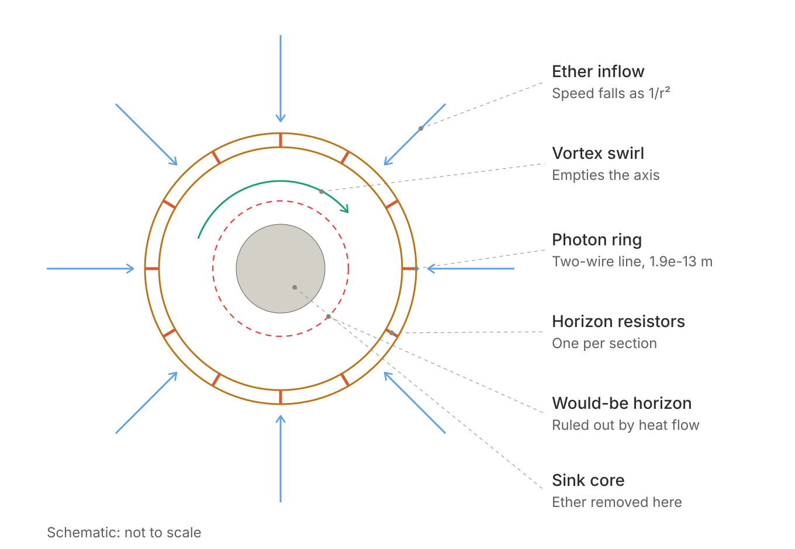
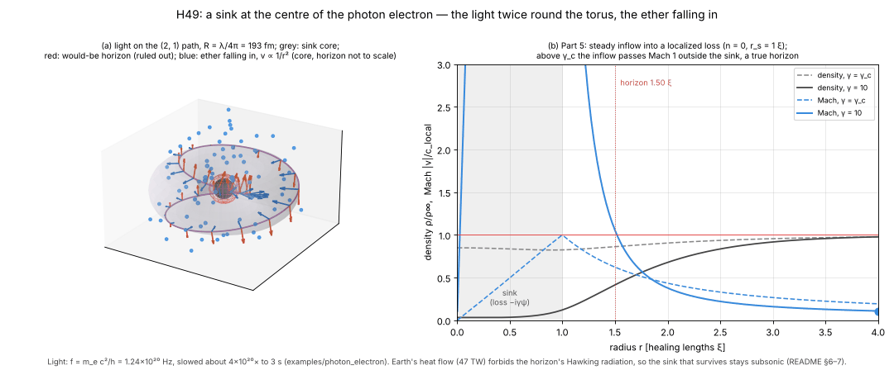
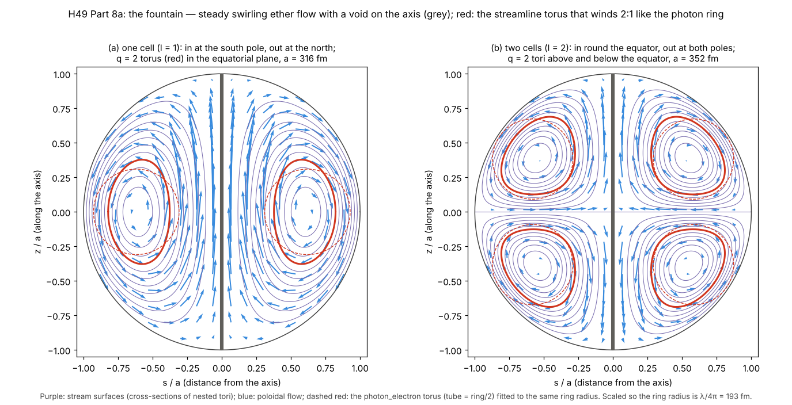
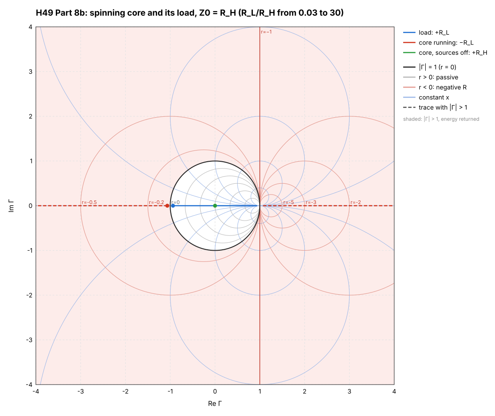

# Ether horizon: a void and a horizon in a nonlinear ether, on the photon electron (H49)

Hypothesis H49 (CLAUDE.md §1, user hypothesis 2026-11-13): a nonlinear
ether can open an empty void and a horizon, a region its waves cannot
leave. Tewari's void (H13) would be the empty core of a fast ether vortex.
An acoustic "dumb hole" would form where the ether flows in faster than its
own waves. Such a horizon at the centre of the photon electron (H23) would
act on its light ring as a resistor: the 377 Ω of the black-hole membrane.

Beside it: [ether_cavitation](../ether_cavitation) asks how
the ether *tears*. This example asks what a *swirl* empties, and what an
inflow hides.

```
go test -short ./examples/ether_horizon   # ~3 s
go test ./examples/ether_horizon          # ~9 s
go run ./examples/ether_horizon           # ~35 s, writes the tables below (run_output.txt)
```

Every result has its standard prediction beside it, and every joule its
column.

## Pictures



The setup, schematic and not to scale. Ether falls in from every side and
slows as 1/r². The vortex swirl empties the axis, and the sink core removes
ether. The photon ring is drawn as the two-wire line, with a horizon
resistor across each section. The dashed circle marks where a horizon would
form; Earth's heat flow rules it out (§6).



Part 8's pictures are `viz/fountain.png` (from `viz/plot_fountain.py`) and
`viz/spin_core_smith.svg|png` (written by the Go run).

`viz/plot_sink3d.py` draws the same thing in 3-D. It shows one period of
the photon electron's light on its (2, 1) path twice round the torus
(taken from `photon_electron/viz/plot_structure.py`), with the sink at the
centre and ether tracers falling in. Beside it is Part 5's steady inflow,
read from `viz/sink_profile.csv`. Regenerate both with:

```
go run ./examples/ether_horizon -viz examples/ether_horizon/viz
python3 examples/ether_horizon/viz/plot_sink3d.py
```

## 1. The void: a vortex in a Gross–Pitaevskii ether

The ether of [ether_knot](../ether_knot) (H29, H44) is a unit vector and
can never be empty. A void needs an order parameter that can vanish, so
here the ether is a superfluid (Gross–Pitaevskii). A straight vortex of
winding n has the profile equation

```
f'' + f'/ρ − n²f/ρ² + f − f³ = 0,     f(0) = 0,  f(∞) = 1,     ρ = r/ξ
```

with ξ = ħ/√(2mμ) the healing length. It is solved by Newton's method on
8,000 intervals out to 40 ξ.

| n | Axis: f ≈ c·ρⁿ | f(0) | Core (f² = ½) | Ergoregion (swirl = local wave speed) |
|---|---|---|---|---|
| 1 | c = 0.583185 | 0 | 1.555 ξ | 1.831 ξ |
| 2 | c = 0.153096 | 0 | 3.082 ξ | 3.594 ξ |
| 3 | c = 0.029455 | 0 | 4.542 ξ | 5.321 ξ |

Against the literature (n = 1): the axis slope 0.583185 against
0.5827811878 ([Rorai et al., arXiv:1212.6389](https://arxiv.org/abs/1212.6389));
the line energy is π(ħ²n0/m)·ln(1.464 R/ξ) against Fetter's ln(1.46 R/ξ)
(*Rev. Mod. Phys.* 81, 647, 2009).

**What the void is.** The density is exactly zero on the axis for every
winding n ≥ 1, and nowhere else. Below one quantum of circulation there is
no vortex and no void, so there is no threshold spin to find: the void
comes with the first quantum. But the void is a line one healing length
thick (a thin torus for a vortex ring), never the sphere of Tewari's
picture. The same vanishing that makes the void is what lets vortex knots
untie: all 1,458 simulated by Kleckner, Kauffman & Irvine (*Nature Phys.*
12, 650, 2016) did. So a void and the knot of H29/H44 pull against each
other.

## 2. The horizon

**A vortex alone has no horizon.** Its swirl outruns the local wave speed
inside the ergoregion (1.83 ξ for n = 1, just outside the core), but the
flow is all sideways, so waves can still leave radially. A horizon needs
a radial inflow faster than the waves: the draining bathtub,
v = (−A r̂ + B φ̂)/r (Visser, *Class. Quantum Grav.* 15, 1767, 1998), with
horizon r_h = A/c and ergosurface √(A² + B²)/c. The inflow needs a sink,
2πA·ρ0 of ether per unit length per second leaving the picture. That is a
ledger column the model has to name.

**A horizon radiates.** Its Hawking temperature is ħc/(2π k_B r_h) (Unruh,
*PRL* 46, 1351, 1981). If the ether's waves are light (c_ether = c):

| Horizon radius | T_H | Rest energy radiated in |
|---|---|---|
| Ring radius, 1.93×10⁻¹³ m | 1.89×10⁹ K (163 keV) | 2.4×10⁻²⁰ s |
| To last the age of the universe | | needs r_h ≥ 8.2×10⁵ m |
| To meet Borexino's τ ≥ 6.6×10²⁸ yr (*PRL* 115, 231802, 2015) | | needs r_h ≥ 1.8×10¹⁵ m |

The power is one thermal channel, π(k_B T)²/6ħ, the least a horizon can
emit, so the times are upper estimates. Bigger horizons are colder and
last longer.

## 3. The coupling: a horizon inside the photon ring

**General relativity, electron mass.** The horizon is fixed by the mass:

| | Value |
|---|---|
| Schwarzschild radius | 1.353×10⁻⁵⁷ m (8×10⁻²³ Planck lengths; ring radius 1.93×10⁻¹³ m) |
| Spin a/M, charge r_Q/M | 2.9×10⁴⁴, 2.0×10²¹: both ≫ 1, so Kerr–Newman has no horizon (naked) |
| If it had one | Hawking T = 1.4×10⁵³ K, gone in 6×10⁻¹⁰⁷ s |
| g | Carter (*Phys. Rev.* 174, 1559, 1968): Kerr–Newman g = 2 exactly; Dirac 2; measured 2.00231930436 (the anomaly is QED) |

**The ether horizon, radius free.** A horizon absorbs the ring's light at
a rate set by its size. Two estimates are computed:
- **Membrane paradigm.** The horizon is a sheet of resistance
  Z0 = 376.73 Ω (Thorne, Price & Macdonald 1986). In the ring's central
  field it takes (8π/3)r_h²·c·u, with u = m c²/V and V the sphere of
  diameter λ/2 that the photon_electron paper puts the field in (its eq. 5).
- **Page.** The exact low-frequency photon cross-section of a
  Schwarzschild hole, σ = (64π/3)(r_h/2)⁴(ω/c)² (Page 1976). It is smaller
  than the membrane estimate by (k r_h)²/2, the GR barrier.

| r_h [m] | Q_h membrane | Q_h Page | Ring absorbed in [s] | Hawking lifetime [s] |
|---|---|---|---|---|
| 10⁻³⁵ (Planck) | 2.9×10⁴⁵ | 8.6×10⁹⁰ | 3.7×10²⁴ | 6.5×10⁻⁶⁵ |
| 10⁻²⁸ | 2.9×10³¹ | 8.6×10⁶² | 3.7×10¹⁰ | 6.5×10⁻⁵¹ |
| 10⁻²⁰ | 2.9×10¹⁵ | 8.6×10³⁰ | 3.7×10⁻⁶ | 6.5×10⁻³⁵ |
| 1.93×10⁻¹³ (ring) | 7.8 | 62 | 1.0×10⁻²⁰ | 2.4×10⁻²⁰ |

**No window.** The ring keeps its light for the age of the universe only
if r_h ≤ 2.9×10⁻³² m (membrane) or 1.3×10⁻²² m (Page). The horizon
survives its own Hawking emission as long only if r_h ≥ 8.2×10⁵ m. So no
size meets both: the bounds miss by 37 orders (membrane) and 28 orders
(Page). A horizon small enough to spare the ring evaporates at once, and
one cold enough to last swallows the ring.

## 4. The circuit: the crossed ring line with a horizon resistor

This is photon_electron's crossed two-wire ring line (200 sections, its
720° double loop; the builder is copied so the two examples stay
independent). A horizon resistor is added across every section, sized
for a chosen Q_h. kronspice AC drives (a0, b0) with 1 A. The table
compares the peak (parabolic) and half-power Q with the ladder's complex
dispersion, Z_s·Y = −4 sin²(θ/2), and books the power at the peak.

| Q_h set | RH [Ω] | f AC [Hz] | f ladder [Hz] | Q AC | Q ladder | P_in [W] | Wires [W] | Horizon [W] | Residual |
|---|---|---|---|---|---|---|---|---|---|
| ∞ | — | 54,548.11 | 54,548.11 | 34.27 | 34.27 | 476.13 | 475.90 | 0 | 3.5×10⁻¹⁰ |
| 1000 | 2.78 MΩ | 54,548.50 | 54,548.50 | 33.14 | 33.14 | 460.36 | 444.89 | 15.26 | 4.6×10⁻¹⁰ |
| 100 | 278 kΩ | 54,551.40 | 54,551.40 | 25.53 | 25.53 | 354.68 | 264.01 | 90.54 | −2.4×10⁻¹⁰ |
| 30 | 83.4 kΩ | 54,553.80 | 54,553.79 | 16.02 | 16.00 | 222.37 | 103.76 | 118.55 | 9.4×10⁻¹¹ |

What the table shows:
- **Losses add.** 1/Q = 1/Q_wire + 1/Q_h.
- **The horizon has its own column.** Its share of the input power is
  Q/Q_h, and the split closes to 5×10⁻¹⁰ (the remainder is the two 1 MΩ
  bleeders).
- **Spin ½ is kept.** The resistors add loss but do not change the
  crossing, so the lowest mode still comes back inverted after one trip.
- **The frequency barely moves.** It shifts only at second order in the
  losses: 1.04×10⁻⁴ at Q_h = 30, about 1/(8·Q_wire·Q_h). At the physical
  Q_h of Part 3 (above 10³⁸ wherever the ring survives) the shift, and any
  change of g with it, is below 10⁻³⁸.

On the extended Smith chart (the `-smith` flag, when it is merged), the
horizon resistor can only pull the ring's trace inward. It is passive, and
it never pushes the trace outside the unit circle.

## 5. The sink: where the inflow comes from (`sink.go`)

A horizon needs ether flowing in faster than its own waves, and that
ether has to go somewhere. The simplest model is the one used for real
condensates with a localized loss, such as an electron beam that removes
atoms (Barontini et al., *PRL* 110, 035302, 2013): a term −iγψ inside a
radius r_s. The steady state is solved in Madelung form, with quantum
pressure kept:

```
a'' + a'/r = 2a(½v² + n²/2r² + a² − μ),    F' = −2γ r a²,    v = F/(r a²)
```

Here a = √ρ, v is the radial velocity and F = r·ρ·v. The solution is shot
from the axis to the far ether. Units: radii in ξ, γ in μ/ħ, flux in
ρ∞ħ/m per unit length. The local wave speed is a, so a horizon is where
|v|/a passes 1.

| n | r_s [ξ] | γ_c (Mach 1 at the edge) | Flux at γ_c | γ = 10: flux | Outer horizon [ξ] | Mach at edge |
|---|---|---|---|---|---|---|
| 0 | 0.5 | 2.649 | 1.817 | 2.148 | 1.073 | 6.0 |
| 0 | 1 | 1.275 | 3.328 | 1.882 | 1.519 | 9.9 |
| 0 | 2 | 0.600 | 6.145 | 2.544 | 2.548 | 11.4 |
| 0 | 5 | 0.216 | 13.95 | 4.574 | 5.580 | 13.3 |
| 1 | 0.5 | 1.565 | 0.050 | 0.268 | 0.812 | 6.8 |
| 1 | 1 | 1.340 | 0.582 | 1.160 | 1.529 | 10.4 |
| 1 | 2 | 0.840 | 3.499 | 2.064 | 2.559 | 12.3 |
| 1 | 5 | 0.257 | 13.21 | 4.348 | 5.585 | 13.6 |

- **A loss of about μ/ħ makes a true horizon.** Once γ passes γ_c, the
  inflow outruns the local wave speed outside the sink, in loss-free
  ether. The horizon stands 0.1 to 0.6 ξ beyond the sink's edge.
- **Weak sinks take ether in proportion.** The flux is 2γ·πr_s²·ρ∞
  (tested to 2×10⁻³).
- **Strong sinks take less.** Past the flux maximum the density is pushed
  out of the sink: the quantum Zeno effect of a localized loss.
- **A vortex starves a small sink.** Its axis is already empty, so at
  γ = 10 a 0.5 ξ sink takes 8× less with n = 1 than without the swirl.
- **The mass ledger closes.** Inflow from far away equals the loss inside
  to 10⁻⁷ at γ_c and to 10⁻⁵ at γ = 10.
- **Not yet tested: dynamical stability.** These are steady states.
  Whether they survive in time is the next run.

## 6. Where the ether goes: the sink's columns

Every particle that arrives brings the Bernoulli constant μ, so the sink
takes μ per particle. The column is ether destroyed, or turned into
something the model does not hold yet.

**Who pays the Hawking radiation.** In a sink flow, the flow does, as the
pump does in laboratory analogues. So Part 2's lifetime, which charged the
electron's rest energy, is not the bound. The radiation still leaves, and
matter at rest does not glow:

| | Value |
|---|---|
| Earth's heat flow (Davies & Davies, *Solid Earth* 1, 5, 2010) | 47 TW, already explained by radiogenic and primordial heat |
| Over Earth's 1.76×10⁵¹ electrons | ≤ 2.7×10⁻³⁸ W per electron |
| An electron-sized horizon emits | 3.4×10⁶ W |
| Smallest horizon under the bound | 2.2×10⁹ m |

Horizons that large around every electron would overlap through all
matter, and no ether wave (light, if c_ether = c) could leave a planet. A
sink electron must therefore stay **subsonic**: its core has to be larger
than the radius where the inflow would reach c. Then it has no horizon.

## 7. A sink electron seen from afar (`far.go`)

**Two sinks attract.** By the Lagally theorem, a sink swallowing ether in
another sink's inflow takes that inflow's momentum. The force is
ρe·Q1·Q2/(4π d²), towards the other sink. That is an inverse square where
like attracts like: gravity's sign, the opposite of Coulomb's. Two
electrons in fact repel 4.2×10⁴² times harder than they attract.

**Fitted to gravity.** Setting ρe·Q²/4π = G m_e² fixes the flux by the
ether density alone:

| ρe [kg/m³] | Q [m³/s] | Swallowed [kg/s] | Growth if kept [1/yr] | Energy column [W] | Horizon radius if point [m] |
|---|---|---|---|---|---|
| 1.2×10⁻³² | 2.4×10⁻¹⁹ | 2.9×10⁻⁵¹ | 1×10⁻¹³ | 2.6×10⁻³⁴ | 8×10⁻¹⁵ |
| 8.5×10⁻²⁷ (critical) | 2.9×10⁻²² | 2.4×10⁻⁴⁸ | 8.4×10⁻¹¹ | 2.2×10⁻³¹ | 2.8×10⁻¹⁶ |
| 10³ | 8.3×10⁻³⁷ | 8.3×10⁻³⁴ | 2.9×10⁴ | 7.5×10⁻¹⁷ | 1.5×10⁻²³ |
| 10¹⁷ | 8.3×10⁻⁴⁴ | 8.3×10⁻²⁷ | 2.9×10¹¹ | 7.5×10⁻¹⁰ | 4.7×10⁻²⁷ |

Where the swallowed ether goes decides which bound applies:
- **The swallowed ether stays.** Then every gravitating body, the Sun too,
  grows at √(4πGρe). Planetary ephemerides hold d(GM_sun)/dt/GM_sun to
  about 10⁻¹³ per year (Pitjeva & Pitjev, *Sol. Syst. Res.* 46, 78, 2012;
  *A&A* 647, A141, 2021), so ρe ≤ 1.2×10⁻³² kg/m³, about 1.4×10⁻⁶ of the
  critical density.
- **The ether is destroyed.** Then the energy column leaves the books.
- **It turns into heat.** Then the heat bound needs ρe ≤ 1.3×10⁻⁴⁰ kg/m³.

At every density listed, the point-sink horizon is below 10⁻¹⁴ m, inside
the ring radius. So a sink whose core is the photon ring is subsonic and
has no horizon.

**Antimatter.** A positron would be a sink too, since it gravitates.
ALPHA-g saw antihydrogen fall at 0.75 ± 0.13 ± 0.16 g (*Nature* 621, 716,
2023). That is consistent, not a test of sinks.

**kronspice twin.** Incompressible potential flow obeys Laplace's
equation, as a resistor lattice does: potential is voltage, flow is
current, continuity is KCL, and a sink is a current source drawing Q. In
a 21³ lattice with its faces at rest and one sink drawing Q = 1:
- **Continuity.** The inflow through the faces is 1.000000000000018.
- **Energy.** The sources' power equals the resistors' power, and the
  ledger closes.
- **Inverse square.** The inflow speed × 4πd² is 1.47, 1.28, 1.15, 1.10
  and 1.08 at d = 2…6 cells. It tends to the continuum's 1 apart from
  lattice discreteness near the sink, and the faces far from it.
- **The attraction.** A second sink at distance d takes ρe·Q2·v1, using
  the lattice's own v1.

## 8. The fountain: the ether circulates instead (`fountain.go`, `spin.go`, `part8.go`)

The sink of Part 5 destroys ether, which leaves a column the model cannot
name. Here the ether goes round instead: in round the equator, swirling,
out at the poles, and back round the outside.

### 8a. The flow

A steady, axisymmetric, swirling flow of an ideal ether obeys the
Bragg–Hawthorne equation (*J. Aeronaut. Sci.* 17, 243, 1950):

```
Δ*ψ = s²·H'(ψ) − C(ψ)·C'(ψ)
```

Here ψ is the Stokes stream function and C = s·u_φ is the swirl. Two
choices make it exactly solvable:
- **Constant Bernoulli head H.**
- **Swirl C = √(C0² + k²ψ²).** The right side is then −k²ψ, so the
  equation is linear: ψ = (kr)·j_l(kr)·Θ_l(θ), the Chandrasekhar–Kendall
  modes (*Astrophys. J.* 126, 457, 1957). The sphere r = a is a stream surface when
  j_l(ka) = 0.

C0 is a line vortex on the axis, whose core is the void of Part 1. Because
C depends on ψ², the swirl is the same above and below the equator.

| l | Flow | ka | Cell centre | Steadiness residual | Net flux through r = a/2 |
|---|---|---|---|---|---|
| 1 | One cell: in at the south pole, out at the north | 4.4934 | 0.611 a, equator | 1.8×10⁻⁸ | 6×10⁻¹⁶ |
| 2 | Two cells: in round the equator, out at both poles | 5.7635 | 0.672 a, 54.7° | 1.2×10⁻⁸ | 5×10⁻⁷ (quadrature) |



**Winding.** The streamlines lie on nested tori. Tracing them gives the
winding q: toroidal turns per turn round the tube. The photon electron's
(2, 1) path has q = 2.
- **Without the axis vortex there is no 2:1 surface.** Every surface winds
  less than once (q = 0.53–0.83). The void's swirl is what makes a q = 2
  surface.
- **Fitting the axis circulation.** Fitting β = C0/(kψ_O) so that the
  q = 2 surface has tube/ring = ½, as the photon torus does:

| l | β | Sphere radius for R = 193 fm | Where the 2:1 tori are |
|---|---|---|---|
| 1 | 1.512 | a = 316 fm | One ring, in the equatorial plane |
| 2 | 1.605 | a = 352 fm | Two rings, at z = ±0.388 a (±137 fm) |

That surface is a fit, one knob for one condition, not a prediction. Your
flow (l = 2) gives two tori, above and below the equator. The photon
electron's single equatorial ring sits on l = 1.

**The books.** Nothing is destroyed: the net flux through every sphere is
zero, and each cell carries 2πψ_O round. The energy is finite apart from
the axis vortex, which grows as ln(1/ξ) with the void radius ξ.

### 8b. The spinning core as a battery

In the membrane paradigm (Blandford & Znajek, *MNRAS* 179, 433, 1977;
Thorne, Price & Macdonald 1986), a spinning horizon threaded by field
lines is a generator:
- **The EMF** is ∝ Ω_H, the spin rate.
- **The internal resistance** R_H is the horizon.
- **The load** R_L is the jets, or here the photon ring.
- **The match.** Ω_F/Ω_H = R_L/(R_H + R_L), and the load gets the most
  power at R_L = R_H, where Ω_F = Ω_H/2.

In kronspice this is VSPIN + RH + RL, solved at its operating point:

| R_L/R_H | Ω_F/Ω_H | Load | Horizon | Spin | Γ_load | Γ_core (Z = −R_L) |
|---|---|---|---|---|---|---|
| 0.1 | 0.091 | 0.083 | 0.826 | 0.909 | −0.818 | −1.222 |
| 0.5 | 0.333 | 0.222 | 0.444 | 0.667 | −0.333 | −3 |
| 1 | 0.5 | **0.25** | 0.25 | 0.5 | 0 | ∞ |
| 2 | 0.667 | 0.222 | 0.111 | 0.333 | 0.333 | 3 |
| 10 | 0.909 | 0.083 | 0.008 | 0.091 | 0.818 | 1.222 |



**Two views of the same core.**
- **Sources off** (kronspice's network-analyser sweep): Z = +R_H, at the
  centre of the chart. The horizon is a resistor that absorbs.
- **At the operating point, seen from its load:** Z = −R_L, outside the
  unit circle, paid by the spin column. Every point meets
  Γ_core·Γ_load = 1, Kurokawa's condition for a steady state. At the match
  the core sits at Γ = ∞.

**Superradiance for the ring.** The ring's wave returns to itself only
after two trips, so its azimuthal number is m = ½. A spinning absorber
amplifies it when ω < mΩ (Zel'dovich, *JETP Lett.* 14, 180, 1971), which
needs Ω > 2ω_C = 1.55×10²¹ rad/s. The rim speed is c·r_c/R, below c for
any core smaller than the ring.

**But the spin runs out at once.** photon_electron's field solver gives
the ring Q = 0.55. A spin of ħ/2 at that rate holds only m_e c²/2. Through
a matched load it keeps the ring going for 1.8×10⁻²² s, about 0.02 of a
period. The electron is stable for more than 6.6×10²⁸ years, so the spin
would need resupplying from a column the model does not have yet.

## Status

H49 is **bounded**.
- **The void.** It exists in a Gross–Pitaevskii ether for any winding, but
  as a line one healing length thick, not a sphere. It needs the vanishing
  field that unties knots.
- **The horizon.** A vortex makes only an ergoregion. A true horizon needs
  an ether sink that is not booked.
- **The coupling.** Inside the photon ring, no ether horizon size both
  spares the ring and survives Hawking emission, by 28–37 orders.
- **The sink.** A localized loss of about μ/ħ makes a true acoustic
  horizon outside the sink in a Gross–Pitaevskii ether, with the mass
  ledger closed. But the Hawking radiation it pays for would break the
  heat bound unless the horizon is 2×10⁹ m wide. A sink electron must
  therefore be subsonic, with no horizon.
- **A sink electron from afar.** It attracts like gravity, not like
  charge. If it keeps the ether it swallows, ρe ≤ 1.2×10⁻³² kg/m³.
- **The fountain (Part 8).** Circulating instead of destroying closes the
  books exactly, and the void's axis vortex is what lets a streamline
  torus wind 2:1 like the photon ring. That torus is a fit, though, and
  the two-pole flow gives two tori, not one. A spinning core can feed the
  ring (−R at its load, +R_H in itself), but its spin is spent in 0.02 of
  a period.
- **General relativity.** The electron-mass hole is naked, and would
  evaporate in 10⁻¹⁰⁶ s if it were not.
- **Standard prediction.** No horizon or void inside the electron: a point
  particle to below 10⁻¹⁸ m, with g − 2 from QED.

Next steps:
1. Time-evolve the sink states, to test whether a supersonic inflow into
   a localized loss is stable.
2. A softened ether. Use the amplitude ether of ether_cavitation, so that
   the void and the knot can be tested in one field.
3. Hawking channels. Count them for a 2-D and 3-D horizon (the one-channel
   rate here is a floor).

## References

- W. G. Unruh, "Experimental black-hole evaporation?", *Phys. Rev. Lett.* 46, 1351 (1981).
- M. Visser, "Acoustic black holes: horizons, ergospheres and Hawking radiation", *Class. Quantum Grav.* 15, 1767 (1998), [gr-qc/9712010](https://arxiv.org/abs/gr-qc/9712010).
- K. S. Thorne, R. H. Price, D. A. Macdonald, *Black Holes: The Membrane Paradigm* (Yale, 1986).
- D. N. Page, *Phys. Rev. D* 13, 198 (1976); low-frequency spin-1 absorption, σ = (64π/3)G⁴M⁴ω²/c⁸, as quoted in [arXiv:2601.16717](https://arxiv.org/abs/2601.16717), App. B.
- B. Carter, "Global structure of the Kerr family of gravitational fields", *Phys. Rev.* 174, 1559 (1968).
- A. L. Fetter, "Rotating trapped Bose–Einstein condensates", *Rev. Mod. Phys.* 81, 647 (2009), [arXiv:0801.2952](https://arxiv.org/abs/0801.2952).
- S. L. Bragg, W. R. Hawthorne, "Some exact solutions of the flow through annular cascade actuator discs", *J. Aeronaut. Sci.* 17, 243 (1950).
- S. Chandrasekhar, P. C. Kendall, "On force-free magnetic fields", *Astrophys. J.* 126, 457 (1957); S. Chandrasekhar, *PNAS* 42, 1 (1956).
- R. D. Blandford, R. L. Znajek, "Electromagnetic extraction of energy from Kerr black holes", *MNRAS* 179, 433 (1977).
- Ya. B. Zel'dovich, "Generation of waves by a rotating body", *JETP Lett.* 14, 180 (1971).
- K. Kurokawa, *Bell Syst. Tech. J.* 48, 1937 (1969).
- C. Rorai, K. R. Sreenivasan, M. E. Fisher, "Propagating and annihilating vortex dipoles in the Gross-Pitaevskii equation", [arXiv:1212.6389](https://arxiv.org/abs/1212.6389) (axis slope 0.5827811878).
- D. Kleckner, L. H. Kauffman, W. T. M. Irvine, "How superfluid vortex knots untie", *Nature Phys.* 12, 650 (2016).
- Borexino Collaboration, "Test of electric charge conservation with Borexino", *Phys. Rev. Lett.* 115, 231802 (2015).
- J. G. Williamson, M. B. van der Mark, *Ann. Fond. Louis de Broglie* 22, 133 (1997) (the field volume, eq. 5).
- G. Barontini et al., "Controlling the dynamics of an open many-body quantum system with localized dissipation", *Phys. Rev. Lett.* 110, 035302 (2013).
- J. H. Davies, D. R. Davies, "Earth's surface heat flux", *Solid Earth* 1, 5 (2010): 47 ± 2 TW.
- E. V. Pitjeva, N. P. Pitjev, *Sol. Syst. Res.* 46, 78 (2012); E. V. Pitjeva et al., *Astron. Astrophys.* 647, A141 (2021): d(GM_sun)/dt.
- ALPHA Collaboration (E. K. Anderson et al.), "Observation of the effect of gravity on the motion of antimatter", *Nature* 621, 716 (2023).
- L. M. Milne-Thomson, *Theoretical Hydrodynamics* (Macmillan): Lagally's theorem for the force on sources and sinks.
