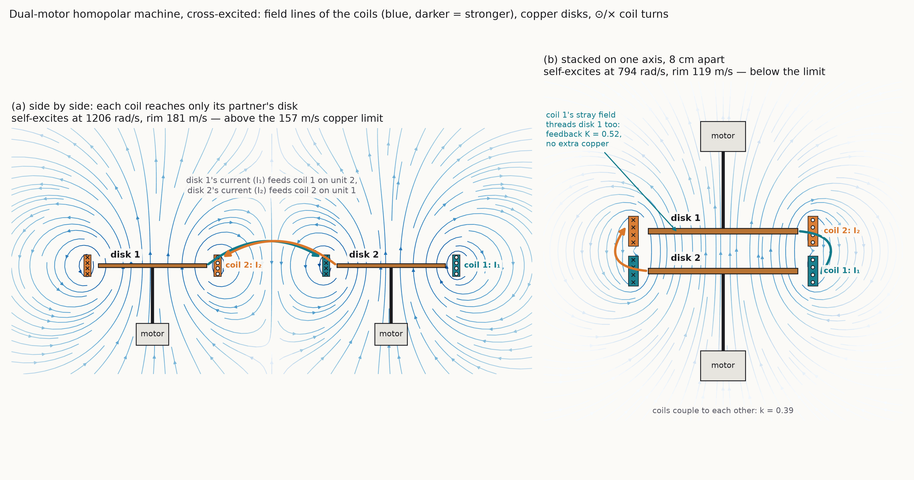
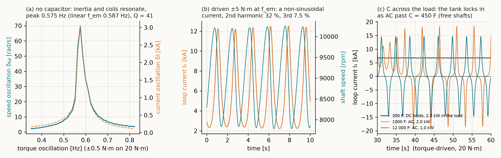
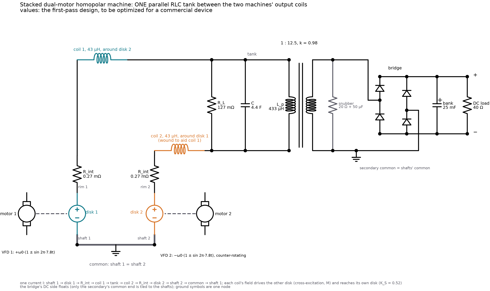

# Tesla's homopolar dynamo from the Lorentz force

Tesla's "Dynamo-Electric Machine," U.S. Patent 406,968 (1889): two
conducting disks on one shaft in fields of opposite polarity, joined at
their rims by a flexible metal belt, with the current taken from the two
shafts so no brush bears on a fast rim. The example derives the disk's EMF
from the Lorentz force by grade selection (CLAUDE.md §3f, milestone M9n),
builds the machine from kronspice's N machine element, compares Tesla's
two-disk arrangement with a single disk and a rim brush, and evolves the
two-disk machine for efficiency at a required output. The versions with
the current through the shaft bearings are in
[homopolar_bearing](../homopolar_bearing); the self-excited twin-disk case
of H15 is in [eckardt_homopolar](../eckardt_homopolar).

```
go run ./examples/homopolar [-gens 20] [-pop 30] [-p 2000]
go run ./examples/homopolar -dual        # stop after the dual-motor machine
go test ./examples/homopolar
```

## The construction

A disk spinning at ω in an axial field B carries its charges at
v = ω×r. The force q(v×B), the grade-1 part of ⟨F·Q†⟩ (`em.LorentzGA`),
pushes them radially, so the disk is a source of EMF between axle and rim.
`em.MotionalEMF` integrates v×B along a radius and must equal

```
EMF = ½ B ω (r_o² − r_i²)
```

In the circuit each disk is one N element with two windings, the disk's
radial path and the field winding (driven at 1 A, the field strength in
the coupling), and one speed-matrix entry K = ½·B·(r_o² − r_i²). The
element gives the speed voltage ω·K·i_f in the disk and the torque
K·i_disk·i_f on the shaft. Each shaft is a mechanical node driven at ω, so
the ledger books the shaft power as inflow and shows it leaving as heat in
the load, the disks, the belt and the contacts.

Reference design: 15 cm copper disks, 5 mm thick, 1 cm axle, 0.8 T,
3000 r/min, 10 mΩ load. Contact and belt resistances (50 µΩ shaft, 500 µΩ
rim brush, 100 µΩ belt) are declared, illustrative inputs, not measured.

## Results

| | Two disks, belt (Tesla) | Single disk, rim brush |
|---|---|---|
| EMF per disk, Lorentz force | 2.8149 V | 2.8149 V |
| ½Bω(r_o² − r_i²) | 2.8149 V | 2.8149 V |
| Disk spreading resistance | 1.45 µΩ | 1.45 µΩ |
| Load | 5.5178 V, 3044.6 W | 2.6678 V, 711.7 W |
| Shaft (ledger inflow) | 3106.4 W, torques 4.94 + 4.94 N·m | 750.9 W, torque 2.39 N·m |
| Efficiency | 0.9801 | 0.9477 |
| Ledger residual | 0 | 0 |

The two disks' EMFs add (open circuit: 2 × EMF at the terminals, to 1e-6),
and the belt costs far less than a brush on a rim moving at 47 m/s, so the
two-disk machine puts more than four times the power into the same load.

The tests check that the Lorentz EMF equals the formula to 1e-12, that the
shaft power from the ledger equals Σ torque·ω to 1e-9, that the torque per
disk is K·I with I = 2·EMF/R_total, and that the ledger residual is below
1e-12.

**Evolved** (genes: outer radius, thickness, field up to 1.5 T, load) for
at least 2 kW with the least loss, 20 generations of 30, seed 1 (562
evaluations): r_o 0.361 m, 6.8 mm thick, 1.22 T, 1 Ω load, giving
24.93 V per disk, 2485 W into the load from 2486 W at the shaft,
efficiency 0.9998.

## The dual motor: cross-excited, with feedback coils (`dual.go`)

The same copper disks without magnets: each disk on its own motor, its
current running through the field coil of the other unit (Rikitake's
cross-excitation, as in [earth_machine](../earth_machine)), and each unit
with a feedback coil carrying its own current (the feedback inductor of
paper107, §14.5.2.3). Everything comes from the geometry: the coupling
M = ω-EMF per ampere is the coil's flux through the disk annulus over 2π
(`em.MutualCircles` averaged over the turns), L is Nagaoka's, R the copper
of a 4-turn coil in a 6 cm × 2 cm window. Liquid-metal shaft contacts (5 µΩ),
the motor rotors and the coupling of two coils on one former (k = 0.95)
are declared.

| | Side by side | Stacked on one axis, 8 cm apart |
|---|---|---|
| coupling M, own former | 2.196×10⁻⁷ V·s/A | 2.196×10⁻⁷ V·s/A |
| coil's stray coupling to its own disk | — (a feedback coil buys it with copper) | 0.519 M, free |
| coil–coil mutual | — | 3.77 µH (k = 0.39) |
| self-excitation threshold | 1206 rad/s, rim 181 m/s (K = 0); 1180 rad/s with K = 1 | 794 rad/s, rim 119 m/s |
| against the copper hoop limit (157 m/s, 220 MPa declared) | above | below |

A feedback coil side by side adds coupling and its own resistance in
proportion, so the threshold hardly moves (K = −0.5 raises it to 3566 rad/s).
Stacking gives each disk its own coil's stray field for nothing: a built-in
K = 0.52, and the only layout whose threshold is below the burst speed.
With both shafts held at one speed (speed drives), the field grows at
exactly (−R + (1+K)·M·ω)/(l11 + l12) in both layouts (engine against exact, 10⁻³).

Driven by torque (20 N·m each), Rikitake's μ = R·√(J/(G·M·L)) is 9.5: the
machine excites itself and settles to a steady 8 kA field; stacked it runs at
135 m/s on the rim, side by side at 206 m/s (past the limit). Reversals,
the earth_machine behaviour, need μ ≈ 1: 1800 N·m and 4.7 MW at the shafts,
16 reversals in 11.5 s (mean 0.63 s) side by side, at a rim past the limit;
with a feedback coil or stacked (both K > 0) the field locks to one polarity.
The motors pay for every joule; the ledger closes to 10⁻⁹–10⁻⁶ of the drive
work. Start-up overshoots the running speed (the motors spin the disks before
the field takes the load), so a real machine starts on its speed drives.



## Resonance and harmonics, and what a load needs (`resonance.go`)

The stacked machine with a 50 µΩ load in each loop and bearing and air
friction of 5×10⁻³ N·m·s (both declared). At 20 N·m it settles at
ω* = R/M_s = 944 rad/s (rim 142 m/s, under the 157 m/s limit), 6.77 kA per
loop, 2.29 kW into each load from 18.9 kW per motor.

**A homopolar loop alone cannot resonate**: R and L, one kind of stored
energy. A resonance needs a second store, and the machine has one: the
shafts. An inertia is a capacitor on the mechanical channel, and the speed
coupling joins it to the coils, so the self-excited machine is an L–J
oscillator. At the steady state the loop's net resistance −R + M_s·ω* is
zero, so to first order the load does not damp it; only friction does:

```
f_em = √(2·M_s·G/(L_s·J)) / 2π = 0.587 Hz,   Q = J·2πf_em/b = 41
```

| Oscillating speed by | Result |
|---|---|
| torque ±0.5 N·m (±2.5 %), swept | resonance at 0.575 Hz (softened from 0.587 by the drive), δω 50–70 rad/s against 1.6 at half the frequency; circuit = RK4 to 0.2 %, ledger 2×10⁻⁸ |
| torque ±0.5 / ±2 / ±5 N·m at f_em | harmonics of the loop current (of the fundamental): 2nd 15 / 24 / 32 %, 3rd 2.6 / 4.3 / 7.5 %, 4th ≤ 2.5 %; no reversal. At ±5 N·m the speed peaks at 10 200 rpm, right at the copper limit |
| speed drives ±30 %, no capacitor | the field's growth rate (−2.3 1/s at 0.9 ω*) does not depend on the oscillation frequency: no resonance, the loop is first order |
| speed drives ±30 %, capacitor across the load | slow oscillations (f_p ≲ f0) lift the field because the speed spends part of each cycle above the AC onset; faster ones average out: the tank resonance is the machine's own and needs no speed swing to start |



**Does a load need a capacitor, an inductor or both?** By the RLC rule a
resonance needs two stores and a loss. The capacitor goes **across the load**
(in parallel): DC still reaches the load, the capacitor's ESR stays out of the
DC path, and the load and C make a parallel tank fed by the coils.

- **Inductance is already there**: the coils, 13.5 µH per loop with the
  stacked mutual. An added series L lowers the frequency but raises √(L/C),
  so it needs more C: only worth it to place f0, never to lock the resonance in.
- **The capacitor locks the resonance in.** With the shafts held at a speed,
  the loop obeys L·C·s² + (L/R_L + r·C)·s + (1 + r/R_L) = 0 (r = R_int − M_s·ω).
  It oscillates at the tank before it settles to DC once C > L/R_L², i.e. the
  tank's Q = R_L/√(L/C) > 1: 5400 F here (1.8 cells of 3000 F). With free,
  torque-driven shafts the inertia joins the tank and the DC state gives way
  at C ≈ 450 F (bisection, from 1 % off the DC state):

| C across each load | tank f0 | Q | outcome | loop current | load |
|---|---|---|---|---|---|
| 30 F | 7.9 Hz | 0.07 | DC | 6.77 kA | 2.29 kW |
| 300 F | 2.5 Hz | 0.24 | DC | 6.77 kA | 2.29 kW |
| 1000 F | 1.37 Hz | 0.43 | AC | ±7.6 kA at 0.22 Hz, 3rd harmonic 66 % | 2.03 kW |
| 3000 F | 0.79 Hz | 0.75 | AC | ±8.0 kA at 0.23 Hz, 3rd 59 % | 1.83 kW |
| 12 000 F | 0.40 Hz | 1.49 | AC | ±8.5 kA at 0.27 Hz, 3rd 37 % | 1.00 kW |
| 24 000 F | 0.28 Hz | 2.11 | AC | ±7.3 kA at 0.14 Hz, 3rd 78 % | 0.67 kW |

  Locked in, the machine is an AC generator below both the tank and f_em:
  the loop current reverses every half cycle (the field flips like a clock),
  rich in the 3rd harmonic. It gives the load less, because much of the AC
  circulates between the coils and the capacitor, heating the ESR and the
  coils. A larger load resistance needs less C (C ∝ 1/R_L²) but raises the
  DC threshold speed. The circuit (load and C as their own elements, with
  the ESR, declared 0.29 mΩ per 3000 F cell) matches the RK4 equations to
  0.6 %, and the ledger closes to 10⁻⁸.
- **Neither** is needed for the resonance in A: the inertia already plays the
  capacitor, tuned by the torque, the inertia and L.

Every watt in the load, the coils and the oscillation is paid by the motors
or the speed drives.

### Faster speed oscillation, how high the resonance goes, and 7.8 Hz

**A faster rpm swing does not let the capacitor shrink.** Shafts held at
0.95 ω* and swung ±h at f_p from 0.25 to 4 f0 (ESR = 0.87 s / C, the time
constant of a 3000 F cell); the rim limit allows h ≤ 0.16:

| C across each load | tank f0 | Q | best growth, h = 0.16 | h = 0.5 (past the rim) |
|---|---|---|---|---|
| 3000 F | 0.79 Hz | 0.75 | +0.17 1/s at f0/4 | +2.40 at f0/4 |
| 1000 F | 1.37 Hz | 0.43 | −0.64 | +1.61 at f0/4 |
| 300 F | 2.50 Hz | 0.24 | −0.85 | −0.85 |
| 100 F | 4.33 Hz | 0.14 | −1.14 | −0.93 |
| 30 F | 7.91 Hz | 0.07 | −1.27 | −1.28 |

A smaller C raises f0, but the load damps the tank at 1/(R_L·C), faster than
f0 rises: Q = R_L·√(C/L) falls as √C. Where the field grows, the best pump is
slow (f0/4). The speed spends part of each cycle above the onset, a
quasi-static gain, not a resonance.

**How high the resonance can go.** These ceilings hold for this copper
machine; going higher needs a lower-L design with a stronger coupling M.

- **Tank:** Q ≥ q needs R_L ≥ q·2πf0·L, and the rim limit caps R_L at
  M_s·ω_burst − R_int = 84 µΩ. So f0 ≤ 0.99 Hz with the speed held (Q ≥ 1),
  and f0 ≤ 3.4 Hz with free shafts (Q ≥ 0.29).
- **Drives:** a rim-safe swing (±148 rad/s at 0.95 ω*) takes J·Δω·2πf of
  torque per shaft: 52 N·m at 1 Hz, 516 N·m at 10 Hz, 5.2 kN·m at 100 Hz.
- **No capacitor:** f_em ∝ √(G/J) gives 0.59 Hz at 20 N·m, 1.9 Hz at
  200 N·m and 5.9 Hz at 2000 N·m, for 19 kW, 190 kW and 1.9 MW per shaft.

**The shafts oscillated at 7.8 Hz, the first Schumann frequency.** A
rim-safe ±101 rad/s about ω* takes ±274 N·m per shaft. It gives a forced,
not resonant, ±346 A at 7.8 Hz on the 6.5 kA DC, which is
M_s·I·δω/(2πf·L_s) exactly. Its harmonics are 1.4 % and 0.5 %, and the load
gets only 3 W at 7.8 Hz. The circuit equals RK4 and the ledger closes to
4×10⁻⁹.

Resonance at 7.8 Hz needs either a 31 F tank (Q = 0.07, overdamped) or an
f_em of 7.8 Hz (3.5 kN·m, 3.3 MW per shaft); neither fits this machine.

As a source for the Earth's Schumann cavity, the two coils are a 282 A·m²
magnetic dipole at 7.8 Hz. Its field falls as μ0·m/(4π·r³) and stays above the
natural Schumann field (about 1 pT) only within 300 m. It radiates
6×10⁻²² W at a 38,000 km wavelength. The cavity is driven by about 50
lightning strokes a second, each kiloamperes over kilometres. This machine
is a local 7.8 Hz magnet, not a Schumann source.

### rpm = 1768·(1 ± h·sin 2π·7.8 t): the shafts following the Schumann sine (`rpm_schumann.go`)

The speed drives impose the profile; "+" on both shafts is in phase, "+"
and "−" antiphase. For a self-excited loop at a held speed,
L_s·İ = (−R + M_s·ω(t))·I integrates to

```
I(t) ∝ exp((M_s·ω0 − R)/L_s · t) · exp(−β·cos 2πft),   β = M_s·ω0·h / (L_s·2πf)
```

**The field grows or decays at the mean speed's rate, whatever the depth h.**
The sine only ripples it, with harmonics 2·Iₙ(β)/I0(β) (modified Bessel
functions).

- **Copper machine, air coils:** it self-excites at 9014 rpm, so at
  1768 rpm the field decays at −18.7 1/s, for h = 0, 0.5 and 1 alike. Nothing
  builds.
- **The same disks with an iron magnetic circuit** (gain k = 5.10, declared,
  chosen so that 1768 rpm is the onset): L_s = 69 µH, R/L_s = 4.57 1/s. The
  mean field on the disk reaches 1.6 T at 10.5 kA. In phase the mean growth
  is zero and the field carries a 7.8 Hz ripple of 2·I1(β)/I0(β): 0.0093,
  0.047 and 0.093 of the DC at h = 0.1, 0.5 and 1. RK4 and the circuit both
  agree with the exact value to 3×10⁻⁴, and the ledger closes to 3×10⁻⁹.
- **Antiphase:** the two speeds sum to a constant, the symmetric mode sees
  almost no oscillation, and the field decays slightly (−0.04 1/s at h = 1).
- **A capacitor across the load** tuned to 7.8 Hz (6 F) or 3.9 Hz (24 F) has
  Q = 0.015–0.03 and changes nothing.
- **Drives:** ±50 N·m at h = 0.1, ±503 N·m at h = 1 (J·ω0·h·2πf). Up to
  186 kW is swapped with the rotor every cycle, so the drives must be
  four-quadrant (regenerative).

**DC amps and AC amps out.** At 10 kA DC per loop (the level is set by how far
the field has built):

| h | DC | AC at 7.8 Hz | at 15.6 Hz | load DC | load AC | AC share |
|---|---|---|---|---|---|---|
| 0.1 | 10 kA | 93 A peak (66 A rms) | 0.2 A | 5.0 kW | 0.2 W | 0.004 % |
| 0.5 | 10 kA | 466 A (330 A rms) | 5.4 A | 5.0 kW | 5.4 W | 0.11 % |
| 1 | 10 kA | 932 A (659 A rms) | 22 A | 5.0 kW | 22 W | 0.43 % |

The coils' L/R time (0.22 s) is long against 1/(2π·7.8) s, so they smooth
the sine. A larger AC share needs a larger β: more R/L_s (which raises the
onset speed) or a slower sine.

DC and AC leave on the same conductors. Taking the AC out separately needs a
branch that blocks DC:

- a series capacitor to an AC load, with C ≫ 1/(2π·7.8·R_ac), about 4000 F
  for a 50 µΩ AC load;
- or a transformer, whose core the DC would saturate unless its flux is
  cancelled.

### One RLC tank between the two machines' coils, a transformer and a rectifier (`output_tank.go`)

One current runs shaft 1 → disk 1 → R_int → coil 1 → R_L ∥ C ∥ L_p → coil 2 →
R_int → disk 2 → shaft 2 (`Dual.Output = OutSeries`). The two shafts are the
common (ground). Shaft 2 counter-rotates and coil 2 is wound to aid coil 1;
co-rotating, the two disks' EMFs cancel round the loop. L_p is the primary
of one transformer (1 : 12.5). Its secondary has its common end tied to the
shafts' common and feeds an AC load, or a bridge (DC side floating) into a
capacitor bank. With one current this is a series self-excited dynamo at
the per-machine onset; the two-loop Rikitake mode is gone. `OutPerLoop` and
`OutShared` (both machines across one tank in parallel) remain, with tests.

The output is conjugate-matched to each machine's 7.8 Hz source impedance.
The tank is two per-machine tanks in series: R_L 127 mΩ, C 4.4 F,
L_p 433 µH, a 25 mF bank and a 40 Ω DC load.

- **G:** the speed sine pumps the field, so it holds at 1337 rpm mean (h = 1).
  At 10 kA, 5.6 kW goes to R_L and 5.3 kW to the AC load (secondary 470 V
  peak).
- **H:** raising the tank Q raises the circulating current (up to 15 kA at
  Q = 30), not the power that crosses the transformer. Rectified, the bank
  holds 449 V and feeds 5.1 kW to the DC load. The engine ledger closes to
  4×10⁻⁸.

### Ball bearings at the rims and an adjustable feedback (`bearing_rim.go`)

Each disk's rim current goes through a ball-bearing bank (P element, measured
0.73 V drop and damage limit, Huber κψ swept) in the series loop. The
bearing drop is a fixed voltage, so at fixed feedback the loop has one
unstable equilibrium current, I* = 2·V_b/(2·M_s·ω − R).

- **The copper machine** cannot reach I* below 2× its onset speed. At 10 kA
  its bearings would run at 404× their damage limit. No copper field coil
  can excite itself at a bearing's current: 1.6 T costs 37 kW per coil
  against 82 W made per disk.
- **The bearing-matched design** uses superconducting field coils of 2438
  turns, set to 19.8 A (0.8 × the rim bank's 24.8 A limit). A PI regulator
  on the adjustable feedback K_v starts it from a 7.4 A pulse and holds the
  set current at 1.6 T: 102 W to the load, 29 W in the bearings, from
  131.5 W at the drives.
- **Huber torque, EM mode:** it leaves the regulated drive torque unchanged.
  Thermal mode returns ≤ 10 % of the bearing heat.

Run `go run ./examples/homopolar -rim` for this part alone. Section 6 of
[REPORT.md](REPORT.md) has the details.

[REPORT.md](REPORT.md) has the full write-up, and the schematic is below.
The values are a first pass, to be optimized for a commercial device.



## Files

| File | What it holds |
|---|---|
| `main.go` | `Design`, the Lorentz EMF, the N-element circuit, the GA problem |
| `main_test.go` | EMF formula, open-circuit sum, torque, ledger, single-disk comparison, short GA run |
| `dual.go` | the dual motor: couplings from the geometry, side-by-side and stacked circuits, RK4 twin, `runDual` |
| `dual_test.go` | threshold growth = exact (both layouts), circuit = RK4 with feedback coils and stacked, ledger, stacked below burst |
| `viz/plot_dual.py` | the layouts figure (field lines from the exact loop field) |
| `resonance.go`, `resonance_test.go` | load and a capacitor across it in the stacked loops, torque or speed oscillation, electromechanical resonance, tank lock-in (bisection), harmonics; `-data DIR` writes the figure data |
| `viz/plot_resonance.py` | the resonance figure |
| `rpm_schumann.go` | rpm = 1768·(1 ± h·sin 2π·7.8t): mean-speed rule, iron variant at its onset, exact Bessel ripple, DC and AC out |
| `output_tank.go`, `output_tank_test.go` | one R_L ∥ C ∥ L_p between the machines' coils (shafts common, shaft 2 counter-rotating, secondary common on the shafts), conjugate match, steady mean speed, tank-Q sweep, bridge into a capacitor bank; tests: series and shared circuits = RK4, each = the per-loop tanks, co-rotating decay, difference mode, rectifier ledger |
| `bearing_rim.go`, `bearing_rim_test.go` | rim ball-bearing banks (P elements, Hertz-scaled damage limit), the unstable equilibrium current, the superconducting bearing-matched design, the PI regulator on the adjustable feedback, Huber κψ swept in EM and thermal modes; tests: Hertz scaling, engine = RK4 with P elements, instability, regulated set point and books, no Huber gain |
| `viz/plot_schematic.py` | the schematic (schemdraw) |
| `REPORT.md` | the dual-motor report |
| `export_test.go` | netlists, KiCad schematics and results sheets in `export/` |

## Sources

- N. Tesla, "Dynamo-Electric Machine," U.S. Patent 406,968, 1889 (`reference/`).
- P. Joot, *Geometric Algebra for Electrical Engineers*, Theorem 3.16 (Lorentz force and power by grade selection; reference only, see CLAUDE.md §3f).
- G. Kron, *Equivalent Circuits of Electric Machinery*, Wiley 1951, Epilogue eq. 9 (the speed-voltage tensor G).
- `doc/M9n.md` for the milestone record.
