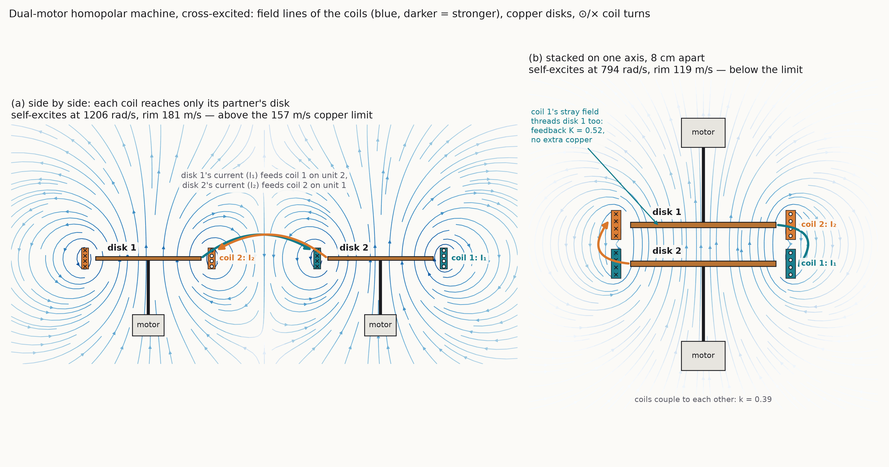
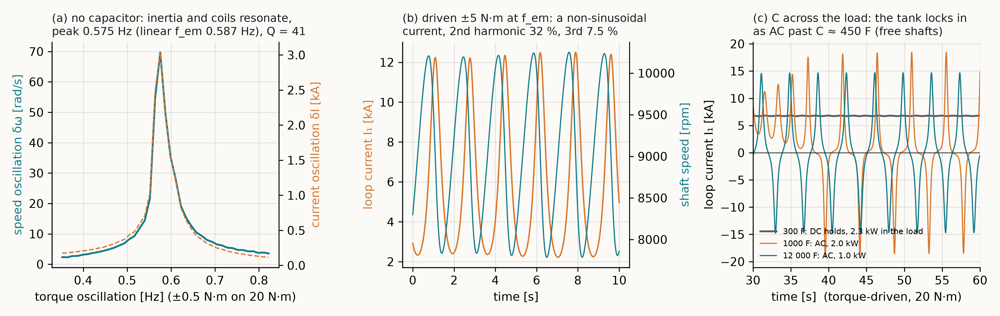
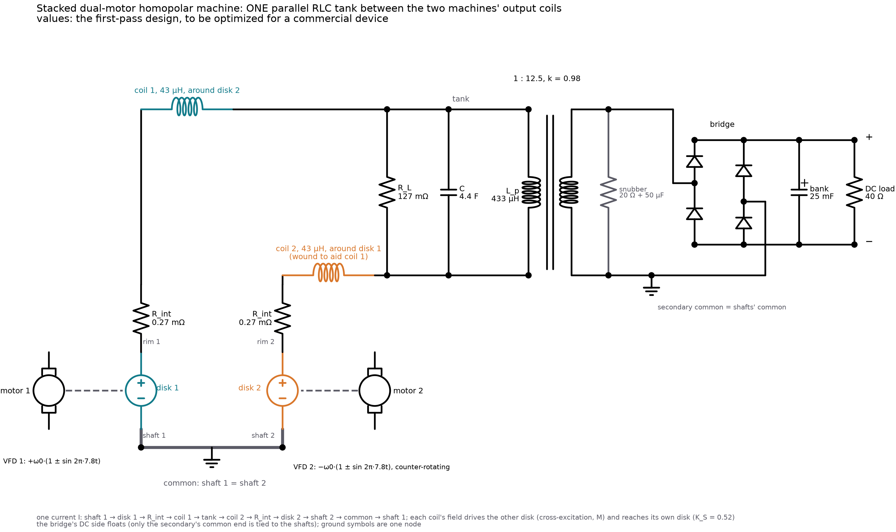

# Report: the stacked dual-motor homopolar machine with an RLC tank between its coils

This report collects the results of the dual-motor work in this example
(`dual.go`, `resonance.go`, `rpm_schumann.go`, `output_tank.go`). It covers
three things:

- the cross-excited copper machine;
- the speed made to oscillate at the first Schumann frequency;
- one parallel RLC tank between the two machines' output coils, with a
  transformer and a rectifier into a capacitor bank for DC loads.

Every number below comes from `go run ./examples/homopolar -dual` and is
checked by `go test ./examples/homopolar`.

> **Note on the values.** The component values in this report and in the
> schematic are a first-pass design, chosen to show the circuit working and
> to close the energy ledger: the coils, iron gain, tank, transformer ratio,
> rectifier, bank and loads. **They will be optimized later for a commercial
> device.** That later work covers ratings, losses, cost, size and the
> saturation, insulation and thermal limits of real parts.

## 1. The machine

There are two copper disks: r_o = 0.15 m, 5 mm thick, on one axis 8 cm
apart. Each disk turns on its own shaft, driven by its own motor and speed
drive (VFD). There are no magnets. Each disk's current runs through a field
coil wound around the *other* disk, so the two loops excite each other
(Rikitake's cross-excitation, as in [earth_machine](../earth_machine)).

What stacking does:

- Each coil's stray field also reaches its own disk. This is a built-in
  self-coupling K_S = 0.52, with no extra copper.
- The two coils couple to each other with k = 0.39.
- The self-excitation threshold falls to 794 rad/s (rim 119 m/s), below the
  copper hoop limit of 157 m/s. Side by side it is 1206 rad/s (181 m/s),
  above the limit.

All couplings come from the geometry: `em.MutualCircles` over the coil
turns, and Nagaoka's formula for L. Every joule of field, heat and output
is paid by the two motors, and the ledger closes to 10⁻⁹–10⁻⁶ of the drive
work.



## 2. Resonance and the load (parts A–E)

- **A. Without a capacitor**, the shafts' inertia is the second energy
  store. With L and J the machine resonates on its own at
  f_em = √(2·M_s·G/(L_s·J))/2π = 0.587 Hz, with Q = 41 at 20 N·m. Driven
  hard, it makes harmonics, because the speed EMF M·ω·I and the torque M·I²
  are products.
- **B–C. A capacitor across the load** (in parallel, not in series) forms a
  tank with the coils, and DC still reaches the load.
  - With the shafts held at speed, the tank locks in when
    C > L/R_L² = 5401 F.
  - With free shafts the inertia joins in, and it locks in at C ≈ 454 F.
  - Locked in, the machine becomes an AC generator at 0.14–0.27 Hz.
- **D. A faster speed oscillation does not buy a smaller capacitor.** The
  load damps the tank at a rate of 1/(R_L·C), and that rises faster than
  the tank frequency f0. For this copper machine the resonance can reach
  about 1–3 Hz electrically and a few hertz mechanically.
- **E. At 7.8 Hz with free shafts** the speed swing is a forced response,
  ±346 A on 6.5 kA. It is not a resonance. As a magnetic dipole the machine
  is a local 7.8 Hz magnet and does not feed the Schumann cavity.



## 3. rpm = 1768·(1 ± h·sin 2π·7.8t) (part F)

The speed drives impose the profile. For a self-excited loop:

```
I(t) ∝ exp((M_s·ω0 − R)/L_s · t) · exp(−β·cos 2πft),   β = M_s·ω0·h/(L_s·2πf)
```

**The mean speed decides growth.** The sine only ripples the field, with
harmonics 2·Iₙ(β)/I₀(β).

- **Air coils:** the machine excites itself at 9014 rpm, so at 1768 rpm the
  field decays at −18.7 1/s, whatever h is.
- **Iron magnetic circuit** (gain 5.10, declared, chosen so that 1768 rpm
  is the onset): the ripple is 0.093 of the DC at h = 1, equal to the exact
  Bessel value to 3×10⁻⁴.

DC amps and AC amps leave on the same conductors. At 10 kA DC and h = 1 the
AC is 932 A peak at 7.8 Hz, which is 0.43 % of the load power.

## 4. One parallel RLC tank between the machines' coils (part G)

One current runs through both machines and the tank:

```
shaft 1 → disk 1 → rim 1 → R_int → coil 1 → [ R_L ∥ C ∥ L_p ] → coil 2 → R_int → rim 2 → disk 2 → shaft 2 → common → shaft 1
```

- **Common:** the two shafts are tied together and grounded. A homopolar
  disk's EMF is between its axle and its rim, so the axles are the natural
  common node.
- **Tank:** one R_L ∥ C ∥ L_p sits between the output ends of coil 1 and
  coil 2. L_p is the primary of one transformer.
- **Secondary:** its common end is tied to the shafts' common. The bridge's
  DC side floats, so the bank is not shorted.
- **Counter-rotation:** going round the loop, disk 2 is traversed rim to
  axle. Its EMF adds to disk 1's only if shaft 2 turns the opposite way and
  coil 2 is wound to aid coil 1. Co-rotating, the two EMFs cancel, and the
  current decays as a plain R–L loop (test: −1.0 1/s, matching
  −2(R_int + R_p)/(2(L + M_c) + 2L_p) to 5 %). Counter-rotation also leaves
  the pair with no net spin.
- **One current, one mode:** this is a series self-excited dynamo with the
  same onset per machine. There is no second (difference) mode, so the
  two-loop Rikitake dynamics, reversals included, does not occur in this
  connection.



**Design (first pass).**

- The iron gain is 4.45, set so the DC onset with the primary carrying the
  DC (R_p = 10 µΩ declared) is 1768 rpm.
- At 7.8 Hz each machine is a source with R_s = 0.275 mΩ behind
  X_s = 2.945 mΩ (L_s = 60 µH). The output is conjugate-matched to it.
- The tank Q is chosen as 3. The coils and the output then form a series
  RLC at 7.8 Hz with Q ≈ 5.4: the output is underdamped.

| Element | Per machine | The one tank between the coils |
|---|---|---|
| R_L | 63.7 mΩ | 127 mΩ |
| C | 8.79 F | 4.40 F |
| L_p (primary) | 216.5 µH | 433 µH |
| transformer | 1 : 12.5, k = 0.98 | 1 : 12.5, k = 0.98 |
| AC load R_ac | 10 Ω | 20 Ω |

The tank is the two per-machine tanks in series, so it gives each machine
exactly what its own tank would. The test checks this to 10⁻⁹. It also
checks that the circuit (machine elements, coils, tank, transformer)
matches the RK4 twin, and that I2 = −I1 at every step.

**Parametric pumping.** With the matched output the 7.8 Hz speed sine pumps
the field: at x = 1 it grows. The steady state is the mean speed at which
the field neither grows nor decays. Both shafts follow
|ω| = 1768·x·(1 + h·sin 2π·7.8t), shaft 2 in the opposite direction. Scaled
to a 10 kA loop current:

| h | steady mean rpm | loop AC | primary AC | R_L | secondary | R_ac |
|---|---|---|---|---|---|---|
| 0.1 | 1758 | 1043 A | 295 A | 150 W | 76 V / 3.8 A | 144 W |
| 0.5 | 1592 | 4306 A | 1218 A | 2.55 kW | 316 V / 15.8 A | 2.45 kW |
| 1.0 | 1337 | 6359 A | 1799 A | 5.56 kW | 470 V / 23.5 A | 5.34 kW |

The tank's voltage is the sum of both machines', so at the same turns ratio
the secondary runs at twice the voltage and half the current of the
shared-tank version. The power is the same.

The work of the speed sine enters through the drives and pays for the AC
outputs and part of the DC field. That is why the field holds below the DC
onset. The circuit matches RK4 (21 666 A against 21 669 A), and the ledger
closes to 10⁻⁶ of the drive work. The primary carries the loop's 10 kA DC
(21.7 kJ stored at 433 µH), so its core needs an air gap or a cancelled DC
flux.

## 5. The circulating current and the rectified DC output (part H)

The current circulating between C and L_p rises with the tank Q:

| Tank Q | L_p | C | primary AC | secondary | AC power out |
|---|---|---|---|---|---|
| 1 | 1299 µH | 3.75 F | 659 A | 23.0 A | 10.8 kW |
| 3 | 433 µH | 4.40 F | 1799 A | 23.1 A | 10.9 kW |
| 10 | 130 µH | 6.64 F | 5833 A | 22.8 A | 10.6 kW |
| 30 | 43.3 µH | 13.1 F | 15 176 A | 19.8 A | 8.0 kW |

**Maximizing the circulating current does not maximize what crosses the
transformer.** The circulating part is the primary's magnetizing current
and stays in the tank. Only the in-phase (load) part reaches the secondary,
and the match sets it, at most EMF²/(8·R_s) per machine. The circulating
current sizes the tank's copper and the capacitor's ripple rating. The
secondary current sizes the rectifier.

**Rectifier into a bank.** The Q = 3 design is run with one bridge, a
25 mF bank (pre-charged to 400 V) and a 40 Ω DC load, at the steady speed
x = 0.756 with h = 1. The secondary's common end is on the shafts' common:

- At an 8.8 kA loop current the bank holds 396 V, with a ripple of
  33 V p-p at 15.6 Hz, and the DC load takes 3.9 kW.
- Scaled to 10 kA, that is 449 V and 5.1 kW.
- The engine's ledger, including diode and bank losses, closes to 4×10⁻⁸ of
  the drive work.

The bridge is nonlinear, so only the engine models it. Its check is the
ledger.

## 6. Where the energy comes from

Every watt at the outputs comes from the two motors and their speed drives:

- **DC field:** paid by the mean shaft torque.
- **AC and rectified DC:** paid by the 7.8 Hz work of the drives. The drives
  swap up to 186 kW with the rotors every cycle at h = 1, so they must be
  four-quadrant (regenerative).

The neutrino and other unmodeled channels are zero. No step adds energy:
not the stacking, the resonance, the tank Q nor the transformer.

## 7. Declared inputs

All of these are illustrative, not measured:

- liquid-metal shaft contacts, 5 µΩ;
- motor rotor inertia;
- windage, 5×10⁻³ N·m·s;
- copper hoop strength, 220 MPa;
- iron gain: 5.10 in part F, 4.45 in part G;
- usable iron flux density, 1.6 T;
- primary winding, 10 µΩ, and transformer coupling, k = 0.98;
- tank Q = 3;
- AC load, 10 Ω per machine;
- secondary winding, 0.05 Ω per machine;
- snubber, 10 Ω + 100 µF per machine;
- diode model (I_s 10⁻⁹ A, n 1.5, r_s 2 mΩ);
- bank, 50 mF per machine, pre-charged to 200 V;
- DC load, 20 Ω per machine.

The one tank between the coils is two per-machine tanks in series: twice
each impedance and half each capacitance (R_ac 20 Ω, secondary 0.1 Ω,
snubber 20 Ω + 50 µF, bank 25 mF at 400 V, DC load 40 Ω). The same code also
builds a tank per machine and one tank shared in parallel by both machines
(`Dual.Output`), with tests for each.
**These values will be optimized later for a commercial device.**

## 8. Reproducing

```
go run ./examples/homopolar -dual                 # all parts, A–H
go test ./examples/homopolar                      # twins, ledgers, the three output connections
python examples/homopolar/viz/plot_schematic.py   # the schematic (schemdraw, matplotlib)
```
