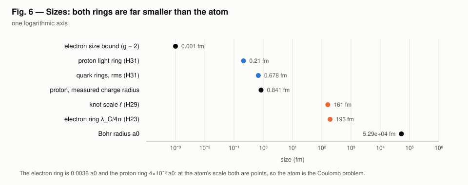
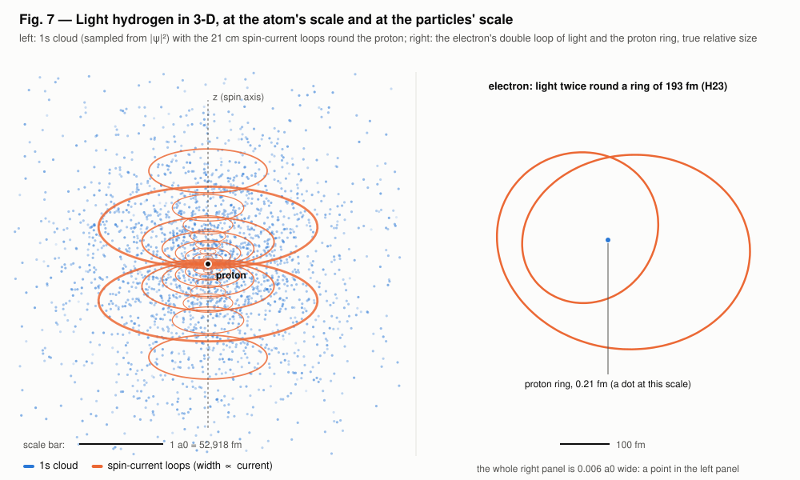
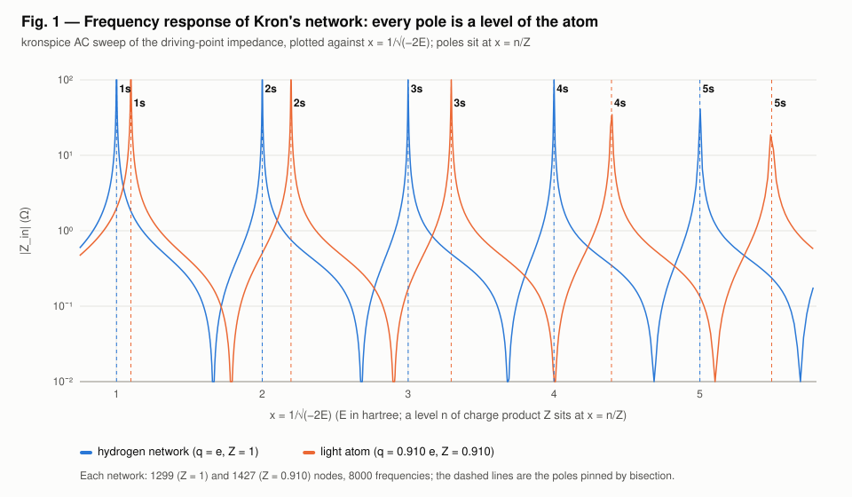
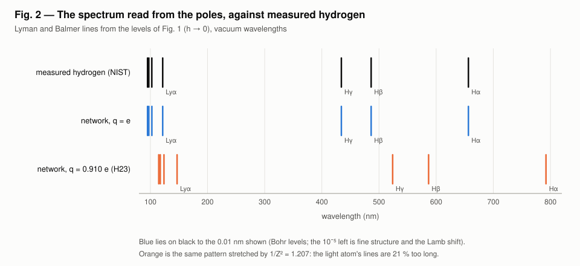
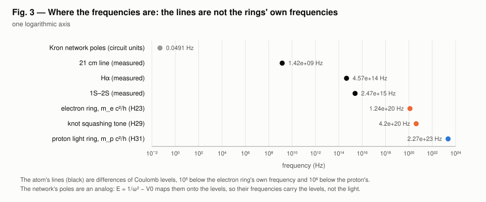
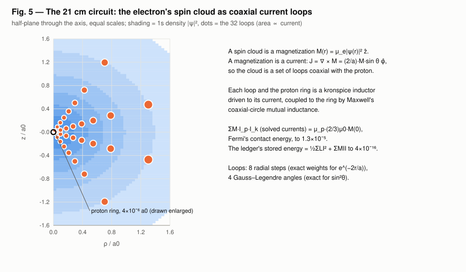
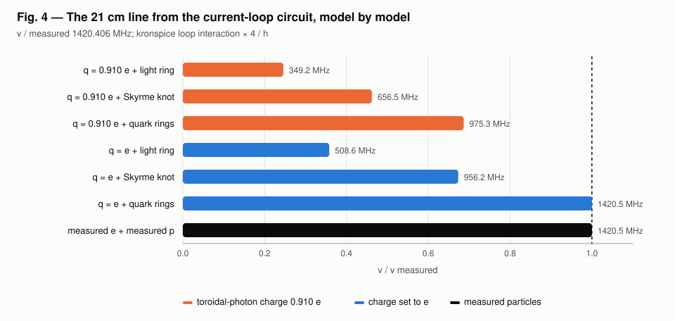

# Light hydrogen: report (H32)

The question this report answers: **does the spectral analysis match the
frequency response of the whole light-hydrogen model?**

**Yes.** The frequency response contains the spectrum. Each energy level of the atom is a pole of
the network's frequency response. The poles agree with the network's own
eigenvalues to every printed digit. Extrapolated to a fine network, they
reach the exact levels to 3×10⁻⁶. Their differences reproduce measured
hydrogen's Lyman and Balmer lines to the 0.01 nm listed, and 1S–2S to
13 ppm.

What the lines match depends on the electron's charge:
- **Charge set to e:** the lines match measured hydrogen.
- **The toroidal photon's own charge, 0.910 e:** the same response gives every line 1.207 times too long. The atom also carries a net charge of 0.090 e.

Three limits on that "yes":
- **The poles are an analog.** The network's frequencies stand for energies through E = 1/ω² − V0; they are not the light the atom emits.
- **The rings' own frequencies are not in the spectrum.** The electron ring's (1.24×10²⁰ Hz) and the proton ring's (2.27×10²³ Hz) sit far above every line (Fig. 3).
- **The 21 cm line is not a resonance of this network.** It is a magnetic interaction energy, computed by a separate circuit (Fig. 4, Fig. 5).

```
go run ./examples/light_hydrogen -svg examples/light_hydrogen/viz   # about 40 s; writes the figures below
```

An interactive 3-D view of Fig. 7 (rotate and zoom: the atom, the 2p_z
state, the particles) is in the repository as
[viz/atom3d.html](viz/atom3d.html); open it in a browser after cloning (it
loads three.js from cdnjs). A hosted copy is at https://claude.ai/artifact/Hb8rksK7WtBHxBkM31ESD4.
The figures here are SVG, drawn by `figures.go` and `atom3d.go` with the
standard library only.

## 1. The model

| Part | From | What it contributes |
|---|---|---|
| Electron | `photon_electron` (H23): one Compton wavelength of light twice round a 193 fm ring | charge 0.910 e, g = 2(1 + α′/2π) |
| Proton | `nucleon_circuits` (H31): light ring (0.21 fm, 1 μN), quark rings (2.793 μN, 0.678 fm) or Skyrme knot (1.880 μN) | charge, moment, size |
| Confinement | `knotted_light`, `ether_knot` (H29) | the knot that would hold the electron's light |
| Binding | Kron's 1945 Schrödinger network, a radial ladder in kronspice | the levels |
| 21 cm line | the electron's spin cloud as coaxial current loops round the proton ring, in kronspice | the hyperfine splitting |



Both rings are far smaller than the atom: 0.0036 a0 and 4×10⁻⁶ a0. At the
atom's scale they are point charges and point moments, so the binding is
the Coulomb problem with charge product Z = q_e·q_p/e².



## 2. The frequency response of the whole network

Kron's network for s states is a ladder:
- series branches carry the kinetic energy;
- shunt branches carry the potential −Z/r;
- capacitors carry the energy;
- the wave function is the node voltage.

In the dual form that kronspice's AC analysis can solve, the network's admittance vanishes at ω² = 1/(E + V0). So every state of the atom is a pole of the driving-point impedance, and the ground state is the highest-frequency pole.

The whole network was swept:
- 8,000 frequencies;
- 1,299 nodes for Z = 1, 1,427 nodes for Z = 0.910;
- a 1 A source at r = 1 a0.



Each pole was then pinned by bisection on the sign of the reactance. Two
networks (spacing 0.1 and 0.05 a0) were extrapolated to zero spacing:

| n | Pole, h = 0.1 | Network matrix, h = 0.1 | Pole, h → 0 | Exact −Z²/2n² | Difference |
|---|---|---|---|---|---|
| 1 | −0.498 756 2112 | −0.498 756 2112 | −0.499 998 4496 | −0.5 | −3.1×10⁻⁶ |
| 2 | −0.124 921 9725 | −0.124 921 9725 | −0.124 999 9756 | −0.125 | −1.9×10⁻⁷ |
| 3 | −0.055 540 1320 | −0.055 540 1320 | −0.055 555 5534 | −0.055 555 5556 | −3.9×10⁻⁸ |
| 4 | −0.031 245 1187 | −0.031 245 1187 | −0.031 249 9996 | −0.031 25 | −1.2×10⁻⁸ |
| 5 | −0.019 998 0004 | −0.019 998 0004 | −0.019 999 9999 | −0.02 | −5.2×10⁻⁹ |

The energies are in hartree, Z = 1. For Z = 0.910 the same holds, with every level scaled by Z².

**What the table shows:**
- **Circuit = matrix:** the circuit's poles equal the network matrix's eigenvalues to all ten digits.
- **Zero-spacing limit:** the extrapolated levels reach the exact levels.

## 3. The spectrum read from the poles

The lines are differences of the extrapolated levels. Non-relativistic Coulomb levels depend on n alone, so the s levels also fix the Lyman lines (np → 1s).

| Line | Measured (NIST, vacuum) | q = e, from the poles | Difference | q = 0.910 e, from the poles |
|---|---|---|---|---|
| Lyman α | 121.57 nm | 121.5689 | −0.001 | 146.7019 |
| Lyman β | 102.57 nm | 102.5737 | +0.004 | 123.7797 |
| Lyman γ | 97.25 nm | 97.2551 | +0.005 | 117.3615 |
| Lyman δ | 94.97 nm | 94.9757 | +0.006 | 114.6108 |
| Hα | 656.46 nm | 656.4698 | +0.010 | 792.1882 |
| Hβ | 486.27 nm | 486.2739 | +0.004 | 586.8061 |
| Hγ | 434.17 nm | 434.1731 | +0.003 | 523.9340 |



1S–2S from the poles is 2466.0284 THz, against the measured 2466.061 413 187 THz (Parthey et al. 2011, ±10 Hz). The model is 13.4 ppm low:
- **About 9 ppm** is what the Bohr levels leave out: fine structure and the Lamb shift, the Dirac and QED part.
- **About 4 ppm** is the extrapolation.

With the toroidal photon's charge, 1S–2S is 2043.5 THz. That is 17 % low, the factor Z² = 0.829.

## 4. Where the frequencies are



The atom's lines lie between 10⁹ Hz (21 cm) and 10¹⁵ Hz (Lyman). The
model's own internal frequencies are far above them:
- the electron ring, m_e c²/h = 1.24×10²⁰ Hz;
- the knot's squashing tone, 4.2×10²⁰ Hz;
- the proton ring, m_p c²/h = 2.27×10²³ Hz.

The spectrum comes from the Coulomb binding between the parts, not from the parts' internal oscillation. The network's poles sit at 0.05 Hz in circuit units: they are an analog, carrying the levels through E = 1/ω² − V0.

## 5. The 21 cm line

The electron's spin, spread over the 1s cloud, is a magnetization. A
magnetization is a current, so the cloud is a set of coaxial loops round
the proton ring:
- **Loops:** 32 of them, with exact quadrature weights.
- **Interaction:** the sum of mutual inductance × proton current × loop current, from kronspice's solved currents, equals Fermi's contact energy to 1.3×10⁻⁵. The ledger's stored energy equals ½ΣLI² + ΣMII to 4×10⁻¹⁶.
- **Spin ½:** the splitting is four times the aligned/anti-aligned energy, because spin ½ couples through S·S, not S_z·S_z.





| Model | 21 cm line | / measured |
|---|---|---|
| q = 0.910 e + light ring | 349.2 MHz | 0.246 |
| q = 0.910 e + Skyrme knot | 656.5 MHz | 0.462 |
| q = 0.910 e + quark rings | 975.3 MHz | 0.687 |
| q = e + light ring | 508.6 MHz | 0.358 |
| q = e + Skyrme knot | 956.2 MHz | 0.673 |
| q = e + quark rings | 1420.5 MHz | 1.000 07 |
| measured electron + proton | 1420.5 MHz | 1.000 07 |
| **Measured** | 1420.405 751 768 MHz | 1 |

The 0.007 % left on the standard row is the Breit, recoil and proton-structure terms beyond Fermi's formula. The quark-ring proton matches only because its moment was fitted to the measured one.

## 6. Results against measurement

| Test | Light atom, q = 0.910 e | Light atom, q = e | Measured |
|---|---|---|---|
| Net charge | +0.090 e | 0 | < 10⁻²¹ e |
| Lyman α | 146.70 nm | 121.569 nm | 121.567 nm |
| 1S–2S, proton-size shift (light-ring proton) | −0.93 MHz | −0.91 MHz | known to 10 Hz |
| 1S–2S, proton-size shift (quark-ring proton) | −0.54 MHz | −0.34 MHz | known to 10 Hz |
| 21 cm (light-ring proton) | 349 MHz | 509 MHz | 1420.406 MHz |
| Electron excited state from the knot | 2.25 MeV | 2.25 MeV | none seen |

**What the light model gets right.** The frequency-response structure: a Coulomb atom whose poles are Bohr's levels. With the charge set to e, the line positions are right to the precision of the Bohr formula.

**What it gets wrong:**
- **The charge:** at 0.910 e the atom is not neutral, and every line is 21 % too long.
- **The proton's moment:** the light-ring proton gives a 21 cm line at 36 % of the measured one.
- **The proton's size:** ring and quark-ring protons both miss 1S–2S by tenths of a MHz, against a 10 Hz measurement.
- **Confinement:** the electron's light still has no confinement that experiment allows. The knot that would hold it predicts an excited electron at 2.25 MeV, which has not been seen.

**Standard prediction:** the Dirac electron with QED and the measured proton. It gives every measured column, including the 9 ppm and the 0.007 % that the Bohr and Fermi formulas leave out.

H32 is recorded as *bounded* in the register.

## Sources

- J. G. Williamson, M. B. van der Mark, *Ann. Fond. Louis de Broglie* 22,
  133 (1997).
- G. Kron, *Phys. Rev.* 67, 39 (1945).
- E. Fermi, *Z. Phys.* 60, 320 (1930); M. I. Eides, H. Grotch,
  V. A. Shelyuto, *Phys. Rep.* 342, 63 (2001).
- C. G. Parthey et al., *Phys. Rev. Lett.* 107, 203001 (2011);
  H. Hellwig et al., *IEEE Trans. Instrum. Meas.* 19, 200 (1970);
  G. Bressi et al., *Phys. Rev. A* 83, 052101 (2011).
- NIST Atomic Spectra Database (line wavelengths); CODATA 2022; PDG 2024.
- G. S. Adkins, C. R. Nappi, E. Witten, *Nucl. Phys. B* 228, 552 (1983);
  L. Faddeev, A. J. Niemi, *Nature* 387, 58 (1997).
