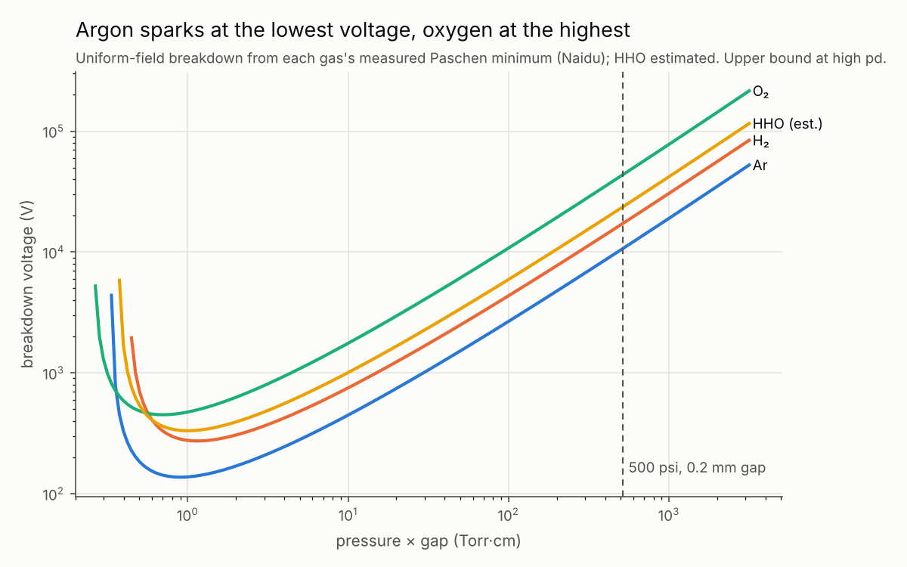
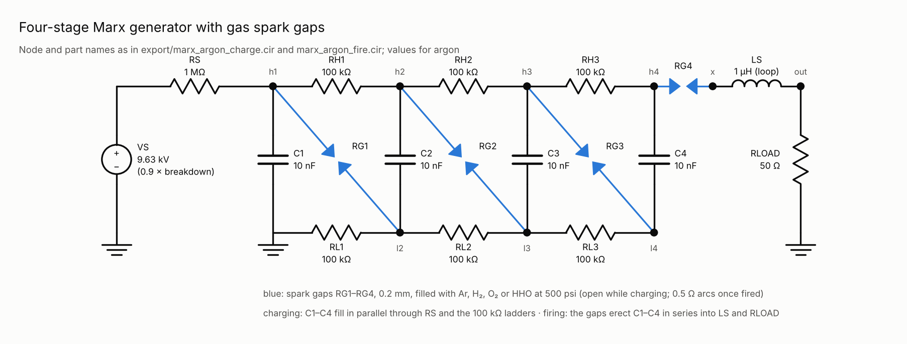
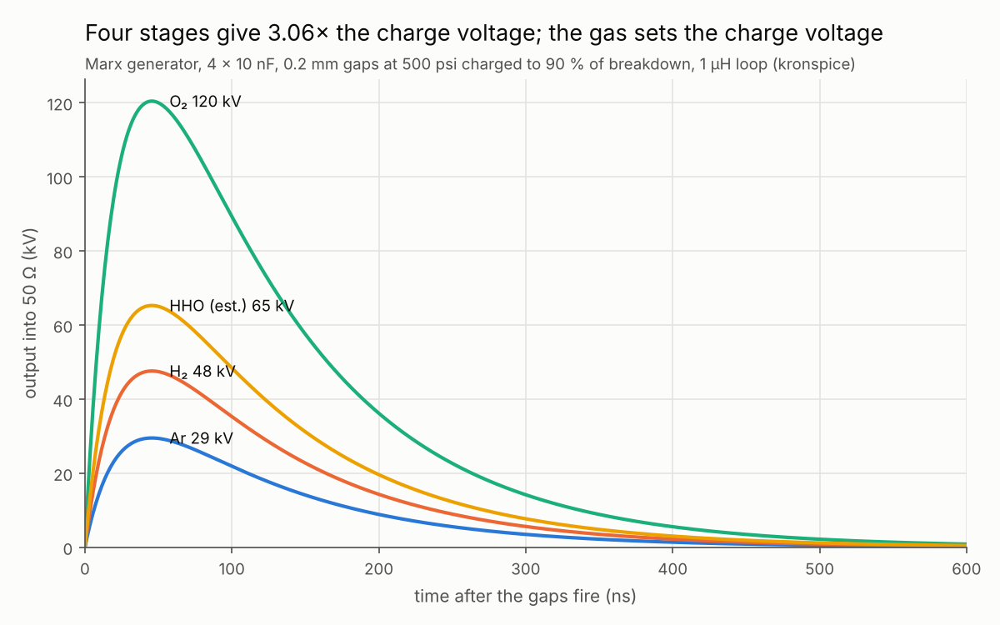
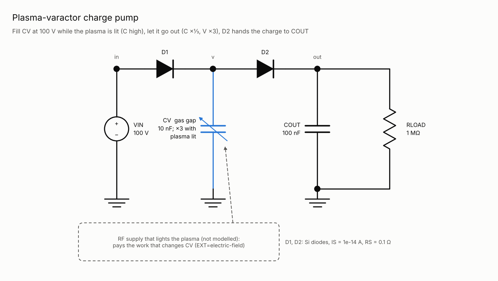
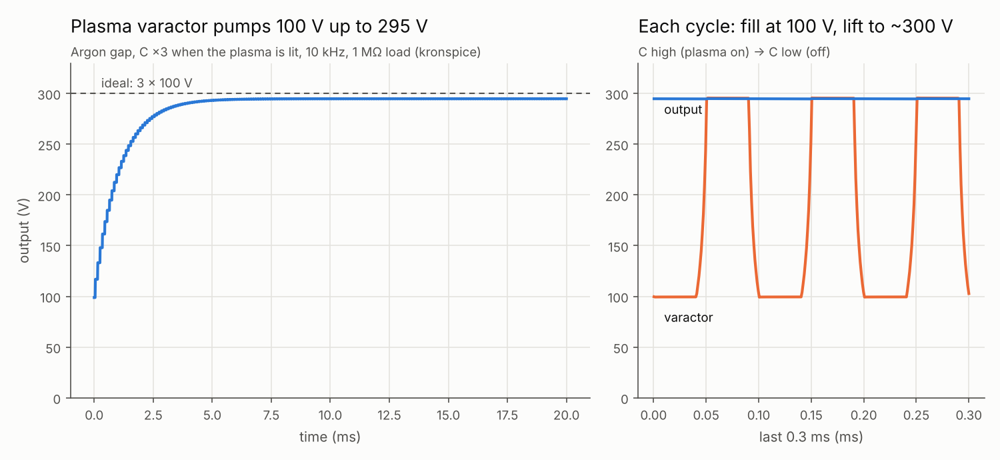

# Magnetic gas: argon, hydrogen, oxygen and HHO at 500 psi, sparked into pulses

Can a gas be made magnetic by tearing an electron off it, compressed to
500 psi, sparked, and used to make pulses? This example works through
that chain with argon as the main case, and hydrogen, oxygen and
oxyhydrogen (HHO, 2 H₂ : 1 O₂) beside it. It asks six things:
- how hard each gas is to spark;
- how magnetic each gas is, and what removing an electron changes;
- what field it takes to hold the gas;
- what compressing it costs and risks;
- what a four-stage Marx generator makes from gaps of each gas;
- what a plasma varactor charge pump makes from argon.

The ECE2 terms (H48) run beside the standard prediction.

Gas-discharge physics is outside the engine (CLAUDE.md §1, non-goals). So
the gas enters the circuits the way that section allows: as a cited
breakdown threshold, and as a declared time-varying capacitance. kronspice
has no switch element yet. So each spark circuit runs in two phases, before
and after the gaps fire, and `IC=` values carry the state across.

```
go run ./examples/magnetic_gas                                            # a few seconds
go test ./examples/magnetic_gas
go run ./cmd/kronspice examples/magnetic_gas/export/marx_argon_fire.cir   # any exported netlist

# charts
go run ./examples/magnetic_gas -viz examples/magnetic_gas/viz/data > examples/magnetic_gas/run_output.txt
python3 examples/magnetic_gas/viz/plot.py
python3 examples/magnetic_gas/viz/schematic.py   # circuit schematics
```

The pressure is taken as 500 psi absolute: 3.447 MPa, 34.02 atm,
25,857 Torr. 500 psig would be 35.0 atm.

## 1. Breakdown voltage

The model uses the Townsend criterion, written through each gas's measured
Paschen minimum. With x = pd / pd_min it reads V = V_min·x / (1 + ln x),
using V_min and pd_min from Naidu & Kamaraju. Every gas is treated by the
same rule, with only two measured numbers each.

| Gas | Paschen minimum | at pd (Torr·cm) | 0.2 mm, 1 atm | 0.2 mm, 500 psi | 1 mm, 500 psi |
|---|---|---|---|---|---|
| **Ar** | **137 V** | **0.90** | **605 V** | **10.7 kV** | **43.9 kV** |
| H₂ | 273 V | 1.15 | 1.01 kV | 17.3 kV | 70.4 kV |
| O₂ | 450 V | 0.70 | 2.40 kV | 43.7 kV | 180 kV |
| HHO (estimate) | 332 V | 1.00 | 1.36 kV | 23.7 kV | 96.9 kV |



- Argon sparks at the lowest voltage, which makes it the easiest gas to
  ionize in a gap. Oxygen holds the most.
- **The 500 psi column is an upper bound.** Applied to air at 1 cm and
  1 atm, the same rule gives 53.4 kV, against about 30 kV measured
  (1.78× high at large pd). Measured gaps also fall below Paschen's law
  above about 10 bar.
- As a cross-check, Raizer's Townsend coefficients give argon 12.9 kV and
  hydrogen 10.6 kV at 0.2 mm and 500 psi. Treat the column as good to
  within a factor of about 2.
- No measured Paschen curve was found for HHO. Its two numbers are
  mole-weighted from H₂ and O₂ and labelled as an estimate everywhere.

## 2. Magnetism: what removing an electron does

SI volume susceptibility χ (M = χH). Pull/weight is the magnetic force
over the gas's own weight in a 100 T²/m gradient, which a strong
laboratory magnet gives.

| Gas | χ at 1 atm | χ at 500 psi | Pull/weight |
|---|---|---|---|
| **Ar** | **−1.0×10⁻⁸** | **−3.5×10⁻⁷** | **−0.05 (pushed out)** |
| H₂ | −2.1×10⁻⁹ | −7.1×10⁻⁸ | −0.20 |
| O₂ | +1.8×10⁻⁶ | +6.1×10⁻⁵ | +11 (lifted) |
| HHO | +6.0×10⁻⁷ | +2.0×10⁻⁵ | +9.7 |

- **Argon does turn paramagnetic** when an electron is removed. Ar⁺ has
  one hole in its 3p shell (²P₃/₂, μ_eff = 2.58 μ_B). Fully ionized at room
  temperature, its χ goes from −3.5×10⁻⁷ to +6.6×10⁻⁵, 189× larger and of
  the other sign. That is an upper bound: at a realistic 1 eV it is
  +1.7×10⁻⁶, and at 1 % ionization the gas stays diamagnetic. Hydrogen
  behaves the same way (H₂⁺ has one unpaired electron).
- **Oxygen goes the other way.** O₂ already has two unpaired electrons,
  and O₂⁺ has one. Ionizing oxygen makes it less magnetic, not more.
- HHO is paramagnetic through its oxygen alone.
- A plasma's free electrons add a small paramagnetic part: spin minus
  Landau, ⅔·μ₀nμ_B²/kT. Confined by a field, though, the plasma acts as a
  diamagnet as a whole (pressure balance, next part).

## 3. Compression: the field, the heat and the energy

| B | Magnetic pressure B²/2μ₀ |
|---|---|
| 1 T | 3.93 atm (57.7 psi) |
| 3 T | 35.3 atm (519 psi) |
| 10 T | 393 atm (5,771 psi) |
| 100 T | 39,300 atm |

- **To hold the 500 psi fill takes 2.94 T cold** (β = 1). Heated to 1 eV,
  the same sealed fill reaches 1,360 atm at 1 % ionization (18.6 T to
  hold) and 2,690 atm fully ionized (26.2 T).
- A field can steer and confine the plasma, but at 500 psi it has to be a
  very strong one. A plasma never becomes a magnet that holds itself.
- **Fast compression heats the gas.** Squeezing 1 atm at 20 °C to 500 psi
  in one stroke heats argon to 1,202 K and the diatomic gases to about
  803 K (530 °C).
- **For HHO that is close to hydrogen's auto-ignition** (about 560–585 °C,
  declared). Compress it slowly and cooled, or not at all.
- **Ionizing the whole fill is out of reach.** Singly ionizing 1 cm³ at
  500 psi takes 2.15 kJ for argon and 1.65 kJ for O₂ and HHO. A spark
  ionizes only a thin channel.
- **HHO holds its own energy.** 1 cm³ at 500 psi holds 228 J of chemical
  energy (H₂ burned to vapour), 120× a 1.9 J argon Marx shot. A spark in it
  starts a detonation, which multiplies the fill pressure many times over
  (not computed here).

## 4. Marx generator: double, triple, quadruple (kronspice .TRAN)

Four 10 nF stages charge in parallel through 100 kΩ ladders and a 1 MΩ
supply resistor, to 90 % of each gas's breakdown at a 0.2 mm, 500 psi gap.
Then the first gap is triggered and the gaps erect the stages in series
into 50 Ω through a 1 µH loop, with 0.5 Ω per arc (declared). Charging to
90 % avoids the jitter of a self-breaking gap. Topology from Marx 1923 and
Bluhm, *Pulsed Power Systems*, §4.1.



The schematic uses the netlists' node and part names (`export/marx_argon_charge.cir`,
`export/marx_argon_fire.cir`). Each gap runs from one stage's high node
to the next stage's low node. Charging leaves every gap open. In the
firing netlist each gap is a 0.5 Ω arc (`RG1`–`RG4`), the supply is gone,
and every capacitor starts at Vc (`IC=`, `UIC`). Only the gas sets Vc.

| Gas | Gap breakdown | Charge to (Vc) | Output peak | Gain (× Vc) | Stored energy | To the load | In the arcs |
|---|---|---|---|---|---|---|---|
| **Ar** | **10.7 kV** | **9.63 kV** | **29.5 kV** | **3.06** | **1.86 J** | **1.78 J** | **71 mJ** |
| H₂ | 17.3 kV | 15.5 kV | 47.6 kV | 3.06 | 4.83 J | 4.65 J | 186 mJ |
| O₂ | 43.7 kV | 39.3 kV | 120 kV | 3.06 | 31.0 J | 29.8 J | 1.19 J |
| HHO (est.) | 23.7 kV | 21.3 kV | 65.3 kV | 3.06 | 9.09 J | 8.74 J | 350 mJ |



- The gas sets only the charging voltage. The shape of the pulse is the
  circuit's: every gas gives 3.06·Vc with a 25 ns rise (10–90 %).
- The peak is 3.06·Vc, not 4·Vc. The erected bank (2.5 nF) drains into
  50 Ω in RC = 130 ns while the 1 µH loop holds the rise back
  (L/R = 20 ns). With no loop inductance the peak would be
  4·Vc·50/52 = 3.85·Vc.
- **The books close.** Charging, the supply gives 3.71 J, half of which
  heats Rs (as for any RC charge) and half is stored. Firing, the
  load and arcs take the stored 1.86 J. The integration mismatch is
  −1.2×10⁻⁴ for charging and −8.7×10⁻⁵ for firing.
- Oxygen gives the biggest pulse, but sparking pure O₂ at 500 psi burns
  electrode metal: an oxygen fire hazard.
- The HHO row is a shot into fuel and oxidizer mixed together. The gap
  detonates the fill.

## 5. ECE2 beside the standard prediction (H48, hypothetical)

The argon Marx is run three ways: plain, with the ECE2 torsion term, and
with the ECE2 scalar term (`.ece form=ece2`). The declared values are
those of `examples/ece_rlc`: ω₀ = 8.339×10⁻⁸ m⁻¹ and κ = 0.05.

| Run | Output peak | Stored | Heat | Model-supplied |
|---|---|---|---|---|
| Standard (Maxwell) | 29.5 kV | 1.86 J | 1.86 J | 0 |
| ECE2 torsion | 29.5 kV (+7×10⁻⁷) | 1.86 J | 1.86 J | 1.8 µJ |
| ECE2 scalar | 32.8 kV (+11.1 %) | 1.86 J | 1.86 J | 5×10⁻¹⁴ J |

- **Torsion** adds a series resistance −2cω₀L = −50 µΩ in the 1 µH loop.
  Too small to see here.
- **Scalar**: every terminal reads 1/(1 − 2κ) = 1.111× its body voltage.
  A probe sees 11 % more voltage for the same stored charge, the same
  energy and the same heat. No energy is delivered.
- ECE2 power is booked as model-supplied, never as inflow. One bench shot
  with a voltage probe and a calorimeter, read against the standard row,
  would decide between them.

## 6. Plasma varactor charge pump

A gas gap is a capacitor. A plasma column, lit by a separate RF supply
(not modelled), fills a fraction f of the gap and acts as a conductor, so
C_on/C_off = 1/(1 − f). That assumes parallel plates and neglects the
sheath (declared). With f = 2/3, C triples. The pump circuit:
- D1 fills the varactor from 100 V while C is high;
- the plasma goes out, so C falls with its charge held and its voltage
  rises toward 300 V;
- D2 hands that charge to a 100 nF output feeding 1 MΩ.

The work that changes C goes through the varactor's electric-field port
(`EXT=electric-field`), so the ledger shows who pays.



`CV` is written as `CV v 0 10n SCALE=PULSE(3 1 …) EXT=electric-field` in
`export/varactor_pump_argon.cir`. Its capacitance steps between 3 × 10 nF
(plasma lit) and 10 nF (plasma out) every half period at 10 kHz, with
edges of 10 % of the period.



| Quantity (argon, last 10 % of 200 cycles at 10 kHz) | Value |
|---|---|
| Ideal output r·Vin | 300 V |
| Simulated output | 295 V |
| From the 100 V supply | 29.7 mW (= I_load × 100 V) |
| From the plasma supply, through the varactor's port | 60.9 mW |
| Into the load | 86.9 mW |
| Integration mismatch | −1.4×10⁻³ of the energy in |

- The extra voltage is paid for: two-thirds of the load's power comes from
  whatever changes C.
- **The pump's ceiling is the gap's breakdown with the plasma off.** For a
  1 mm gap at 500 psi that is 43.9 kV in argon, 70.4 kV in H₂, 180 kV in O₂
  and 96.9 kV in HHO (estimate).
- **Pressure alone barely tunes the capacitor.** Going from 1 atm to
  500 psi raises C by only ×1.017 (Ar), ×1.008 (H₂), ×1.016 (O₂) or ×1.011
  (HHO), because ε − 1 is about 5×10⁻⁴ per atmosphere. The plasma does the
  tuning.
- The capacitance edges are 10 % of the period, so the time step resolves
  dC/dt. With 2 % edges at 1/200 of a period, the books were off by 13 %.

## What a bench test needs

- A pressure vessel rated well above 500 psi, with a burst disc. Spark
  energy here is joules, but the gas stores more than that: HHO stores
  hundreds of joules per cm³.
- High-voltage practice: the Marx reaches 30–120 kV.
- **Do not compress or spark HHO** without a detonation-rated design.
  Avoid pure O₂ at pressure around arcing metal.
- To measure: the breakdown of each gas at pressure (to replace the
  Paschen upper bound), the output pulse with a calibrated divider, and
  the varactor's capacitance with the plasma lit.

## Files

| File | What it holds |
|---|---|
| `gas.go` | The four gases (and air for the check): cited constants, Paschen rule, Raizer cross-check |
| `magnet.go` | Susceptibilities (neutral, Curie ions, free electrons), magnetic pressure, field to hold, adiabatic heating, ionization and HHO chemical energy |
| `circuits.go` | Marx generator (charging and firing netlists, ECE2 variants) and the varactor pump, run in kronspice with their ledgers |
| `main.go` | The seven parts; `-viz dir` writes CSVs |
| `viz.go`, `viz/plot.py` | Chart data and the three PNGs |
| `viz/schematic.py` | The Marx and pump schematics (`schematic_marx.png`, `schematic_pump.png`) |
| `main_test.go` | Known values: Paschen closed forms, O₂ Curie law, compression numbers, Marx gains and ledgers, ECE2 checks, pump power split |
| `export_test.go` | Netlists, KiCad schematics and results sheets in `export/` (`KRONSPICE_EXPORT=1`) |
| `run_output.txt` | The full printout |

## Sources

- Paschen minima: M. S. Naidu and V. Kamaraju, *High Voltage Engineering*,
  p. 27, as tabulated at pe2bz.philpem.me.uk, "Paschen's Law".
- Townsend coefficients A, B: Yu. P. Raizer, *Gas Discharge Physics*
  (Springer 1991), Table 4.1 and §4.4.
- Air at 1 cm: about 30 kV/cm at 1 atm, "Electrical breakdown studies of
  partial pressure argon"; Paschen's law beyond about 10 bar, "Effect of
  High Pressures on DC Voltage Breakdown" (UCSD LIDINE 2021).
- Molar susceptibilities and gas permittivities: CRC *Handbook of
  Chemistry and Physics*.
- Ionization energies and ΔfH°(H₂O, g): NIST Chemistry WebBook.
- Curie law: C. Kittel, *Introduction to Solid State Physics*, 8th ed.,
  eq. 14.21. Landau diamagnetism: same, ch. 14.
- Magnetic pressure: J. D. Jackson, *Classical Electrodynamics*, 3rd ed.,
  §6.7. Plasma pressure balance: F. F. Chen, *Introduction to Plasma
  Physics*, 3rd ed., §3.5.
- Marx generator: E. Marx (1923); H. Bluhm, *Pulsed Power Systems*
  (Springer 2006), §4.1.
- ECE2 terms: CLAUDE.md §1 H48 and `examples/ece_rlc`.
- Declared values (not measured): arc resistance 0.5 Ω, loop inductance
  1 µH, plasma fill fraction 2/3, hydrogen auto-ignition 560–585 °C, the HHO
  Paschen estimate.
