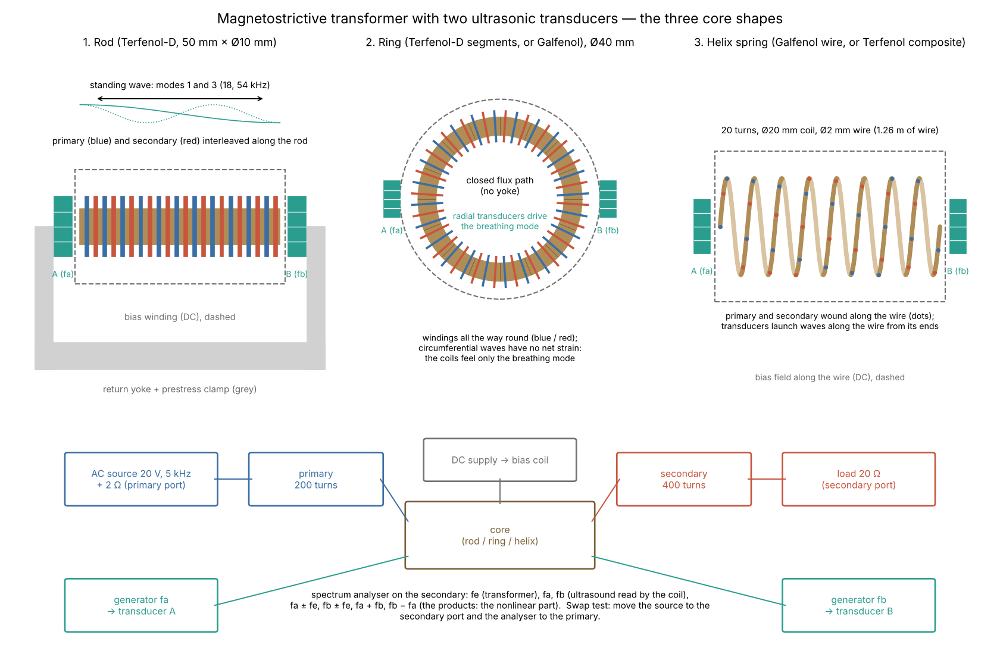
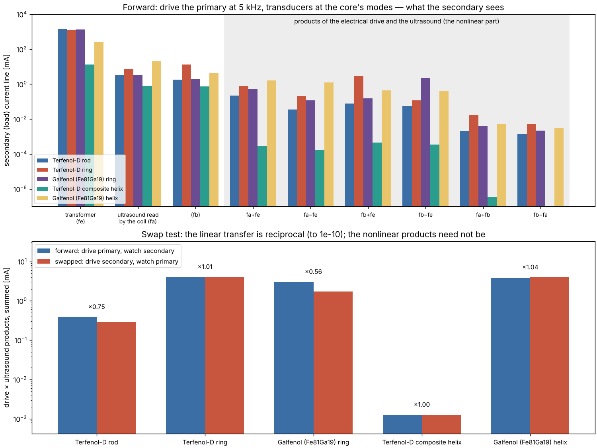

# Magnetostrictive transformer with two ultrasonic transducers

A transformer whose core is a magnetostrictive material carrying
ultrasonic standing waves from two transducers: a mechanical relative of
Barrett's oscillator-shuttle mixer ([barrett_osc](../barrett_osc), H36).
Register entry H37 (CLAUDE.md §1).

- **Cores:** Terfenol-D and Galfenol, shaped as a rod, a ring and a
  helical spring.
- **Windings:** a primary (200 turns) and a secondary (400 turns), wound
  along the core, on a DC bias coil.
- **Drive:** the primary at 5 kHz, and the two transducers at the core's
  modes.
- **Swap test:** the secondary is driven instead, and the primary watched.

```
go run ./examples/magnetostrictive_transformer            # about 2 s
go run ./examples/magnetostrictive_transformer -data DIR  # also the figure data
python3 examples/magnetostrictive_transformer/viz/plot_lines.py DIR viz/lines.png
python3 examples/magnetostrictive_transformer/viz/setup.py viz/setup.png
go test ./examples/magnetostrictive_transformer
```



## The model

**Material.** An anhysteretic magnetization with quadratic
magnetostriction, from one potential:

    M = Ms·tanh(Ht/a),   λ = λm·tanh²(Ht/a),   Ht = H + Hbias
    σ = E·(ε − λ),       B = μ0·(Ht + M) + σ·λ′(Ht)

Both follow from Φ(Ht, ε) = ½E(ε−λ)² − μ0·(Ht²/2 + Ms·a·ln cosh(Ht/a))
(σ = ∂Φ/∂ε, B = −∂Φ/∂Ht). So the magnetic and mechanical sides exchange
energy exactly, and the stored energy is Φ + Ht·B. Hysteresis and eddy
currents are not modelled; the latter is why the helix uses Terfenol
composite, and a solid Terfenol core would need laminating.

**Windings.** Uniform windings make H uniform along the core, so the coils
link the core's mean flux. The bias puts every material at Hb = 0.66·a,
where λ′ is largest.

**Mechanics.**
- **Rod and helix wire:** free–free lines of segments, with the
  transducers at the two ends.
- **Ring:** its breathing mode, driven by radial transducers.
- **Damping:** Kelvin–Voigt, set to each material's Q at the first tone.

| Material (declared) | d = λ′ at bias | μr | k | E | c | Q | bias | sources |
|---|---|---|---|---|---|---|---|---|
| Terfenol-D | 13.3 nm/A | 7.1 | 0.77 | 30 GPa | 1801 m/s | 10 | 57 kA/m | Etrema: μr 3–10, E 25–35 GPa, 800–1200 ppm |
| Terfenol-D/epoxy composite (51 %) | 5.4 nm/A | 3.7 | 0.31 | 15 GPa | 1698 m/s | 15 | 66 kA/m | measured d33 ≈ 5.5 nm/A, k33 ≈ 0.34 |
| Galfenol (Fe81Ga19) | 20.9 nm/A | 87 | 0.49 | 60 GPa | 2774 m/s | 100 | 6 kA/m | Etrema: d33 15–30 nm/A, μr 75–100, Bs 1.5 T, 7800 kg/m³ |

The cores:
- **Rod:** Terfenol-D, 50 mm × Ø10 mm. The flux closes through a return
  yoke, and a prestress clamp holds the rod.
- **Ring:** Ø40 mm, 5 × 5 mm. Terfenol as bonded segments (it is too brittle
  to bend), or machined Galfenol.
- **Helix:** 20 turns, Ø20 mm, of Ø2 mm wire (1.26 m), in Galfenol, which
  bends like steel, or moulded Terfenol composite.

**Electrical and acoustic set-up.**
- **Ports:** 2 Ω on the primary and 20 Ω (the load) on the secondary, each
  winding with 5 % leakage.
- **Drive:** 20 V at 5 kHz.
- **Transducers:** 5 N each.
- **Tones:** the rod's modes 1 and 3; the ring's breathing mode and 1.37×
  it; the helix wire's odd modes near 20 and 40 kHz. Even modes of a
  free–free line, and a ring's circumferential modes, have no net strain,
  so uniform coils cannot feel them.

**Numerics.** The coil currents are stiff: a thin core's leakage time
constant can be nanoseconds. So they step by backward Euler, and the
mechanics by symplectic Euler. With a 4× finer step the lines move by
1–2 % and the ledger residual falls 4×, as a first-order scheme should.

## Results



Forward run (drive the primary, watch the secondary). All lines are load
current in mA.

| Core | tones fa, fb [kHz] | H/a | fe | fa | fb | fa+fe | fa−fe | fb+fe | fb−fe | fa+fb | fb−fa | ledger |
|---|---|---|---|---|---|---|---|---|---|---|---|---|
| Terfenol-D rod | 18.0, 54.0 | 0.07 | 1398 | 3.16 | 1.78 | 0.22 | 0.034 | 0.078 | 0.057 | 0.002 | 0.001 | 1e-3 |
| Terfenol-D ring | 14.3, 19.6 | 0.11 | 1199 | 6.92 | 13.6 | 0.77 | 0.21 | 2.9 | 0.12 | 0.017 | 0.005 | 1e-2 |
| Galfenol ring | 22.1, 30.2 | 0.18 | 1335 | 3.48 | 1.94 | 0.56 | 0.12 | 0.15 | 2.2 | 0.004 | 0.002 | 5e-3 |
| Terfenol composite helix | 20.9, 39.9 | 0.02 | 13.1 | 0.79 | 0.75 | 3e-4 | 2e-4 | 5e-4 | 4e-4 | 3e-7 | 1e-7 | 8e-5 |
| Galfenol helix | 21.0, 40.8 | 0.17 | 272 | 20.0 | 4.31 | 1.7 | 1.3 | 0.44 | 0.41 | 0.005 | 0.003 | 2e-3 |

What the secondary sees:
- **The transformer line (fe):** 1.2–1.4 A for the rod and rings. The
  helix's long, thin magnetic path gives a far smaller inductance and field.
- **The ultrasound itself (fa, fb):** the coil reads it through the
  Villari effect, 1–20 mA.
- **The products of drive and sound (fa ± fe, fb ± fe):** this is the
  nonlinear part, up to 2.9 mA. It appears only with both the drive and the
  sound on (`TestRodAndRing`). It is largest where the field swings
  furthest on the curve (H/a) and the coupling is strong.
- **Sound × sound products (fa + fb, fb − fa):** about 100× weaker. In
  this model the magnetization is linear in strain, so these products need
  the magnetic field as a go-between.

The shapes compared:
- **Rings (closed flux path, no yoke):** these give the strongest products
  per amp. The Terfenol ring's fb line (13.6 mA, off resonance) beats its fa
  line (6.9 mA, at the breathing frequency). With the coils loaded, the
  ring's resonance moves up by the ΔE effect: for k = 0.77, the
  constant-B/constant-H frequency ratio is 1/√(1 − k²) = 1.57.
- **The Galfenol helix:** it reads the ultrasound best (20 mA at fa).
- **The Terfenol-composite helix:** its low permeability and long path give
  little field (H/a = 0.02), so it is the weakest.
- **Does the spring shape amplify?** No. Uniform strain along the wire
  changes the coil's diameter, not its length, so it gives no
  amplification. The amplified motion of a spring comes from twisting the
  wire (the Wiedemann effect), which needs a current through the helix
  itself. That is not modelled here; it is the next step.
- **Ring standing waves:** on a ring wound all the way round, the
  circumferential standing waves cannot reach the coils. Only the breathing
  mode couples. Sector windings would change that.

**Swap test.** The same source is moved to the secondary port (in series
with its 20 Ω), and the primary watched.

| Core | reciprocity (small drive) | fe fwd → rev [mA] | products summed fwd → rev [mA] |
|---|---|---|---|
| Terfenol-D rod | 4e-12 | 1397.8 → 1397.8 | 0.39 → 0.29 (×0.75) |
| Terfenol-D ring | 5e-12 | 1199.2 → 1199.8 | 4.01 → 4.06 (×1.01) |
| Galfenol ring | 1e-13 | 1334.5 → 1334.5 | 3.04 → 1.71 (×0.56) |
| Terfenol composite helix | 2e-11 | 13.14 → 13.14 | 0.0013 → 0.0013 |
| Galfenol helix | 2e-10 | 271.9 → 268.7 | 3.79 → 3.95 (×1.04) |

At small drive the transformer is reciprocal to 1e-10 or better. That is
the check that the magnetoelastic coupling is energy-consistent. At full
drive the transformer line stays almost reciprocal, but the products need
not be. The Galfenol ring gives 44 % less going backwards, the rod 25 %
less. The two directions put the core at different points of its curve
(the windings' current, and so the field swing, differ), which is what
your swap test was looking for: a clean sign of the nonlinearity.

## Bench notes

- **Mounting:** Terfenol-D is brittle (28 MPa in tension). Pre-compress it
  (a few to 10 MPa) and bond the transducers under that clamp.
- **Galfenol:** it can be machined into a ring or bent into a spring.
- **Bias:** set it with a DC coil or permanent magnets. The products vanish
  at zero bias, where λ′ = 0.
- **Spectrum analyser:** watch fa ± fe and fb ± fe on the secondary.
  Repeat with the transducers off (products gone) and with the drive off
  (only fa, fb).
