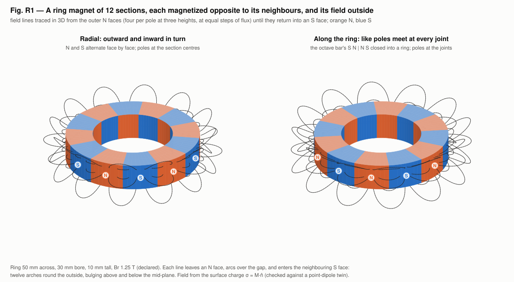
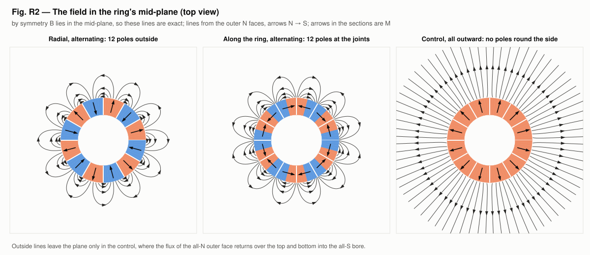
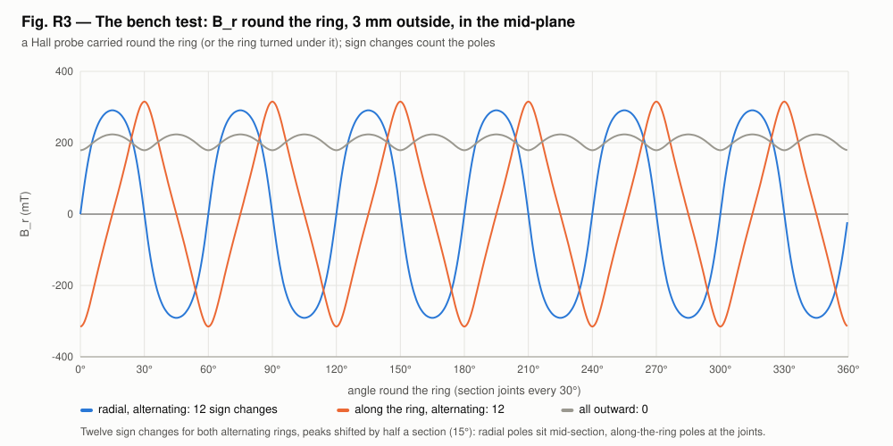

# Octave magnet: does a bar magnet have four pairs of poles? (H33)

Hypothesis H33 (CLAUDE.md §1, user hypothesis 2026-11-05) comes from Walter Russell's painting "Analysis of the Octave Bar Magnet". It says a bar magnet has *"four pairs of poles — not one pair"*, drawn as a chain of lens-shaped rings strung along the magnet's axis. This example builds the standard field of a bar magnet exactly, shows what each claim looks like as a field, and fixes the bench measurement that decides between them. The painting and the full comparison are in [doc/russell-octave-report.md](../../doc/russell-octave-report.md).

```
go run ./examples/octave_magnet                 # a few seconds
go run ./examples/octave_magnet -svg viz        # also the figures and the ring GIFs (about ten seconds)
go test ./examples/octave_magnet
```

## The model

- **The bar as currents.** A magnetization M(z)ẑ in a rod of radius a is exactly a sheet of azimuthal current M(z) on its side (J = ∇×M, K = M×n̂; Jackson §5.8–5.9). It is built as 2,000 coaxial loops, each carrying M·dz.
- **Poles.** The poles are the magnetic charge −∇·M: the end faces, plus every place inside where M changes.
- **Field lines.** They are the contours of the flux function ψ = ρA_φ, summed from the exact elliptic-integral potential of a loop (Smythe §7.10).
- **The bar.** An alnico rod, 12.7 × 76.2 mm, Br = 1.25 T. Demagnetization is ignored, declared.

## Results

| Check | Result |
|---|---|
| Sheet field on the axis against the exact solenoid formula | 1.3×10⁻⁶ of μ0M0 |
| Elliptic loop field against Biot–Savart (`em.Loop`), off the axis | 2×10⁻⁶ |
| kronspice search coil: flux ∫V dt against ΣM·I and 2πψ | equal to six digits |

| Bar | Charge sites | B_z sign changes on the axis | B_z sign changes 3 mm beside it |
|---|---|---|---|
| uniform (an ordinary bar): one pair | 2 | 0 | 2 |
| four segments S N \| N S \| S N \| N S: four pairs end to end | 5 | 3 | 5 |

**What the lenses mean.** A field line that leaves the axis at one pole and returns at the next is a lens strung on the axis, so a chain of poles draws a chain of lenses, as in Russell's painting. The uniform bar's outside lines run end to end in one family (Fig. M1).

**The bench test.** Run a Hall probe, or the search coil modelled here, parallel to the bar at a fixed gap and count the sign changes of B_z (Fig. M2).
- **Two:** one pair, the standard prediction.
- **Five or more on an ordinary, unmodified bar:** Russell's four pairs.

Status: *untested* until that measurement is made.

## The ring of twelve: the octave bar bent into a ring

The same idea, extended to a ring magnet cut into twelve 30° sections, each magnetized opposite to its neighbours (user request, 2026-11-05). There are two ways to make neighbouring sections "opposite", and both are built:

- **Radial.** Each section is magnetized along its own centre line, outward and inward in turn, so the outer face reads N S N S … This is the standard multipole ring used in motors, magnetic couplings and encoders.
- **Along the ring.** Each section is magnetized along the ring, clockwise and anticlockwise in turn, so like poles meet at every joint (N|N, S|S). This is the four-segment bar above (S N | N S | …) closed into a ring. Its poles are consequent poles at the joints.
- **Control.** All twelve sections are magnetized outward.

**The model** (`ring.go`):
- **The ring.** 50 mm across, 30 mm bore, 10 mm tall, Br = 1.25 T (declared). Each section is uniformly ("parallel") magnetized, the way segmented magnets are made.
- **Its field.** A uniformly magnetized body carries all its magnetic charge on its surface, σ = M·n̂ (Jackson §5.9). Here that charge sits on the outer arc, the inner arc and the two cut faces. The flat top and bottom carry none, since M lies in the plane. Outside the magnet, B = μ0H is the Coulomb field of that charge.
- **Its twin.** The same volume written as point dipoles m = M·dV (Jackson eq. 5.56).
- **Field lines.** RK4 along B̂. They start on the outer N faces, at equal steps of flux, and stop when they reach the magnet again.

**Checks:**

| Check | Radial | Along the ring |
|---|---|---|
| Surface charge against the point-dipole twin, 6 points outside | 7.8×10⁻⁵ of \|B\| | 7.9×10⁻⁵ |
| Net magnetic charge, of Σ\|Q\| | 5×10⁻¹⁷ | 2×10⁻¹⁷ |
| ∇·B and ∇×B outside (central differences, of \|∇B\|) | 1×10⁻⁷, 3×10⁻⁷ | 3×10⁻⁷, 1×10⁻⁷ |

**The field outside** (B_r 3 mm outside the outer face, in the mid-plane, the scan a Hall probe makes):

| Ring | Sign changes | Peak \|B_r\| | N poles at |
|---|---|---|---|
| radial, alternating | 12 | 291 mT | 15°, 75°, 135°, 195°, 255°, 315° (section centres) |
| along the ring, alternating | 12 | 315 mT | 30°, 90°, 150°, 210°, 270°, 330° (joints) |
| all outward (control) | 0 | 223 mT | none (B_r > 0 all round) |

**What the field looks like.**
- **Both alternating rings.** Twelve poles round the outside, six N and six S. Every line leaves an N pole, arches over to the neighbouring S pole and goes back in. The result is a crown of twelve arches round the ring. The arches lie flat in the mid-plane and bulge above and below it (Fig. R1).
- **Reach.** The field falls off quickly with distance, because neighbouring poles cancel each other.
- **The two alternating rings compared.** They look alike from outside. The difference is that their poles sit half a section (15°) apart.
- **The control.** Its outer face is all N and its bore all S. Its flux leaves radially and comes back over the top and bottom into the bore.
- **Symmetry.** B lies in the mid-plane, so the top-view lines of Fig. R2 are exact.

**The bench measurement in kronspice** (`ring_pickup.go`):
- **Setup.** A 200-turn, 6 mm pickup coil faces the outer side, 1.5 mm out. R = 8.26 Ω from the wire; L = 246 µH from Wheeler's multilayer formula (both declared). The load is 8.2 Ω, and the radial ring turns at 3000 rpm.
- **Signal.** The coil sees 6 electrical cycles per revolution (300 Hz, one per pole pair), 6.23 V peak open circuit, and 1.75 V rms (375 mW) across the load.
- **Ledger.** Every joule is work done turning the ring: in 3.011×10⁻² J = heat 3.011×10⁻² J + Δstored (residual 6×10⁻⁶).







Turntable views: [viz/ring3d_radial.gif](viz/ring3d_radial.gif), [viz/ring3d_tangential.gif](viz/ring3d_tangential.gif).

**What it means for H33.**
- **Russell's like-poles-meet pattern, closed into a ring, works.** It gives twelve real poles, as many as the standard radial multipole ring.
- **But the pattern has to be built in.** The control shows that a ring magnetized one way all round has no poles round its side.
- **The bar's status is unchanged.** It still turns on the Hall-probe scan of an ordinary bar.

## Tests

| Test | Checks | Tolerance |
|---|---|---|
| `TestSheetAxis` | sheet field = exact solenoid formula on the axis, both bars | 1e-5 of μ0M0 |
| `TestLoopFieldTwin` | elliptic loop field = Biot–Savart, four points | 1e-5 |
| `TestPoles` | 2 charge sites (uniform), 5 (four segments), net charge zero | exact |
| `TestScan` | sign changes 2 / 0 (uniform), 5 / 3 (four segments) | exact |
| `TestSearchCoil` | kronspice fluxmeter = ΣM·I = 2πψ | 1e-6 |
| `TestRingTwin` | ring: surface charge = point-dipole twin, 6 points outside, both rings | 2e-4 |
| `TestRingChargeDivCurl` | ring: net charge zero; ∇·B, ∇×B zero outside | 1e-12; 1e-5 |
| `TestRingScan` | ring: 12 / 12 / 0 sign changes; N poles at 15° + 60°k (radial), 30° + 60°k (along the ring) | exact; 0.6° |
| `TestRingLinesClose` | ring: every line from an outer N face ends on an S section | exact |
| `TestRingPickup` | ring: kronspice pickup coil, 6 cycles per revolution, ledger closes | exact; 1e-4 |

## Files

| File | Contents |
|---|---|
| `main.go` | bar, current sheet, loop field, poles, scans, kronspice search coil |
| `figures.go`, `svg.go` | Fig. M1 (field lines by marching squares on ψ) and Fig. M2 (the bench scan) |
| `ring.go` | the 12-section ring: sections, surface charge, point-dipole twin, scans, field-line tracing |
| `ring_main.go`, `ring_pickup.go` | Part 5 of the run; the pickup coil in kronspice |
| `ring_figures.go`, `raster.go` | Figs. R1–R3 (3D view by depth-sorted projection) and the turntable GIFs (stdlib rasterizer) |
| `main_test.go`, `ring_test.go` | the tests above |
| `viz/` | `figM1_fieldlines.svg`, `figM2_scan.svg`, `figR1_ring3d.svg`, `figR2_midplane.svg`, `figR3_scan.svg`, `ring3d_radial.gif`, `ring3d_tangential.gif` |
| `run_output.txt` | the recorded run |

## Sources

- W. Russell, "Analysis of the Octave Bar Magnet" (painting); *The Universal One* (1926); *The Secret of Light* (1947). The hypothesis source.
- J. D. Jackson, *Classical Electrodynamics*, 3rd ed., §5.5, §5.6 (eq. 5.56, dipole field), §5.8–5.9; H. A. Wheeler, "Simple inductance formulas for radio coils", *Proc. IRE* 16, 1398 (1928); W. R. Smythe, *Static and Dynamic Electricity*, §7.10.
