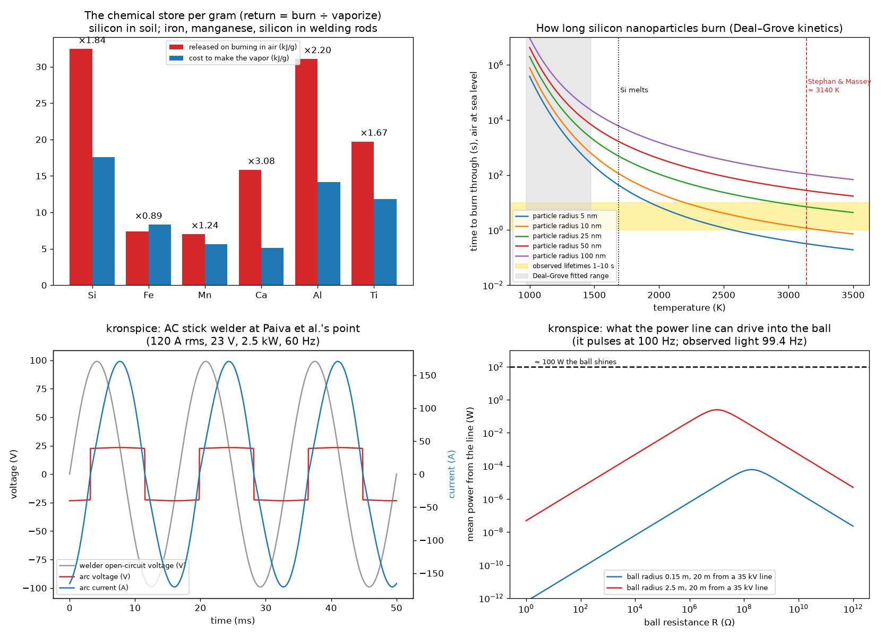

# Silicon ball lightning: the chemical model, and whether a welding arc can make it

Abrahamson & Dinniss (*Nature* 403, 519, 2000) propose that lightning
striking soil reduces its silica and throws out a filamentary network of
silicon, SiO or SiC nanoparticles. As these slowly oxidize in air, the
stored chemical energy comes out as heat and light: a ball that lasts
seconds without any field holding it together. Cen, Yuan & Xue
(*Phys. Rev. Lett.* 112, 035001, 2014; `reference/PhysRevLett.112.035001.pdf`)
recorded the first spectrum of a natural ball lightning. It showed
silicon, iron and calcium (soil) lines throughout its 1.64 s life.

This example checks the model with numbers:
- the energy each element stores per gram;
- how fast silicon nanoparticles burn;
- a welding arc at the laboratory operating point, simulated in kronspice;
- the 35 kV power line next to the Qinghai ball, simulated in kronspice.

It is the standard counterpart to the field-held plasmoid of
[Force-Free_Harmonic_Plasmoids](../Force-Free_Harmonic_Plasmoids) (H26).
That plasmoid lasts microseconds to milliseconds; this one stores its
energy in chemistry.

```
go run ./examples/silicon_ball_lightning                 # about four seconds
go test ./examples/silicon_ball_lightning
go run ./examples/silicon_ball_lightning -viz examples/silicon_ball_lightning/viz
python examples/silicon_ball_lightning/viz/render.py      # viz/silicon_ball_lightning.png
python examples/silicon_ball_lightning/viz/make_report.py # silicon_ball_lightning_report.pdf
```

Report: [silicon_ball_lightning_report.pdf](silicon_ball_lightning_report.pdf).



## Observations used

| Source | Kind | Size | Lifetime | Notes |
|---|---|---|---|---|
| Abrahamson & Dinniss 2000 | the "average" natural ball | 30 cm | ≈ 10 s | like a 100 W lamp |
| Cen, Yuan & Xue 2014 (Qinghai, 2012) | natural, two spectrographs at 0.9 km | luminous ≈ 5 m | 1.64 s | 8.6 m/s; Si I, Fe I, Ca I throughout; N I, O I periodic; light oscillates at 99.4 Hz; 35 kV line 20 m away |
| Paiva et al. 2007 (*PRL* 98, 048501) | arc on pure silicon | 1–4 cm | 2–5 s | arc 20–25 V, 100–140 A, 60 Hz |
| Stephan & Massey 2008 | laboratory silicon | 1–4 cm glow, ≈ 1 mm molten core | — | ≈ 3140 K |
| Dikhtyar & Jerby 2006 (*PRL* 96, 045002) | microwave hot spot | 3 cm | 30–40 ms after power off | |

## Results (`run_output.txt`)

**1. The chemical store.** The table gives the heat released on burning in
air and the heat to turn a gram into vapor (from 298 K to boiling). The
data are standard enthalpies (NIST-JANAF / CRC); the vaporization cost is
good to about ±10 %.

| Element → oxide | Burns (kJ/g) | Vaporize (kJ/g) | Return | Mass for 1 kJ |
|---|---|---|---|---|
| Si → SiO₂ | 32.43 | 17.60 | **1.84** | 31 mg |
| Fe → Fe₂O₃ | 7.38 | 8.32 | **0.89** | 136 mg |
| Mn → MnO | 7.01 | 5.65 | 1.24 | 143 mg |
| Ca → CaO | 15.84 | 5.14 | 3.08 | 63 mg |
| Al → Al₂O₃ | 31.05 | 14.14 | 2.20 | 32 mg |
| Ti → TiO₂ | 19.72 | 11.79 | 1.67 | 51 mg |

The reduced silicon species release, on burning: SiO → SiO₂ 18.4 kJ/g,
SiC → SiO₂ + CO₂ 30.7 kJ/g.

- **Very little mass is needed.** The average ball (100 W for 10 s,
  about 1 kJ) needs only **31 mg of silicon**.
- **The lightning pays for the store.** Soil holds silicon as SiO₂, so the
  strike must first reduce it, paying the same 32.4 kJ/g (plus the
  vapor's 17.6 kJ/g). The ball releases energy the lightning put in.
- **Oxides store nothing.** Sand (SiO₂) and rutile welding flux (TiO₂)
  are already burned; only reduced metal stores energy.
- **For welding rods:**
  - the steel core (iron) returns less heat than it costs to vaporize
    (0.89);
  - the silicon and manganese deoxidizers return more (1.84, 1.24);
  - so the silicon in a rod is the better fuel.

**2. How fast silicon nanoparticles burn.** I used Deal–Grove kinetics for
silicon in dry oxygen (*J. Appl. Phys.* 36, 3770, 1965), scaled to the
oxygen in air. A particle of radius r is burned through when the oxide
shell has consumed r of silicon.
- At 1100–1500 K, the range where Deal–Grove was measured, 5–100 nm
  particles take **minutes to days**, far slower than the observed
  seconds.
- Extrapolated upward, **10 nm particles burn in 1.6–10 s at
  2200–2900 K**; 25 nm particles need 2900–4600 K.
- The hot end matches Stephan & Massey's ≈ 3140 K estimate and the white
  colour of the Qinghai ball's stable stage. So for the chemical model to
  give seconds, the ball must be roughly 2000–3000 K with particles of
  order 10 nm.

**3. kronspice: an AC stick welder at Paiva et al.'s point.** The welder
is a transformer with 70 V open-circuit voltage behind a leakage
inductance. The arc is a current-controlled element whose voltage stays
near 22.5 V whatever the current.
- A leakage inductance of 1.447 mH gives **120 A rms at 23 V rms:
  2.5 kW** at 60 Hz, inside Paiva's 20–25 V, 100–140 A.
- The ledger closes to 2×10⁻⁵.
- If 1–10 % of one second of arc vaporizes electrode metal:

| Metal | Vapor | Chemical store | A 100 W ball would last |
|---|---|---|---|
| Si | 1.4 – 14 mg | 46 – 460 J | 0.5 – 4.6 s |
| Fe | 3.0 – 30 mg | 22 – 220 J | 0.2 – 2.2 s |
| Mn | 4.4 – 44 mg | 31 – 310 J | 0.3 – 3.1 s |

A welding-class arc easily makes enough vapor for seconds of glow.
**Your welding-rod idea is consistent with the chemistry:** the arc pays
for the vapor, and the burning gives seconds. Silicon (from a
silicon-bearing electrode or work piece) stores most per gram. The
fraction of arc energy that actually vaporizes metal was not measured
here; it is the number a bench run must give.

**4. kronspice: the power line beside the Qinghai ball.** A 35 kV
three-phase line (20.2 kV phase to ground, 50 Hz) 20 m away couples to a
ball of radius a through a mutual capacitance C_m ≈ 4πε0a²/d. The ball
also has its own capacitance to ground.
- The power the line can drive into the ball's resistance **pulses at
  100.00 Hz**: power goes as current squared, so it peaks twice per line
  cycle. The ball's light was seen to oscillate at 99.4 Hz.
- At most the line can deliver **60 µW** into a 15 cm ball, or 0.25 W if
  the ball were the full 5 m luminous size. The ball shines about 100 W.
  This maximum is the matched-load value ¼·ω·C_m²·V²/(C_m + C_b), checked
  in the tests.
- **So the line can flicker the ball but cannot power it.** The energy is
  in the chemistry, as Abrahamson & Dinniss say.

## Where it stands

- **The chemical model passes the energy test.** Tens of milligrams of
  reduced silicon hold the energy of a seconds-long ball, and a welding
  arc or a lightning strike pays to make it.
- **It passes the timing test only if the ball is hot**, about 2000–3000 K
  with particles of order 10 nm. That temperature matches the laboratory
  estimate, but it is an extrapolation of wafer kinetics.
- **The flicker fits; the power doesn't.** The Qinghai flicker fits a
  50 Hz line as an outside modulator. The line cannot be the ball's
  source.
- **Next bench measurements:**
  - the fraction of welding-arc energy that vaporizes the electrode;
  - particle size and temperature of a silicon ball, from its spectrum;
  - a lifetime comparison of silicon-bearing and plain steel electrodes.

## Tests

| Test | Checks |
|---|---|
| `TestChemistry` | Si 32.43 kJ/g; vaporization cost from its parts; Fe return < 1, Si > 1.5 |
| `TestDealGrove` | B(1473 K) = 0.0477 µm²/h (5 %); burn time monotonic; 10 nm in 3.5 s needs 2000–3200 K |
| `TestWeld` | 120 A, 20–25 V, 2–3 kW, ledger ≤ 10⁻³ |
| `TestLine` | pulsation 100 Hz; power ≤ 1 mW for 0.15 m; sweep maximum = matched-load formula (2 %) |

## Files

| File | Contents |
|---|---|
| `data.go` | observations; element thermochemistry |
| `chem.go` | oxidation heat, vaporization cost, Deal–Grove burn time |
| `circuits.go` | kronspice: welder and arc; power line to ball |
| `main.go`, `viz.go` | the report; `-viz` CSVs |
| `main_test.go` | tests |
| `viz/render.py`, `viz/make_report.py` | the figure; the PDF report |

## Sources

- J. Abrahamson, J. Dinniss, "Ball lightning caused by oxidation of nanoparticle networks from normal lightning strikes on soil", *Nature* 403, 519 (2000).
- J. Cen, P. Yuan, S. Xue, "Observation of the optical and spectral characteristics of ball lightning", *Phys. Rev. Lett.* 112, 035001 (2014) — `reference/PhysRevLett.112.035001.pdf`.
- G. S. Paiva et al., *Phys. Rev. Lett.* 98, 048501 (2007); K. D. Stephan, N. Massey, *J. Atmos. Sol.-Terr. Phys.* 70, 1589 (2008); V. Dikhtyar, E. Jerby, *Phys. Rev. Lett.* 96, 045002 (2006).
- B. E. Deal, A. S. Grove, "General relationship for the thermal oxidation of silicon", *J. Appl. Phys.* 36, 3770 (1965).
- NIST-JANAF Thermochemical Tables; CRC Handbook of Chemistry and Physics.
