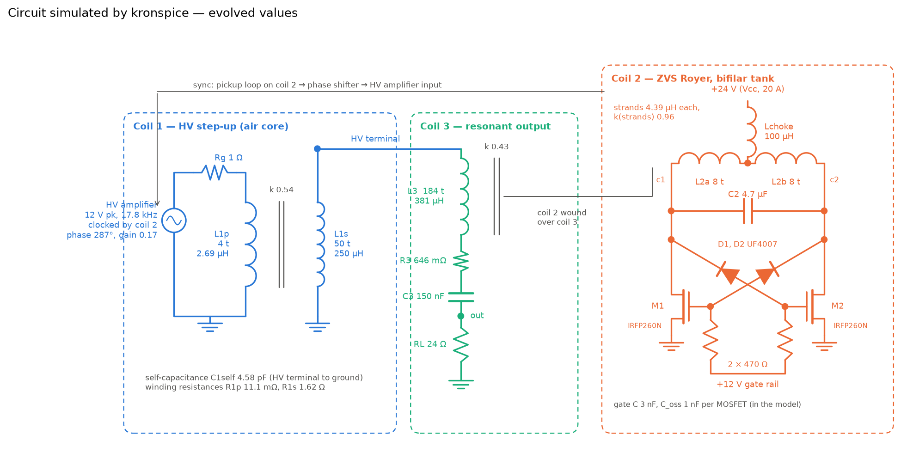

# Three coils, two drives: high voltage and high current in one resonant coil

Three coils and one output:

- **Coil 1** is an air-core step-up transformer. Its high-voltage terminal is
  wired to the top of coil 3.
- **Coil 2** is the tank coil of a resonant (zero-voltage-switching, Mazzilli)
  Royer oscillator on 24 V, wound bifilar and centre-tapped over coil 3.
- **Coil 3** is a series-resonant RLC loop (L3, R3, C3, load) from the HV
  terminal to ground.

So coil 3 is driven twice: by voltage through the wire from coil 1 and by
current through the magnetic coupling from coil 2. The aim is to synchronize
the two drives and get the most power into the load. The genetic algorithm
evolves the turn counts, the spacing between coils 2 and 3, both capacitors,
the load and the HV drive. kronspice runs every candidate as a full
transient, MOSFETs and diodes included, with the energy ledger on.

The full write-up, with schematic, waveforms, trends, winding instructions
and bill of materials, is
[three_coil_sync_report.pdf](three_coil_sync_report.pdf).

```
go run ./examples/three_coil_sync -quick              # the hand-picked baseline, a few seconds
go run ./examples/three_coil_sync -sync -data examples/three_coil_sync/viz/data > examples/three_coil_sync/run_output.txt     # design A, ~25 min on 16 cores
go run ./examples/three_coil_sync -data examples/three_coil_sync/viz/data_free > examples/three_coil_sync/run_free.txt        # design B, ~25 min
go run ./examples/three_coil_sync -waves -data examples/three_coil_sync/viz/data -data-free examples/three_coil_sync/viz/data_free
python3 examples/three_coil_sync/viz/plot_report.py examples/three_coil_sync/viz/data examples/three_coil_sync/viz
python3 examples/three_coil_sync/viz/plot_report.py examples/three_coil_sync/viz/data_free examples/three_coil_sync/viz/free
python3 examples/three_coil_sync/viz/schematic.py examples/three_coil_sync/viz/data examples/three_coil_sync/viz
python3 examples/three_coil_sync/viz/schematic.py examples/three_coil_sync/viz/data_free examples/three_coil_sync/viz/free
go run ./examples/three_coil_sync -regen -data examples/three_coil_sync/viz/data > examples/three_coil_sync/regen_output.txt   # regenerative load, ~20 s
python3 examples/three_coil_sync/viz/make_report.py examples/three_coil_sync/three_coil_sync_report.pdf
go test ./examples/three_coil_sync
```



## Construction

- **Inductances from geometry.** Every coil is a stack of circular turns.
  Self and mutual inductances are sums of Maxwell's coaxial-circle formula
  (`em.MutualCircles`) over every pair of turns, plus the loop self term
  μ₀r(ln(8r/a) − 2) (`geom.go`). The matrix is one consistent Neumann
  matrix, so every coupling is below 1. Copper resistance includes the skin
  effect (no proximity effect). Coil 1's self-capacitance comes from
  Medhurst's formula.
- **Fixed construction.** Coil 3 uses Ø1.0 mm wire on a Ø50 mm former.
  Coil 2 is two Ø2.0 mm strands side by side over a spacer. Coil 1 has a
  Ø0.4 mm secondary on a Ø75 mm former and a Ø2.0 mm primary over its
  grounded end.
- **Royer** (`circuit.go`). Two MOSFETs (level 1, V_T 4 V, about 30 mΩ,
  3 nF gate, 1 nF C_oss). A 100 µH choke feeds the centre tap. Gates are
  pulled up through 470 Ω from 12 V and pulled down by UF4007-class diodes
  to the opposite drain. One gate resistor is 2 % high, so the oscillator
  starts the same way every run.
- **Two ways to drive coil 1:**
  - **B, free-running:** a 48 V sine generator with 1 Ω source resistance.
    The GA evolves its frequency (as a ratio of the Royer's unloaded tank
    frequency) and its starting phase.
  - **A, synchronized (`-sync`):** the tank voltage is buffered and shifted
    by a first-order all-pass (0–180°) and a sign (the other 180°), then
    amplified with gain G into coil 1. The GA evolves the phase and the
    gain. On a bench this is a pickup loop on coil 2, a comparator or PLL
    and a class-D bridge. The amplifier is a controlled source, so its power
    is model-supplied in the ledger and is counted as HV input.
- **Fitness** (`run.go`). The error is 100/(100 + P_load) plus a
  proportional penalty for each rating exceeded, and a penalty when the
  Royer does not oscillate. The ratings are:
  - MOSFET drain 150 V;
  - supply 20 A;
  - coil 2 strand 30 A rms;
  - coil 3 8 A rms;
  - C3 2 kV;
  - HV terminal 20 kV;
  - HV input 400 W.
- **Each candidate** is a 2.5 ms transient at steps of 0.2 µs or less,
  measured over the last 0.5 ms. Each search uses population 48,
  25 generations, seed 1, and 1152 simulations.

## Results

| | A — synchronized | B — free-running |
|---|---|---|
| coil 3 / coil 2 per strand / spacer | 184 t / 8 t / 7.3 mm | 101 t / 7 t / 4.2 mm |
| coil 1 secondary : primary | 50 : 4 t | 55 : 12 t |
| C2, C3, load | 4.7 µF, 150 nF, 24 Ω | 2.2 µF, 100 nF, 24 Ω |
| HV drive | slaved, 287°, gain 0.167 (12 V pk) | 24.02 kHz, 48 V pk |
| Royer frequency | 17.77 kHz (locked by construction) | 26.03 kHz (not locked) |
| **load power** | **374.6 W** | **577.4 W** |
| HV input + Royer input | 15.2 + 462.1 W | 379.0 + 472.9 W |
| efficiency | 0.785 | 0.678 |
| output ripple (max − min)/mean per cycle | 0.001 | 1.008 (beats at ~2 kHz) |
| change at a 4× finer step | 0.03 % | 1.6 % |

### Each drive alone and both together

| | load, HV coil alone | load, Royer alone | sum | (√P₁ + √P₂)² | both |
|---|---|---|---|---|---|
| A | 2.1 W | 323.7 W | 325.8 W | 377.8 W | 374.6 W |
| B | 97.9 W | 270.3 W | 368.2 W | 693.6 W | 577.4 W |
| baseline (hand-picked) | 1.36 W | 0.19 W | 1.55 W | — | 0.99 W |

- **Coil 3 carries one current.** Its power goes as the square of that
  current. When the two drives share a frequency, their currents add as
  phasors, so the load power can exceed the sum of the two alone, up to
  (√P₁ + √P₂)² in phase. Both sources then deliver more, and the ledger
  shows it.
- **In the wrong phase the drives fight.** In the baseline, both on gave
  less than the HV coil alone, and the Royer's supply took power back. On
  design A, the phase alone moves the output from 245 W to 391 W.
- **B's Royer can be locked.** It injection-locks to the HV generator for
  HV frequencies 1.02–1.15× B's value. Locked at 1.02× it gives 585 W,
  steady, but the HV generator then delivers 491 W. That is past its 400 W
  rating, so the GA stopped at the edge of the lock range.
- **Neither search kept coil 1 as a high-voltage coil.** Both chose about
  50 secondary turns, and the HV terminal reaches only 158 V (A) and 340 V
  (B). A high-voltage, low-current drive cannot push much current through
  coil 3's resonant loop, which is a few tens of ohms, so evolution traded
  voltage for current.
- **B's HV side is lossy.** 194 W of B's HV input heats the generator's
  own 1 Ω source resistance.
- **The binding limits are the 20 A supply and the 30 A strand current.**
  Design A's output still rises with HV gain (409 W at 1.5×), but the
  Royer's supply current rises with it.
- **No surplus.** The load never gets more than the two supplies deliver.
  The transient ledger closes to 7e-5 (A) and 1e-4 (B) of the input energy.

### Recycling the load's energy (`-regen`, `regen.go`)

Can feeding the load's energy back make the circuit 99.99 % efficient? To
test it, design A's load resistor is replaced by a regenerative load:

- a step-down transformer (ferrite, k 0.995, 2 mH primary, ratio n:1);
- a full bridge of low-drop rectifiers (Schottky or synchronous, about
  0.35 V at 20 A, 2 nF junction capacitance);
- an RC snubber (2 Ω, 47 nF);
- a return path through a 0 V ammeter into the 24 V rail.

The ratio n (3–6) and C3 (0.8–1.2×) are swept; the best point is n 4.25,
C3 × 0.9.

| | plain 24 Ω load | regenerative load |
|---|---|---|
| power at the load | 374.6 W, kept as heat | 383.4 W through the port |
| returned to the 24 V rail | — | 365.6 W (recovery 0.954) |
| supplies' net input | 477.4 W | 125.5 W |
| of which circuit losses / recycling path | 102.8 W / — | 105.4 W / 17.5 W |
| useful output kept | 374.6 W | 0 W |

- **The recycling works.** The supplies' net input falls from 477 W to
  125 W.
- **What is left is exactly the losses.** Nothing is kept at the load, so
  the net input is what the copper, switches, capacitor ESR and rectifiers
  turn into heat. The test `TestRegenerativeLoad` checks this balance to
  3 %, and the ledger closes to 2e-5.
- **383 W / 125 W = 3.1 is not an efficiency.** It is how much power
  circulates per watt of loss, like a resonator's Q.
- **Recycling cannot beat the losses.** It lowers the bill to the losses,
  never below them. Raising efficiency means cutting the losses
  themselves; 92–96 % is realistic with copper coils at tens of kilohertz.
- **Where it is useful:** testing at full power without a dump load.

### Build note

Coil 1's secondary carries coil 3's full current, 4–5 A rms, so wind it
with Ø1.0 mm wire, not the Ø0.4 mm the model assumed. Thicker wire only
lowers the loss and changes the inductance little. The report's winding
instructions and BOM use Ø1.0 mm.

## Files

| File | What it holds |
|---|---|
| `main.go` | flags, baseline and the two evolved designs, the text report |
| `geom.go` | coils as stacks of turns: L, M, R, self-capacitance; the design type |
| `circuit.go` | the kronspice circuit: coil 1, coil 3, ZVS Royer, slaved HV amplifier |
| `measure.go` | transient and steady-state measurements (power, frequency, lock, ripple, peaks, losses) |
| `run.go` | genes, fitness and ratings, the GA run, comparisons, trend sweeps, CSV output |
| `regen.go` | the regenerative load on design A: ratio and C3 sweep, power returned to the rail (`-regen`) |
| `main_test.go` | geometry against Nagaoka, couplings, the Royer alone (frequency, π·Vcc peak), no surplus, evolved designs reproduce, regenerative load (net input = losses) |
| `export_test.go` | baseline and both evolved designs as netlists, KiCad schematics, results sheets (`export/`) |
| `viz/` | `plot_report.py`, `schematic.py`, `make_report.py`; figures for A in `viz/`, for B in `viz/free/` |
| `viz/data`, `viz/data_free` | CSV data of each run, and `best.cir`, the evolved circuit as a netlist |
| `run_output.txt`, `run_free.txt`, `check_output.txt`, `regen_output.txt` | the two GA runs, the finer-step check, the regenerative-load sweep |

## Limits

- Air-core coils only, no proximity effect.
- No stray coupling between coil 1 and coils 2–3: keep them three
  diameters apart.
- Level-1 MOSFETs.
- An ideal phase shifter and amplifier, apart from the 1 Ω source.
- A resonant Royer, not the classic saturating-core Royer, which needs the
  hysteretic core model of CLAUDE.md §3j (milestone M9r).
- Coil 1's wire gauge is fixed and its current is not rated (see the build
  note).

## Sources

- G. H. Royer, *AIEE Trans.* 74, 1955: the self-oscillating converter.
- The Mazzilli ZVS driver: a resonant Royer with cross-coupled gate diodes,
  widely used in induction heaters.
- J. C. Maxwell, *Treatise* Vol. II art. 701: mutual inductance of
  coaxial circles.
- E. B. Rosa, F. W. Grover, *Bull. Bur. Stand.* 8, 1912: the loop self term.
- H. Nagaoka, 1909: the current-sheet check in the tests.
- D. W. Knight, 2016, §5, and A. Medhurst, *Wireless Engineer* 24, 1947:
  coil self-capacitance.
- R. Adler, *Proc. IRE* 34, 351, 1946: injection locking, the lock range
  seen in design B.
