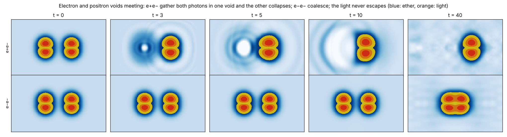
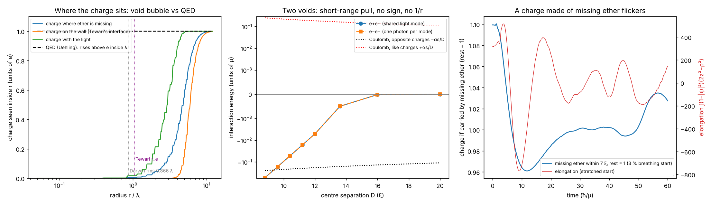

# void_charge — electrical properties for the void (proposed H51)

**Question (user, 2026-11-14).** QED's bare electron is a point with no size
and no structure — much like the void of a nonlinear ether. If we give the
void electrical properties (a negative charge, a pressure), they can be
tested against electrical measurements. Tewari's book already does this, so
re-read it.

**Hypothetical.** Everything about the void below is a model under test. The
measured values and the standard prediction are stated beside each test.

**Standard prediction.** The electron is a point charge −e, smaller than
10⁻¹⁸ m. Its Coulomb field is conservative and the same in every direction.
Dirac's equation smears its charge over an rms 0.866 ƛ (the Darwin term,
ƛ = ħ/mc = 3.86 × 10⁻¹³ m). QED vacuum polarization makes the charge seen
grow at short distance (α = 1/128 at the Z mass). An e⁺e⁻ pair annihilates
into two 511 keV photons, and the electron has no excited states.

**The charge itself is a suggestion, not a criterion.** The standard model
puts −e in by hand (the ledger's rule), so assigning it to the void is fair.
What is tested is everything that follows from where and how the void
carries it.

## Part 1 — Tewari's charged void, re-read

Source: *Universal Principles of Space and Matter* (2017), §2.3 (eq. 2.4),
§2.6 (eq. 2.14), §3.1 (eqs. 3.1.3–3.1.7) and §8.0–8.1. Copy in
`reference/tewari_upsm_2017.pdf`.

What he says:

- **The void holds no charge.** It is "fieldless". The charge is the surface
  integral of the space fluid's speed on the void's surface, the interface
  (eq. 2.4): q = π² r_e² c. From the measured e this fixes
  r_e = 4.03 × 10⁻¹³ m = 1.04 ƛ.
- **The field is axial.** E = −c² r_e² sin²θ / 2r² (eq. 3.1.3). It is
  strongest in the equator and zero along the spin axis, and it stops at
  r_e. He says Coulomb's law can hold only down to r_e.
- **The positron is the same void spinning the other way** (§2.3).
  Attraction and repulsion come from the two velocity fields adding or
  cancelling between them.
- **Charge comes in units** because a smaller void is unstable and an
  interface has no fractions (§2.3).
- **Annihilation.** The interfaces overlap, the circulation stops, and the
  void collapses in r_e/c. One spherical shell of light, of width r_e, goes
  out. The energy freed is (4/5)mc² per particle (eq. 2.14).

Tested against measurement:

| Test | His void | Measured | Verdict |
|---|---|---|---|
| Field is conservative (∮E·dl = 0) | 0.75 e²/r_e = 2.68 keV gained per lap (out along the equator, back along the axis) | zero for any static field | fails |
| Hydrogen 2p, by orientation to the spin axis | levels spread by 4.08 eV | degenerate; fine structure 45 µeV, Lyman-α one line | fails by ~10⁵ |
| Charge radius vs hydrogen 2S | ⟨r²⟩ = 1.09 ƛ² against Darwin's 0.75: 9.9 GHz extra (31.8 GHz if added to Dirac's) | Lamb shift known to ±9 kHz | fails by ~10⁶ |
| Form factor at LEP2 (√s = 200 GeV) | \|F\| ≤ 2.4 × 10⁻⁶ (a shell: sin x / x, x = 4 × 10⁵) | ≥ 0.985 | fails |
| Energy freed per pair | 0.8 × 2mc² | 2mc² | fails by 20 % |
| Wavelength of the annihilation light | r_e = 0.166 h/mc | h/mc (511 keV) | fails by ×6 |
| Shape of the annihilation light | one spherical shell, no frequency | two back-to-back 511 keV photons, crossed polarizations (Wu & Shaknov 1950) | fails |

His *pictures* — a field-free void, charge on its surface, the positron as
opposite rotation, annihilation as the void filling in — can be kept and
tested. His *formulas* for them fail. The rest of this example uses the
ether of `examples/void_shells`, where the void and its light are computed
rather than assumed.

## The model

The ether and light are those of `examples/void_shells` (`field.go`,
copied):

- a Gross–Pitaevskii ether ψ;
- double-loop light modes (m = ½), one photon per mode, ε = 300 playing ħc,
  opacity V0 = 20;
- an axisymmetric 0.4 ξ grid, box ρ < 24 ξ, |z| < 24 ξ.

One photon makes a round bubble with M = 391.82, so ƛ = ε/M = 0.766 ξ. The
void reaches 4.4 ξ = 5.75 ƛ.

The charge is assigned to the void in three ways:

- **where the ether is missing** (1 − |ψ|²);
- **on the wall**, Tewari's interface (|∇|ψ|²|);
- **with the light** (χ²).

## Part 2 — Charge radius

Any spread of the electron's charge shifts hydrogen's S levels by
(2/3)α⁴mc²⟨r²⟩/(n³ƛ²). Dirac's Darwin term is exactly such a spread, with
⟨r²⟩ = ¾ƛ², and it is confirmed. The 2S Lamb shift (1057.845 ± 0.009 MHz)
leaves room for only |Δ⟨r²⟩| ≤ 3 × 10⁻⁷ ƛ² more. LEP2 needs an rms radius
≤ 7.7 × 10⁻⁷ ƛ (3 × 10⁻¹⁹ m).

| Placement | rms radius | ⟨r²⟩/ƛ² | Extra 2S shift if it replaces Darwin | If added to Dirac | F at q = 1/ƛ |
|---|---|---|---|---|---|
| where the ether is missing | 5.05 ƛ | 25.5 | 722 GHz | 743 GHz | −0.05 |
| on the wall | 6.26 ƛ | 39.2 | 1121 GHz | 1143 GHz | −0.05 |
| with the light | 3.03 ƛ | 9.2 | 246 GHz | 268 GHz | 0.15 |

The charge a probe sees inside radius r runs the **opposite way** to QED's.
Inside the void it falls toward zero; in QED it rises above e.

| r / ƛ | missing ether | wall | light | QED α(r)/α |
|---|---|---|---|---|
| 8 | 0.967 | 0.918 | 1.000 | 1 |
| 4 | 0.318 | 0.012 | 0.896 | 1 |
| 2 | 0.047 | 0 | 0.214 | 1 |
| 1 | 0.005 | 0 | 0.017 | 1 |
| 0.1 | 0 | 0 | 0 | 1.0014 |

A charged void would have to be smaller than about 10⁻⁶ ƛ to look like the
measured electron. The computed one is 5–6 ƛ.

## Part 3 — Exact charge

Measured: every electron, muon and proton carries the same |e| to about
10⁻²¹, whatever its mass, speed or surroundings.

**If the charge is the missing ether, it is not in units:**

| State | Missing ether (ξ³) | Relative to one photon at ε = 300 |
|---|---|---|
| ε = 100 | 173.4 | 0.448 |
| ε = 300 | 386.9 | 1 |
| ε = 1000 | 933.7 | 2.413 |
| 2 photons, ε = 300 | 719.1 | 1.859 |
| 3 photons, ε = 300 | 1047.9 | 2.708 |

**Nor is it constant in time.** Start the bubble 3 % too large and let it
move freely. The ether in the whole box is conserved exactly, but the
missing ether within 7 ξ swings from 0.961 to 1.035 of its rest value as
the void breathes and sheds sound.

**What does come in units is the light's winding** (m = ±½). Its sign is
the handedness — Tewari's opposite rotation for the positron. Charge as
winding would be exact and conserved. But m enters these equations only as
m² = ¼, so nothing feels its sign. The winding labels the charge without
producing any force (Part 4).

## Part 4 — Electron and positron voids

Two relaxed bubbles sit on the axis, centres D apart:

- **e⁺e⁻** (opposite windings) may share the lowest light mode;
- **e⁻e⁻** (same winding) must take one photon per mode.

| D (ξ) | D (ƛ) | Wall gap (ξ) | e⁺e⁻ − 2M | e⁻e⁻ − 2M | Difference | Coulomb αε/D |
|---|---|---|---|---|---|---|
| 8.8 | 11.5 | 1.6 | −0.522 | −0.521 | −9.4 × 10⁻⁴ | 0.249 |
| 9.6 | 12.5 | 2.4 | −0.166 | −0.166 | −4.0 × 10⁻⁵ | 0.228 |
| 10.4 | 13.6 | 3.2 | −0.052 | −0.052 | −1.6 × 10⁻⁶ | 0.211 |
| 12.0 | 15.7 | 4.8 | −0.0051 | −0.0051 | −2.6 × 10⁻⁹ | 0.182 |
| 16.0 | 20.9 | 8.8 | −0.00002 | −0.00002 | −3 × 10⁻¹³ | 0.137 |

Both pairs feel the same short-range pull, falling as e^{−1.43 D}. That is
the ether's screened static response (e^{−√2 r}/r). The only e⁺e⁻/e⁻e⁻
difference is the light's exchange splitting, which is also exponential.
There is no 1/r force and no sign: like charges do not repel. Coulomb's law
needs a field that reaches out, and this ether has none.

**In real time** (no friction), the walls start 1.6 ξ apart:

- **e⁺e⁻:** within t ≈ 5 both photons gather in one void. The emptied void
  collapses and sends out a spherical shell — Tewari's collapsing void and
  outgoing shell. But the shell is sound, not light, and both photons stay
  in the surviving void.
- **e⁻e⁻:** each void keeps its photon until the two coalesce into one
  elongated bubble by t ≈ 20.

Relaxed, the merged e⁺e⁻ bubble has M = 649.0 against 2M = 783.6, so 17.2 %
is freed (e⁻e⁻: 726.9, 7.2 %). In the e⁺e⁻ run about 114 of it is in sound
beyond 14 ξ by t = 30. No light leaves: a photon's energy (ε√λ = 285) is
about a fifth of what escape through the ether needs (ε√V0 = 1342).

So the pair never annihilates. It becomes one neutral bubble of light (the
windings cancel) that lasts forever. Measured: positronium decays in
0.125 ns (para) or 142 ns (ortho), into two or three photons carrying all
2mc².



## Part 5 — Stiffness: the void's own vibrations

We disturb the bubble by 3 % and watch it move (ħ = 1 in these units, so
ħω/mc² = ω/M):

| Mode | ω (μ/ħ) | ħω / mc² | Energy | How read |
|---|---|---|---|---|
| breathing (l = 0) | 0.27 | 6.8 × 10⁻⁴ | 0.35 keV | does not ring: one slow swing back (first turn at t = 11.8, ω ≈ π/t) |
| stretching (l = 2) | 0.48 | 1.2 × 10⁻³ | 0.62 keV | rings; median half-period over 8 turning points |
| sliding (l = 1) | 0 | — | — | free translation: no restoring force, no dipole |

**EDM: passes.** A round void has no electric dipole moment (measured
|d_e| < 4.1 × 10⁻³⁰ e·cm).

**Internal modes: fails.** The void has soft modes below a keV — an excited
electron. They sit near ħ × (sound speed / void size), and the ether's sound
is about 400 times slower than its light. Measured: no excited state of the
electron has ever been seen. Light scatters off free electrons as off a
structureless charge (Thomson, Klein–Nishina), and collider searches exclude
excited electrons up to TeV masses.

## Part 6 — Scorecard

| Property | Tewari's void | Computed bubble | Measured |
|---|---|---|---|
| charge −e | input (fixes r_e) | input (assigned) | suggestion: put in by hand |
| field conservative | fails | no field at all | yes |
| field isotropic | fails (sin²θ; Lyman-α split) | — | yes |
| charge radius vs hydrogen | fails (1.04 ƛ shell) | fails (3–6 ƛ) | Darwin 0.866 ƛ; extra ⟨r²⟩ ≤ 3 × 10⁻⁷ ƛ² |
| form factor at LEP2 | fails | fails | pointlike to ~3 × 10⁻¹⁹ m |
| running charge | none (Coulomb stops at r_e) | opposite sign (falls inside) | α rises at short distance |
| charge quantized | claimed (no smaller void) | winding yes; missing ether no | exact to 10⁻²¹ |
| charge constant in time | — | missing ether flickers by % | yes |
| like charges repel | via flow (not computed) | fails (they merge) | yes, 1/r² |
| e⁺e⁻ → 2mc² of light | fails (0.8, one shell) | fails (sound only; light kept) | 2 × 511 keV photons |
| EDM | 0 (axial) | 0 (round) | < 4.1 × 10⁻³⁰ e·cm: passes |
| no internal excitations | — | fails (sub-keV modes) | none seen |

**Verdict.** Giving the void electrical properties makes the model testable,
and the tests are decisive:

- **Too big.** The void is about six orders of magnitude too large for
  hydrogen and LEP.
- **No field that reaches out.** The ether as built cannot carry a charge's
  force, and it cannot let the light out when voids meet.
- **What survives** is the light's winding as an exact, signed charge
  label. It still needs a field that feels its sign.

A void model that hopes to pass needs three things:

- a void (or charge) no bigger than ~10⁻⁶ ƛ;
- a massless field coupled to the winding's sign, which gives 1/r² forces
  with the right signs;
- a channel through which cancelled windings release their light.

## Files and reproduction

- `field.go` — the void_shells solver (copied).
- `charge.go` — measured constants and Tewari's numbers.
- `measure.go` — charge placements, ⟨r²⟩, form factor, enclosed charge, pair states, ringing.
- `main.go` — Parts 1–6.
- `main_test.go` — Tewari's r_e and the Darwin formula; measurements on a uniform ball; ringing reader; bubble charge radius and pair interaction against Coulomb.
- `viz/plot_charge.py` → `void_charge_graph.png`, `void_charge_collision.png`, `void_charge.mp4` / `.gif`.

```
go test ./examples/void_charge
go run ./examples/void_charge -viz examples/void_charge/viz     # about 19 min
python3 examples/void_charge/viz/plot_charge.py
python3 examples/void_charge/viz/make_report.py
```


