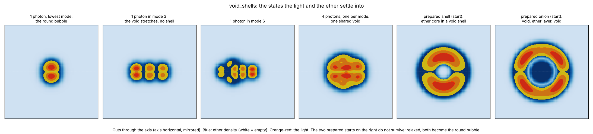
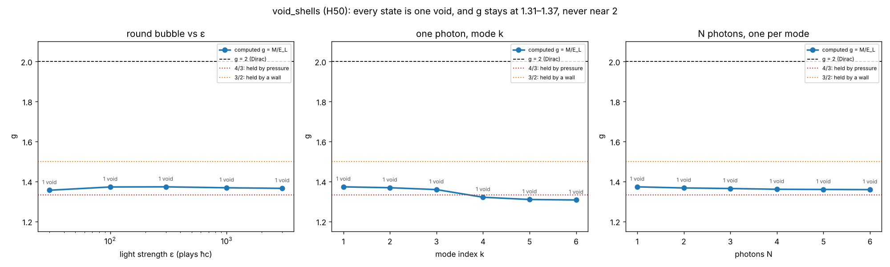

# Void shells: light pushing out, ether pushing in, built up in shells (proposed H50)

**Question (user, 2026-11-13).** Keep the structure simple: a particle as
a void in a nonlinear ether, its light pushing out and the ether pushing
in. Do void shells, nested layers of void and ether, form, and can they
give the electron's g = 2?

This is the simplest structure left after
[ether_horizon](../ether_horizon) Part 13. There, every donut-shaped void
either travelled or settled into a round bubble of light. Here nothing
is added: no vortex and no imposed shape. The shapes come out of the
balance.

```
go run ./examples/void_shells -viz examples/void_shells/viz   # about 25 minutes
python3 examples/void_shells/viz/plot_shells.py                # pictures
go test ./examples/void_shells                                 # about 1 minute
```

The output is in `run_output.txt`.

## The model (`field.go`)

The two fields sit on an axisymmetric (ρ, z) grid in healing-length units
(grid 0.4 ξ, box ρ < 24, |z| < 24). This is ether_horizon Part 13's
solver, copied so the examples stay independent, and extended to several
light modes.

- **Ether:** a Gross–Pitaevskii field ψ, E_e = ∫ ½|∇ψ|² + ¼(|ψ|² − 1)² dV.
- **Light:** the double-loop modes χ_q·e^{iφ/2} (m = ½, spin ½), the
  eigenmodes of H = −∇² + m²/ρ² + V0|ψ|² (V0 = 20: dense ether is opaque).
  Each occupied mode holds one photon of energy ε√λ_q, where ε plays ħc.
  The photons are spin ½, so they take one mode each.
- **Coupling:** the light pushes the ether with Σ (εV0/2√λ_q)χ_q²ψ. The
  ether pushes back through V0|ψ|² in H.
- **g = Mc²/E_L:** rest energy over the light's, with the charge riding
  with the light (ether_horizon Part 11).

**Numerics.** The light modes come from subspace inverse iteration
(conjugate gradients) with Rayleigh–Ritz. States are relaxed by
dissipative flow, so the energy only falls. Real-time runs use RK4 with
no friction.

**Checks.** An independent Python solver (`ref/void_shells_ref.py`, scipy
eigsh) gives the same round bubble to 11 digits. Energy is conserved to
0.06–0.7 % over 40 time units.



## Results

### 1. The round bubble

One photon in the lowest mode:

| ε | void ρ / z reach | light in void | ether's share of the mass | g | size / ƛ |
|---|---|---|---|---|---|
| 30 | 2.4 / 2.0 | 0.9964 | 0.263 | 1.356 | 5.9 |
| 100 | 3.2 / 2.8 | 0.9987 | 0.271 | 1.373 | 5.6 |
| 300 | 4.4 / 3.6 | 0.9997 | 0.272 | 1.373 | 5.8 |
| 1000 | 6.0 / 4.8 | 0.9999 | 0.269 | 1.369 | 5.7 |
| 3000 | 8.0 / 6.4 | 1.0000 | 0.268 | 1.366 | 5.6 |

- **Stable.** It is stable, round (slightly flattened along the axis),
  sits still, and holds its light.
- **Breathes in real time.** It holds there too, with energy conserved
  to 0.06 %.
- **The ether carries about a quarter of the mass,** so g ≈ 1.37 for every
  strength.

### 2. One photon in a higher mode

| mode | voids | ρ / z reach | g |
|---|---|---|---|
| 1 | 1 | 4.4 / 3.6 | 1.373 |
| 2 | 1 | 3.2 / 5.6 | 1.369 |
| 3 | 1 | 3.6 / 6.8 | 1.360 |
| 4 | 1 | 3.2 / 7.6 | 1.321 |
| 5 | 1 | 3.6 / 8.8 | 1.310 |
| 6 | 1 | 2.8 / 10.4 | 1.308 |

**No shell forms.** The light's nodes are thinner than the ether's healing
length, so the ether cannot enter them. The void stretches along the
axis into a chain of lobes, and g goes down, not up.

### 3. A prepared shell

The start is an ether core (r < 3) inside a void shell (3 < r < 8), with
one photon. Relaxed, the core dissolves, and the result is the round
bubble of Part 1 to all printed digits (M = 391.823195, g = 1.373198). In
real time the light squeezes the core out as sound: by t ≈ 10 the centre
is empty, and a breathing round bubble remains.

### 4. Several photons, one per mode

| N | voids | ρ / z reach | g |
|---|---|---|---|
| 1 | 1 | 4.4 / 3.6 | 1.373 |
| 2 | 1 | 4.8 / 5.6 | 1.368 |
| 3 | 1 | 5.2 / 7.2 | 1.365 |
| 4 | 1 | 6.4 / 7.2 | 1.361 |
| 6 | 1 | 6.4 / 10.4 | 1.359 |

The photons share one growing void, and no ether layer forms between
them.

### 5. A prepared onion

The start is a void core, an ether layer (3 … 5.5) and a void shell
(5.5 … 9), with two photons. The layer is squeezed out from both sides,
and the result is exactly the two-photon bubble of Part 4
(M = 726.9319).

### 6. Why no shell reaches g = 2

g = 1 + E_ether/E_L. Scale the void by λ:

- the light's energy goes as 1/λ;
- the ether's pressure work as λ³;
- its wall as λ².

At balance E_L = 3E_P + 2E_W, so g = 1 + (E_P + E_W)/(3E_P + 2E_W), which
lies between 4/3 and 3/2.

- **The round bubbles lie there.**
- **The excited modes dip just below 4/3** (1.31–1.32), because the
  finite opacity lets the light leak into the wall.
- **g = 2 needs an ether energy that grows as λ¹,** a constant-force
  string. In this ether only a vortex line does that, and ether_horizon
  Part 13 found vortex rings travel or unwind.
- **Shells only add walls (λ²) and layers (λ³).** They cannot move g toward
  2, and the light squeezes them out anyway.



## Status

H50 is **bounded**.

- **The simple structure is real.** Light pushing out and ether pushing in
  give one stable, round, resting bubble with spin ½ that keeps its light.
- **Shells do not form, and do not survive when prepared.** Higher modes
  stretch the void, several photons share one void, and a prepared shell
  or onion is squeezed back into the bubble.
- **g = 1.31–1.37 for every state,** 32–35 % below 2. That is outside even
  a generous tolerance, so the energy split, not the precision, is what
  fails.
- **Size:** about 6 reduced Compton lengths, 2×10⁻¹² m at the electron's
  mass.

**Standard prediction.** A pointlike electron (below 10⁻¹⁸ m) with
g = 2.00231930436 from Dirac's equation and QED.

Next steps:
1. An ether with a constant-force (λ¹) term, the only way this balance can
   give g = 2.
2. A firmer statement of the acceptance criteria: which measurements are
   direct, and what tolerance a first model should meet.

## Pictures

- `viz/shells_g.png`: g for every state, against 2, 4/3 and 3/2.
- `viz/shells_gallery.png`: the states the fields settle into, and the two
  prepared starts.
- `viz/shells.mp4` and `viz/shells.gif`: the prepared shell and the round
  bubble in real time, t = 0–40.

All of them come from the Go run (`viz/states.csv`, `viz/frames/`, the
frames not in git).

## References

- E. P. Gross, *Nuovo Cimento* 20, 454 (1961); L. P. Pitaevskii, *Sov. Phys. JETP* 13, 451 (1961).
- J. G. Williamson, M. B. van der Mark, *Ann. Fond. Louis de Broglie* 22, 133 (1997) (the double-loop photon).
- A. Chodos et al., *Phys. Rev. D* 9, 3471 (1974) (a cavity held by pressure: the bag model).
- X. Fan et al., *Phys. Rev. Lett.* 130, 071801 (2023) (g = 2.00231930436).
- examples/ether_horizon, Parts 9, 11–13.
